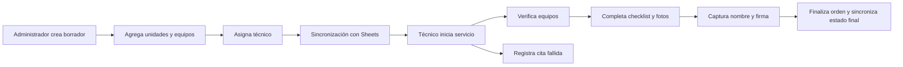
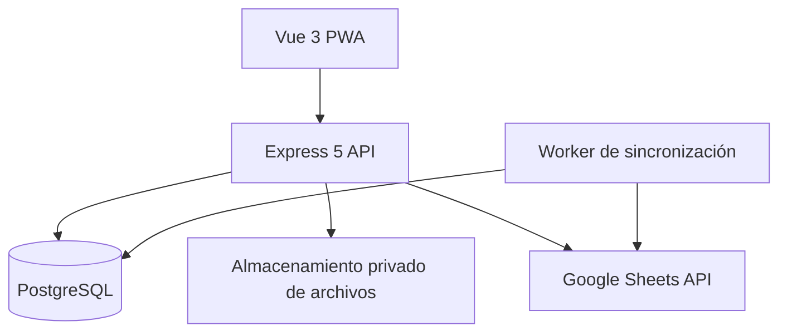

# Bull Dog Solution — Órdenes de servicio

Sistema web responsivo para preparar, asignar, ejecutar y auditar órdenes multiservicio de equipos en unidades vehiculares.

> Este README describe el estado objetivo del producto una vez concluido el MVP. La implementación se encuentra organizada en [ROADMAP.md](./ROADMAP.md) y su definición técnica completa está en [SPECS.md](./SPECS.md).

La documentación del estado técnico implementado, incluidos los diagramas de arquitectura y entidad-relación, está disponible en [docs/technical/README.md](./docs/technical/README.md).

> **Estado de AWS (2026-09-28):** staging está completamente eliminado. No hay URL ni IP pública ni quedan base de datos, archivos o secretos de staging; los datos anteriores se borraron sin respaldo recuperable. `infra/cdk` describe sólo la arquitectura prevista para un futuro redeploy. Consultá [Infraestructura y operación](./docs/technical/infrastructure-and-operations.md) antes de usar los procedimientos de despliegue.

## Descripción

La plataforma sustituye el flujo operativo realizado en AppSheet y reúne en un solo lugar el trabajo administrativo y de campo:

- Los administradores crean órdenes, seleccionan clientes, registran unidades, asignan equipos y eligen al técnico responsable.
- Los técnicos consultan sus servicios, verifican equipos, documentan cada unidad con checklist y fotografías, reportan discrepancias y obtienen la firma del cliente.
- Los técnicos pueden guardar una nota general de ejecución antes del cierre; las notas no se separan por unidad.
- Google Sheets conserva la autoridad sobre los catálogos de clientes y equipos.
- PostgreSQL mantiene los datos transaccionales, el historial y el estado de sincronización.
- Las fotografías, firmas y reportes se almacenan de forma privada mediante el proveedor de archivos configurado. Google Drive está integrado; PostgreSQL conserva únicamente sus referencias y metadatos.

## Funcionalidades principales

### Administración

- Autenticación segura y administración local de usuarios y técnicos.
- Creación de órdenes con varias unidades, varios equipos por unidad y distintos tipos de servicio en una misma orden.
- Consulta de clientes y equipos directamente desde Google Sheets.
- Asignación y reasignación de técnicos.
- Seguimiento del estado y progreso de cada servicio.
- Detección visible de conflictos cuando una fila de Sheets cambia externamente.
- Consulta de evidencias, firma, discrepancias, auditoría y sincronización.
- Reporte PDF de cada orden completada con portada, detalle por unidad/equipo y fotografías en formato amplio.
- Reintento controlado de operaciones fallidas con Google Sheets.

### Operación técnica

- Vista mobile-first de las órdenes asignadas.
- Verificación individual de equipos.
- Reporte de diferencias de ID, IMEI, serie o unidad sin bloquear el trabajo.
- Checklist posterior al servicio para tablero, cristales, accesorios, molduras y carrocería.
- Estados `Bien`, `Mal` y `No aplica`, con observación obligatoria para elementos en mal estado.
- Captura de al menos diez fotografías por unidad, distribuidas entre las categorías del checklist.
- Firma única del cliente y registro del nombre de la persona firmante.
- Cierre normal con validación integral o cierre simplificado como cita fallida.

### Seguridad y trazabilidad

- Access y refresh tokens JWT con rotación y revocación de sesiones.
- Autorización por rol y pertenencia de la orden.
- Validación de todas las entradas mediante Valibot.
- Almacenamiento privado y URLs prefirmadas de corta duración.
- Auditoría de operaciones administrativas y cambios relevantes.
- Idempotencia, concurrencia optimista y outbox para efectos externos.
- Logs estructurados con redacción de secretos y datos sensibles.

## Flujo del servicio



Una discrepancia puede registrarse durante la verificación y no impide finalizar la orden cuando los demás requisitos están completos.

## Arquitectura

El proyecto utiliza un monolito modular en un monorepo. El frontend y la API se desarrollan y construyen por separado, mientras que las reglas de negocio permanecen en el backend.



| Capa            | Tecnologías                                                                           |
| --------------- | ------------------------------------------------------------------------------------- |
| Lenguaje        | TypeScript                                                                            |
| Frontend        | Vue 3, Vite, Vue Router, Pinia, TanStack Query                                        |
| Interfaz        | Naive UI, Tailwind CSS, VueUse                                                        |
| API             | Node.js, Express 5, Valibot                                                           |
| Persistencia    | PostgreSQL, Prisma                                                                    |
| Autenticación   | JWT, Argon2id                                                                         |
| Integraciones   | Google Sheets API, Google Drive compartido privado para evidencias, firmas y reportes |
| Documentación   | OpenAPI 3.1, Swagger UI                                                               |
| Pruebas         | Vitest, Supertest, Playwright                                                         |
| Infraestructura | Docker Compose local; AWS CDK para staging                                            |

## Estructura del repositorio

```text
.
├── apps/
│   ├── api/                 # API Express y módulos de negocio
│   └── web/                 # Aplicación Vue y PWA
├── packages/
│   ├── contracts/           # DTOs y esquemas Valibot compartidos
│   ├── eslint-config/       # Configuración común de lint
│   └── typescript-config/   # Configuración común de TypeScript
├── prisma/
│   ├── migrations/          # Historial de migraciones
│   ├── schema.prisma        # Modelo de datos
│   └── seed.ts              # Datos iniciales de desarrollo
├── infra/
│   ├── cdk/                 # Stacks AWS de staging
│   ├── docker/              # Imágenes y configuración local/ECS
│   └── scripts/             # Operación, smoke tests y E2E
├── docker-compose.yml
├── pnpm-workspace.yaml
├── ROADMAP.md
└── SPECS.md
```

Los módulos siguen slicing vertical. Cada dominio contiene sus rutas, controladores, servicios, persistencia, contratos y pruebas. Google Sheets y los proveedores de almacenamiento se consumen a través de interfaces/adaptadores reemplazables.

## Estados de una orden

Una orden normal sigue este recorrido:

```text
DRAFT -> ASSIGNED -> IN_PROGRESS -> COMPLETED
                  -> REQUIRES_CORRECTION -> IN_PROGRESS
       -> CANCELLED
```

Una cita fallida utiliza el flujo:

```text
ASSIGNED -> IN_PROGRESS -> FAILED_APPOINTMENT
```

El administrador resuelve una cita fallida cancelando el servicio o reprogramándolo. La
reprogramación conserva la orden fallida como historial y crea una copia enlazada en estado
`DRAFT`, con una nueva fecha y un nuevo folio.

Para completar un servicio normal, todas las unidades deben tener sus equipos verificados, checklist completo y fotografías requeridas. La orden también debe incluir el nombre y la firma del cliente. Una cita fallida requiere únicamente un motivo.

## Integración con Google Sheets

Google Sheets permanece como fuente oficial de los catálogos externos:

- `Clientes`: lectura de `IDCliente` y `Cliente`.
- `SALIDAS`: lectura del catálogo de equipos y actualización limitada de su asignación.
- `DIRECTORIO TECNICO` y `2026`: directorio y reporte en el libro configurado por
  `GOOGLE_TECHNICIANS_SPREADSHEET_ID`. Cada cobro nuevo se inserta en la fila 2 del
  reporte y desplaza los cobros anteriores hacia abajo.

La aplicación solo puede escribir las columnas autorizadas:

| Columna | Contenido                                       |
| ------- | ----------------------------------------------- |
| `J`     | Cliente                                         |
| `K`     | Estado del servicio                             |
| `L`     | Unidad                                          |
| `M`     | Marca/modelo de la unidad                       |
| `N`     | Año                                             |
| `O`     | Número de serie                                 |
| `P`     | Tipo de servicio, cuando el negocio lo habilite |

Las columnas `A` e `I` nunca son modificadas. Al asignar y al completar, la API vuelve a localizar
el equipo por ID o IMEI y escribe únicamente las celdas necesarias. Instalación, revisión y sensor
fuel dejan el equipo como `INSTALADO`; desinstalación y el equipo anterior de un cambio lo devuelven
a `STOCK TECNICO`, limpian el cliente (`J`) y los datos del vehículo (`L:O`). El equipo nuevo de un
cambio hereda el cliente y el vehículo. Una cita fallida no modifica el inventario.

Las actualizaciones de equipos se procesan inmediatamente. La publicación en el reporte técnico
usa una ventana semanal configurable desde **Sincronización**: por defecto, acepta órdenes cerradas
hasta el martes al finalizar el día y las publica el miércoles a las 17:00 en
`America/Hermosillo`. Las órdenes cerradas después del corte pasan a la semana siguiente. El panel
muestra por defecto operaciones del reporte técnico; las operaciones internas de equipos se pueden
consultar con el filtro de tipo y no deben interpretarse como órdenes adicionales.

## Requisitos

- Node.js 24.20.0 LTS, fijado en `.nvmrc` y `.node-version`.
- pnpm 11.9.0 mediante Corepack.
- Docker y Docker Compose.
- Documento de Google Sheets de desarrollo compartido con una cuenta de servicio.
- Credenciales de Google Sheets y del proveedor de almacenamiento elegido para entornos no locales.

## Puesta en marcha local

1. Activar la versión fijada de pnpm e instalar las dependencias:

   ```bash
   corepack enable
   pnpm install --frozen-lockfile
   ```

2. Crear la configuración local a partir del archivo de ejemplo:

   ```bash
   cp .env.example .env
   ```

3. Para trabajar con recarga en caliente, levantar PostgreSQL y MinIO:

   ```bash
   docker compose up -d postgres minio minio-init
   ```

4. Aplicar las migraciones y cargar datos iniciales:

   ```bash
   pnpm prisma:migrate
   pnpm prisma:seed
   ```

   El seed local crea `admin@example.invalid` y `technician@example.invalid`. Cambia
   `SEED_ADMIN_PASSWORD` antes de ejecutarlo fuera de un entorno local; en producción es obligatorio.

5. Iniciar API y web:

   ```bash
   pnpm dev
   ```

La aplicación web queda disponible por defecto en `http://localhost:5173` y la API en `http://localhost:3000`. `VITE_DEV_PORT`, `VITE_API_PROXY_TARGET` y `PORT` permiten usar puertos diferentes sin modificar código.

Como alternativa, el stack completo compilado se levanta con:

```bash
docker compose up --build -d
```

En esta modalidad, la web se publica por defecto en `http://localhost:4173`, la API en `http://localhost:3000` y la consola de MinIO en `http://localhost:9001`. Los puertos pueden sobrescribirse en `.env` con las variables documentadas en `.env.example`.

## Configuración

La aplicación valida su configuración al iniciar y se detiene si falta una variable obligatoria. Los grupos principales son:

| Grupo         | Variables principales                                         |
| ------------- | ------------------------------------------------------------- |
| Aplicación    | `NODE_ENV`, `PORT`, `APP_ORIGIN`, `API_ORIGIN`, `TRUST_PROXY` |
| Base de datos | `DATABASE_URL`, `DIRECT_URL`                                  |
| JWT           | Claves pública/privada, issuer, audience y TTL de cada token  |
| Cookies       | Dominio, modo seguro y política SameSite                      |
| Objetos       | Configuración y credenciales del proveedor de almacenamiento  |
| Google Sheets | IDs de catálogos y técnicos, cuenta de servicio y pestañas    |
| Límites       | Tamaños de evidencia/firma, TTL de URLs y caché de catálogos  |
| Resiliencia   | Timeouts, reintentos, circuit breaker y frecuencia del outbox |
| Programación  | Día de corte, día/hora de envío y zona del reporte técnico    |
| Logs          | `LOG_LEVEL`                                                   |

Los secretos no deben guardarse en el repositorio. En producción se utilizan identidades administradas o un gestor de secretos cuando el proveedor lo permita.

## Comandos disponibles

| Comando                | Descripción                                 |
| ---------------------- | ------------------------------------------- |
| `pnpm dev`             | Inicia API y web en desarrollo              |
| `pnpm build`           | Construye todas las aplicaciones y paquetes |
| `pnpm format`          | Formatea los archivos del repositorio       |
| `pnpm format:check`    | Verifica el formato sin escribir cambios    |
| `pnpm lint`            | Ejecuta el análisis estático                |
| `pnpm typecheck`       | Comprueba TypeScript estricto               |
| `pnpm test`            | Ejecuta pruebas unitarias y de integración  |
| `pnpm test:e2e`        | Ejecuta escenarios Playwright               |
| `pnpm docs:build`      | Genera OpenAPI 3.1                          |
| `pnpm docs:validate`   | Valida el contrato de la API                |
| `pnpm prisma:migrate`  | Aplica migraciones de base de datos         |
| `pnpm prisma:seed`     | Carga datos iniciales de desarrollo         |
| `pnpm prisma:validate` | Valida la configuración y el esquema Prisma |

## API y documentación

La API utiliza el prefijo `/api/v1` y responde en JSON con un `requestId` para trazabilidad.

- Especificación OpenAPI: `/api/v1/openapi.json`.
- Swagger UI: `/api/docs`.
- Estado de proceso: `/health/live`.
- Estado de dependencias: `/health/ready`.

Los endpoints abarcan autenticación, usuarios, técnicos, catálogos externos, órdenes, unidades, equipos, checklist, evidencias, firma, auditoría y sincronización.

## Pruebas

La estrategia combina:

- Pruebas unitarias para validaciones, transiciones, autorización, rotación de tokens e identificación de equipos.
- Pruebas de integración para Express, PostgreSQL, almacenamiento de objetos, Sheets simulado, outbox e idempotencia.
- Pruebas de contrato para comparar OpenAPI con respuestas reales de la API.
- Pruebas end-to-end de los recorridos completos de administrador y técnico.

Los escenarios automatizados nunca escriben en la hoja de producción.

## Despliegue

El producto se despliega con entornos separados de desarrollo, staging y producción:

- Frontend estático servido mediante CDN o reverse proxy.
- API ejecutada como contenedor Node.js.
- PostgreSQL administrado con respaldos automáticos y restauración probada.
- Google Drive compartido privado para evidencias, firmas y reportes.
- Reverse proxy con TLS y, preferentemente, API bajo el mismo dominio público.
- Google Sheets distinto para staging y producción.

El pipeline ejecuta instalación reproducible, lint, typecheck, pruebas, generación de OpenAPI, builds, escaneos, migraciones controladas, despliegue y smoke tests.

La IaC define staging en AWS `us-east-2` con ECS sobre un host EC2, RDS PostgreSQL, Secrets Manager y CloudWatch, pero el ambiente fue eliminado y no está desplegado. CDK configura Google Drive compartido para evidencias, firmas y reportes, e inyecta sus credenciales dedicadas desde Secrets Manager; ya no provisiona S3 ni le concede permisos al task role. Para recrearlo se requieren credenciales dedicadas de Drive y el ID del Drive compartido. No hay URL/IP ni datos persistentes; la arquitectura prevista usa HTTP a una IPv4 efímera sin CloudFront ni ALB. Producción aún no tiene stacks IaC propios en la rama actual. Consulte [Infraestructura y operación](./docs/technical/infrastructure-and-operations.md) para el estado, diagramas objetivo, persistencia, CI/CD y brechas antes de producción, y [Staging y despliegue](./docs/staging-and-deployment.md) para recrearlo desde cero.

## Alcance del MVP

El MVP no incluye operación offline completa, aplicaciones móviles nativas, edición de los catálogos externos, facturación, cuentas bancarias ni microservicios. No modifica automáticamente `Fecha de salida` ni `Estado` del equipo en Google Sheets; sí administra `Estado del servicio` conforme al resultado de la orden.

## Documentación del proyecto

- [Especificación técnica](./SPECS.md)
- [Ruta de implementación](./ROADMAP.md)
