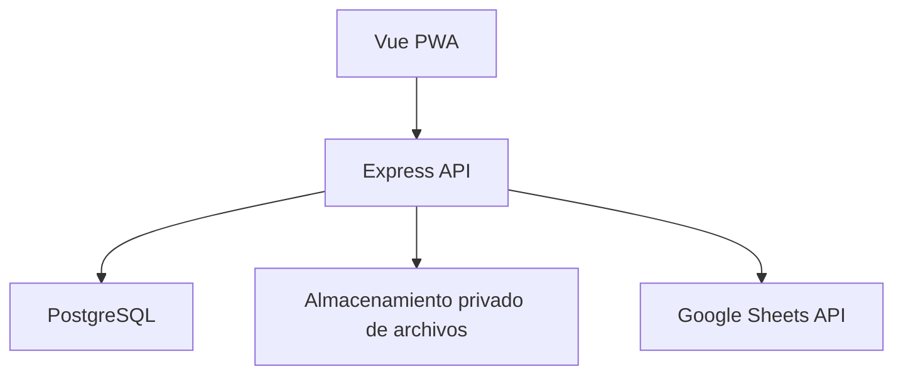

# Especificación técnica — Sistema de órdenes de servicio

> Esta especificación mantiene los requisitos funcionales y de diseño del proyecto. No sustituye el
> estado implementado: el sistema ya incluye administración de usuarios, acceso técnico compartido,
> tarifas por orden, reportes PDF y Google Drive para archivos. AWS staging fue eliminado y no hay
> despliegue productivo; los pendientes de infraestructura/operación se mantienen como tales. Para
> el estado ejecutable y los detalles actuales, consulta [la documentación técnica](./docs/technical/README.md).

**Organización:** Bull Dog Solution

**Documento:** Especificación técnica del MVP

**Fecha:** 2026-09-10

**Versión:** 0.3

**Estado:** Implementado y actualizado

## 1. Objetivo

Construir un sistema web responsivo que sustituya el flujo operativo actual en AppSheet para administrar órdenes multiservicio de equipos en unidades vehiculares.

El sistema debe permitir que un administrador prepare completamente una orden, asigne un técnico, seleccione el cliente, registre las unidades y asigne uno o varios equipos a cada unidad. El técnico debe consultar sus órdenes, verificar la información, documentar el estado de cada unidad mediante checklist y fotografías, reportar discrepancias, obtener una firma final del cliente y cerrar el servicio.

Google Sheets continuará siendo la fuente oficial de los catálogos de clientes y equipos. La aplicación consultará esos datos mediante Google Sheets API y solo modificará las columnas expresamente autorizadas de la pestaña `SALIDAS`.

## 2. Alcance del MVP

### 2.1 Incluido

- Autenticación mediante JWT.
- Roles de administrador y técnico.
- Administración local de usuarios y técnicos.
- Consulta del catálogo de clientes en Google Sheets.
- Consulta y asignación de equipos desde Google Sheets.
- Creación, edición, asignación y seguimiento de órdenes.
- Varias unidades por orden.
- Varios equipos por unidad.
- Servicios de instalación, revisión, desinstalación, sensor fuel, cambio de equipo y cita fallida.
- Combinación de varios servicios en una misma orden mediante el tipo de cada unidad.
- Checklist por unidad.
- Mínimo de diez fotografías por unidad.
- Reporte de discrepancias sin bloquear el trabajo del técnico.
- Una firma del cliente por orden.
- Reporte PDF de la orden de servicio completada, conforme a [docs/service-order-report-spec.md](./docs/service-order-report-spec.md).
- Almacenamiento privado de archivos, con proveedor intercambiable.
- Auditoría de acciones relevantes.
- Registro y reintento de sincronizaciones con Google Sheets.
- Directorio técnico sincronizado, configuración de tarifas pactadas por orden, reajuste post-cierre y congelación de tarifas al cierre.
- Publicación del cobro en el libro de técnicos.
- Interfaz web responsiva y PWA básica.

### 2.2 Fuera del MVP

- Modo offline completo.
- Aplicaciones móviles nativas.
- Edición de clientes dentro de la aplicación.
- Alta o edición de equipos dentro de la aplicación.
- Facturación.
- Administración de cuentas bancarias.
- Pago o dispersión de tarifas a técnicos.
- Modificación automática de `Fecha de salida` o `Estado` del equipo en Google Sheets.
- Microservicios.

## 3. Reglas de negocio confirmadas

1. Una orden pertenece a un cliente y se asigna a un técnico.
2. Una orden contiene una o más unidades.
3. Una unidad puede tener varios equipos.
4. El administrador registra previamente la orden, las unidades y los equipos.
5. El técnico no crea unidades ni equipos desde cero.
6. El checklist se realiza después del servicio.
7. Las categorías iniciales del checklist son:
   - Tablero.
   - Cristales.
   - Accesorios.
   - Molduras.
   - Carrocería.
8. Cada categoría admite `Bien`, `Mal` o `No aplica`.
9. Cada unidad requiere al menos diez fotografías completadas en una galería propia; no se asignan a las categorías del checklist.
10. Cuando una categoría se marque `Mal`, la observación es obligatoria.
11. Para finalizar un servicio normal, todas las unidades deben tener:
    - Equipos verificados.
    - Checklist completo.
    - Al menos diez fotografías por unidad.
12. Se requiere una sola firma del cliente por toda la orden.
13. La firma requiere el nombre de la persona que firma.
14. Si el IMEI, ID, serie o unidad no coincide, el técnico reporta una discrepancia y continúa.
15. Una cita fallida exige solamente un motivo y no requiere checklist, fotografías ni firma.
16. Google Sheets conserva la autoridad sobre los catálogos de clientes y equipos.
17. La aplicación no modifica `Fecha de salida` ni `Estado` del equipo; administra `Cliente`, `Estado del servicio` y los datos del vehículo conforme al resultado.

## 4. Stack tecnológico

| Capa                       | Tecnología                                             |
| -------------------------- | ------------------------------------------------------ |
| Lenguaje                   | TypeScript                                             |
| Frontend                   | Vue 3 + Vite                                           |
| Enrutamiento               | Vue Router                                             |
| Estado de cliente          | Pinia                                                  |
| Estado de servidor y caché | TanStack Query para Vue                                |
| Cliente HTTP               | Axios                                                  |
| Validación                 | Valibot                                                |
| Componentes UI             | Naive UI                                               |
| Estilos                    | Tailwind CSS mediante plugin de Vite                   |
| Backend                    | Node.js + Express 5                                    |
| ORM                        | Prisma                                                 |
| Base de datos              | PostgreSQL                                             |
| Autenticación              | JWT con access y refresh tokens                        |
| Hash de contraseñas        | Argon2id                                               |
| Archivos privados          | Google Drive o proveedor de almacenamiento configurado |
| API de Google              | `googleapis` / Google Sheets API v4                    |
| Seguridad HTTP             | Helmet, CORS y rate limiting                           |
| Logs HTTP                  | Morgan                                                 |
| Logs de aplicación         | Winston con salida estructurada JSON                   |
| Documentación API          | OpenAPI 3.1 + Swagger UI                               |
| Resiliencia externa        | Timeouts, reintentos controlados y circuit breaker     |
| Utilidades Vue             | VueUse cuando evite implementaciones propias           |
| Pruebas                    | Vitest, Supertest y Playwright                         |
| Contenedores               | Docker                                                 |
| Gestor de paquetes         | pnpm                                                   |

Las versiones exactas se fijarán en el lockfile al crear el proyecto. Se usarán versiones estables compatibles con la versión LTS de Node.js seleccionada al iniciar la implementación.

### 4.1 Paquetes principales previstos

```text
# Compartidos
typescript valibot @valibot/to-json-schema axios

# API
express prisma @prisma/client jose argon2
cors helmet cookie-parser express-rate-limit morgan winston
swagger-ui-express opossum googleapis
@aws-sdk/client-s3 @aws-sdk/s3-request-presigner

# Web
vue vue-router pinia @tanstack/vue-query
naive-ui tailwindcss @tailwindcss/vite @vueuse/core

# Pruebas
vitest supertest @playwright/test
```

La lista es una intención arquitectónica; antes de instalar se eliminarán paquetes redundantes y se comprobará compatibilidad entre versiones.

## 5. Arquitectura

Se implementará un monolito modular. El frontend y el backend vivirán en un monorepo, pero se construirán como aplicaciones separadas.



### 5.1 Responsabilidades

**Vue:** interfaz, navegación, captura de cámara, firma, validación inmediata y consumo de la API.

**Express:** autenticación, autorización, validación final, reglas de negocio, Prisma, Google Sheets, URLs firmadas para objetos, auditoría y manejo de errores.

**PostgreSQL:** datos transaccionales, órdenes, snapshots externos, checklist, referencias de evidencias, sesiones, auditoría y estado de sincronización.

**Almacenamiento privado:** bytes de fotografías, firmas y reportes; el proveedor se configura por entorno y PostgreSQL conserva solo referencias y metadatos.

**Google Sheets:** catálogo oficial de clientes y equipos y datos actuales de asignación permitidos.

### 5.2 Principios de diseño

- **Monolito modular:** un solo despliegue de API, dividido por dominios de negocio.
- **Slicing vertical:** cada módulo contiene sus rutas, casos de uso, persistencia, contratos y pruebas.
- **Dependencias hacia adentro:** controladores y adaptadores dependen de servicios/casos de uso, no al revés.
- **Controladores delgados:** traducen HTTP a una llamada de aplicación; no contienen reglas de negocio.
- **Integraciones detrás de puertos:** Google Sheets y los proveedores de almacenamiento se consumen mediante interfaces reemplazables y adaptadores concretos.
- **Contratos compartidos:** Valibot define los DTOs; Prisma define persistencia y no se expone al frontend.
- **Estado remoto separado del estado de UI:** TanStack Query administra datos del servidor; Pinia solo estado global de interfaz y sesión.
- **Abstracción progresiva:** una vista o componente se mueve a `shared` después de comprobar reutilización real, no por anticipación.
- **Sin tiempo real innecesario:** el MVP no incluye Socket.IO. Se añadirá únicamente si aparece un caso que no pueda resolverse con invalidación de consultas o polling moderado.

## 6. Estructura del repositorio

```text
service-orders/
├── apps/
│   ├── web/
│   │   ├── src/
│   │   │   ├── app/
│   │   │   ├── modules/
│   │   │   │   ├── auth/
│   │   │   │   ├── orders/
│   │   │   │   ├── technicians/
│   │   │   │   ├── external-catalogs/
│   │   │   │   └── service-execution/
│   │   │   ├── shared/
│   │   │   │   ├── components/
│   │   │   │   ├── composables/
│   │   │   │   ├── http/
│   │   │   │   ├── layouts/
│   │   │   │   └── utils/
│   │   │   ├── router/
│   │   │   ├── stores/
│   │   │   └── main.ts
│   │   └── vite.config.ts
│   └── api/
│       ├── src/
│       │   ├── config/
│       │   ├── docs/
│       │   ├── events/
│       │   ├── middleware/
│       │   ├── modules/
│       │   ├── resilience/
│       │   ├── shared/
│       │   ├── app.ts
│       │   └── server.ts
│       └── tsconfig.json
├── packages/
│   ├── contracts/
│   ├── eslint-config/
│   └── typescript-config/
├── prisma/
│   ├── schema.prisma
│   ├── migrations/
│   └── seed.ts
├── infra/
│   └── docker/
├── docker-compose.yml
├── pnpm-workspace.yaml
└── package.json
```

## 7. Módulos del backend

```text
modules/
├── auth
├── users
├── technicians
├── external-clients
├── external-equipment
├── orders
├── units
├── order-equipment
├── checklists
├── evidence
├── signatures
├── discrepancies
├── google-sheets
├── object-storage
├── audit
└── health
```

Cada módulo podrá contener `router`, `controller`, `service`, `repository`, esquemas Valibot, tipos y pruebas. Los controladores serán delgados; las reglas vivirán en servicios.

### 7.1 Estructura estándar de un módulo backend

```text
modules/{domain}/
├── {domain}.router.ts
├── {domain}.controller.ts
├── {domain}.service.ts
├── {domain}.repository.ts
├── {domain}.policy.ts
├── {domain}.schemas.ts
├── {domain}.types.ts
├── {domain}.errors.ts
├── {domain}.openapi.ts
└── __tests__/
```

- `router`: rutas y composición de middleware.
- `controller`: adaptación HTTP, sin decisiones de negocio.
- `service`: casos de uso y transacciones.
- `repository`: consultas Prisma específicas del dominio.
- `policy`: autorización contextual, por ejemplo pertenencia de una orden al técnico.
- `schemas`: contratos Valibot del módulo.
- `openapi`: operación, ejemplos y respuestas para la documentación.
- `errors`: errores de dominio traducidos por el manejador global.

No se crearán repositorios genéricos universales. Prisma se encapsulará solo cuando la abstracción proteja reglas, facilite pruebas o evite consultas duplicadas.

## 8. Modelo de datos

### 8.1 Enumeraciones

```text
UserRole:
  ADMIN
  TECHNICIAN

OrderServiceType:
  INSTALLATION
  REVIEW
  UNINSTALLATION
  FAILED_APPOINTMENT

OrderStatus:
  DRAFT
  ASSIGNED
  IN_PROGRESS
  REQUIRES_CORRECTION
  COMPLETED
  FAILED_APPOINTMENT
  CANCELLED

UnitStatus:
  PENDING
  IN_PROGRESS
  COMPLETED

ChecklistCategory:
  DASHBOARD
  WINDOWS
  ACCESSORIES
  TRIMS
  BODYWORK

ChecklistCondition:
  GOOD
  BAD
  NOT_APPLICABLE

EquipmentVerificationStatus:
  PENDING
  MATCHED
  DISCREPANCY_REPORTED

UploadStatus:
  PENDING
  COMPLETED
  REJECTED
  DELETED

SyncStatus:
  PENDING
  PROCESSING
  SYNCED
  FAILED
```

### 8.2 Entidades principales

#### User

- `id: UUID`
- `email: string`, único y normalizado.
- `passwordHash: string`.
- `name: string`.
- `role: UserRole`.
- `technicianId: UUID?`.
- `active: boolean`.
- `createdAt`, `updatedAt`.

#### Technician

- `id: UUID`.
- `externalKey: string?`, clave durable `TEC-XXXX` del directorio.
- `name: string`.
- `workshop: string?`.
- `legalName: string?`.
- `address: string?`.
- `city: string?`.
- `state: string?`.
- `phone: string?`.
- Datos administrativos del directorio y tarifas decimales para salida, instalación, revisión, desinstalación, cita fallida, sensor fuel y cambio de equipo.
- `active: boolean`.
- `createdAt`, `updatedAt`.

#### Order

- `id: UUID`.
- `folio: string`, único.
- `serviceType: OrderServiceType`.
- `status: OrderStatus`.
- `clientSheetId: string`.
- `clientNameSnapshot: string`.
- `technicianId: UUID`.
- Snapshots del técnico, precio unitario, cantidades, costos, viáticos, total, moneda, fecha y versión del cálculo.
- `pricingBreakdown: jsonb?`, desglose por servicio de las órdenes mixtas.
- `pricingOverrides: jsonb?`, sobreescritura personalizada de tarifas y viáticos pactados para la orden.
- `scheduledAt: timestamptz`.
- `isHomeService: boolean`.
- `serviceAddress: string?`.
- `generalNotes: string?`.
- Las notas de ejecución son generales de la orden, no independientes por unidad. Pueden capturarse durante la ejecución y se guardan antes del cierre si tienen cambios pendientes.
- `failedReason: string?`.
- `version: integer`, para concurrencia optimista.
- `createdById: UUID`.
- `startedAt`, `completedAt`, `cancelledAt`.
- `createdAt`, `updatedAt`.

El número de semana se deriva de `scheduledAt` y no se almacena como dato editable.

#### OrderUnit

- `id: UUID`.
- `orderId: UUID`.
- `serviceType: OrderServiceType`.
- `label: string`.
- `makeModel: string`.
- `year: integer?`.
- `serialNumber: string`.
- `status: UnitStatus`.
- `createdAt`, `updatedAt`.

El número de serie debe ser único dentro de una orden. La unicidad global se evaluará con los datos reales antes de imponerla.

#### OrderEquipment

- `id: UUID`.
- `orderUnitId: UUID`.
- `sheetName: string`, inicialmente `SALIDAS`.
- `sheetRowHint: integer?`, solo como optimización, nunca como identidad.
- `externalId: string?`, columna D.
- `imei: string?`, columna E.
- `externalKey: string`, identidad interna derivada.
- `brandSnapshot: string?`.
- `modelSnapshot: string?`.
- `lineSnapshot: string?`.
- `iccidSnapshot: string?`.
- `carrierSnapshot: string?`.
- `equipmentConditionSnapshot: string?`.
- `serviceStatusSnapshot: string?`.
- `rawSnapshot: jsonb`.
- `verificationStatus: EquipmentVerificationStatus`.
- `verifiedAt: timestamptz?`.
- `verifiedById: UUID?`.
- `createdAt`, `updatedAt`.

Un equipo no puede estar asignado a dos órdenes activas dentro de la aplicación. Se agregará un índice único parcial mediante una migración SQL cuando la restricción no pueda expresarse completamente en Prisma.

#### Checklist

- `id: UUID`.
- `orderUnitId: UUID`, único.
- `completedById: UUID?`.
- `completedAt: timestamptz?`.
- `createdAt`, `updatedAt`.

#### ChecklistItem

- `id: UUID`.
- `checklistId: UUID`.
- `category: ChecklistCategory`.
- `condition: ChecklistCondition?`.
- `notes: string?`.
- `createdAt`, `updatedAt`.

Restricción única: `checklistId + category`.

#### Evidence

- `id: UUID`.
- `checklistItemId: UUID`.
- `objectKey: string`, único.
- `mimeType: string`.
- `sizeBytes: integer`.
- `checksum: string?`.
- `width: integer?`.
- `height: integer?`.
- `status: UploadStatus`.
- `uploadedById: UUID`.
- `createdAt`, `completedAt`, `deletedAt`.

#### Signature

- `id: UUID`.
- `orderId: UUID`, único.
- `signerName: string`.
- `objectKey: string`, único.
- `mimeType: string`.
- `sizeBytes: integer`.
- `signedAt: timestamptz`.
- `capturedById: UUID`.
- `createdAt`.

#### Discrepancy

- `id: UUID`.
- `orderId: UUID`.
- `orderUnitId: UUID`.
- `orderEquipmentId: UUID?`.
- `type: string`.
- `description: string`.
- `expectedSnapshot: jsonb`.
- `observedSnapshot: jsonb`.
- `reportedById: UUID`.
- `reportedAt: timestamptz`.
- `resolvedAt: timestamptz?`.
- `resolvedById: UUID?`.
- `resolutionNotes: string?`.

La discrepancia no impide que el técnico continúe ni que cierre la orden si el resto de los requisitos se cumple.

#### RefreshSession

- `id: UUID`.
- `userId: UUID`.
- `jti: UUID`, único.
- `tokenHash: string`.
- `userAgent: string?`.
- `ipAddress: inet?`.
- `expiresAt: timestamptz`.
- `revokedAt: timestamptz?`.
- `replacedByJti: UUID?`.
- `createdAt`.

#### AuditLog

- `id: UUID`.
- `actorUserId: UUID?`.
- `action: string`.
- `entityType: string`.
- `entityId: string?`.
- `before: jsonb?`.
- `after: jsonb?`.
- `requestId: string?`.
- `ipAddress: inet?`.
- `createdAt`.

No se registrarán contraseñas, JWT, credenciales, contenido binario ni URLs firmadas.

#### SheetSyncOperation

- `id: UUID`.
- `orderId: UUID?`.
- `operationType: string`.
- `idempotencyKey: string`, único.
- `payload: jsonb`.
- `status: SyncStatus`.
- `attempts: integer`.
- `lastErrorCode: string?`.
- `lastErrorMessage: string?` sanitizado.
- `nextAttemptAt: timestamptz?`.
- `createdAt`, `updatedAt`, `syncedAt`.

## 9. Estados y transiciones

### 9.1 Orden normal

```text
DRAFT -> ASSIGNED -> IN_PROGRESS -> COMPLETED
                  -> REQUIRES_CORRECTION -> IN_PROGRESS
       -> CANCELLED
```

### 9.2 Cita fallida

```text
ASSIGNED -> IN_PROGRESS -> FAILED_APPOINTMENT
                                  |-> resolución CANCELLED
                                  `-> resolución RESCHEDULED -> nueva orden DRAFT
```

El cierre como cita fallida requiere únicamente `failedReason` no vacío.
Una cita fallida conserva su cierre, tarifa y reporte. El administrador debe resolverla mediante
cancelación administrativa o reprogramación. Reprogramar crea una nueva orden enlazada en estado
`DRAFT`, copiando la configuración operativa pero no los resultados de ejecución de la visita
anterior.

### 9.3 Reglas de transición

- Solo un administrador crea, edita, asigna, reasigna o cancela órdenes.
- Un técnico solo inicia y trabaja órdenes asignadas a él.
- Una orden completada es inmutable para el técnico.
- Un administrador puede marcarla `REQUIRES_CORRECTION` conservando auditoría.
- Reabrir una orden no elimina evidencias ni firmas anteriores; cualquier reemplazo queda auditado.
- Las transiciones se validan en el servicio del backend y nunca dependen solo del frontend.

## 10. Integración con Google Sheets

### 10.1 Autenticación

- La integración se ejecuta exclusivamente en el backend.
- Se utilizará una cuenta de servicio de Google Cloud.
- El documento se compartirá con el correo de la cuenta de servicio.
- Las credenciales se guardarán como secretos del entorno.
- El frontend nunca recibirá credenciales ni tokens de Google.
- Se otorgará el alcance mínimo necesario para leer y actualizar el documento configurado.

### 10.2 Pestaña `Clientes`

| Columna | Encabezado  | Uso                           |
| ------- | ----------- | ----------------------------- |
| A       | `IDCliente` | Identificador externo estable |
| B       | `Cliente`   | Nombre visible                |

La pestaña será de solo lectura. La orden guardará `IDCliente` y un snapshot del nombre.

### 10.3 Pestaña `SALIDAS`

| Columna | Encabezado                | Permiso                                                  |
| ------- | ------------------------- | -------------------------------------------------------- |
| A       | Fecha de salida           | Solo lectura                                             |
| B       | Marca                     | Solo lectura                                             |
| C       | Modelo                    | Solo lectura                                             |
| D       | ID                        | Solo lectura                                             |
| E       | IMEI                      | Solo lectura                                             |
| F       | Línea                     | Solo lectura                                             |
| G       | ICCID                     | Solo lectura                                             |
| H       | Compañía                  | Solo lectura                                             |
| I       | Estado                    | Solo lectura; valores `NUEVO` o `USADO`                  |
| J       | Cliente                   | Escritura al asignar/completar; se limpia al retirar     |
| K       | Estado del Servicio       | Escritura controlada: `INSTALADO` o `STOCK TECNICO`      |
| L       | UNIDAD                    | Escritura al asignar/completar; se limpia al retirar     |
| M       | MARCA/MODELO DE LA UNIDAD | Escritura al asignar/completar; se limpia al retirar     |
| N       | AÑO                       | Escritura al asignar/completar; se limpia al retirar     |
| O       | NUMERO DE SERIE           | Escritura al asignar/completar; se limpia al retirar     |
| P       | Tipo de servicio          | Escritura solo si forma parte explícita de la asignación |

La aplicación nunca escribirá rangos completos de una fila. Solo actualizará `J`, `K`, `L`, `M`, `N`, `O` y, cuando corresponda, `P`.

La asignación crea la sincronización inicial y el cierre vuelve a encolar el estado final de cada
equipo. Instalación, revisión y sensor fuel escriben `INSTALADO` con cliente y vehículo;
desinstalación limpia `J` y `L:O` y escribe `STOCK TECNICO`; cambio de equipo aplica la salida al
anterior y la instalación al nuevo. Una cita fallida no altera `SALIDAS`.

El valor de P no se derivará automáticamente del enum `OrderServiceType` hasta definir su catálogo real. En la hoja se observaron valores como `ESTANDAR` y `OBD/SCAN`, que representan un concepto diferente a instalación, revisión, desinstalación o cita fallida.

### 10.4 Identificación de equipos

La fila no es una identidad estable porque puede cambiar al ordenar o insertar registros.

Regla de identidad:

1. Usar `ID` cuando tenga un valor válido y no sea `PENDIENTE` o `N/A`.
2. Validar además el IMEI cuando exista.
3. Si el ID no es válido, usar el IMEI como llave temporal.
4. Si no hay ID ni IMEI único, mostrar `Datos incompletos` y no permitir asignar.
5. Guardar `sheetRowHint` solo para acelerar la búsqueda.
6. Antes de escribir, volver a localizar la fila y comprobar ID, IMEI y snapshot esperado.

Se recomienda agregar en el futuro una columna protegida `SISTEMA_ID` con UUID inmutable, pero no es requisito del MVP.

### 10.5 Lectura y caché

- Los clientes y equipos se consultan desde Google Sheets.
- El backend podrá usar caché de corta duración para búsquedas.
- La caché no será autoritativa.
- Antes de asignar se realizará una lectura fresca.
- La UI mostrará cuándo se obtuvo el catálogo y permitirá recargarlo.

### 10.6 Escritura y concurrencia

Antes de modificar una fila:

1. Localizar nuevamente el registro por ID/IMEI.
2. Comparar las columnas relevantes con el snapshot mostrado al administrador.
3. Comprobar que el equipo no esté en otra orden activa de PostgreSQL.
4. Si cambió externamente, responder `409 SHEET_ROW_CONFLICT`.
5. Actualizar únicamente las celdas autorizadas mediante `spreadsheets.values.batchUpdate`.
6. Guardar la respuesta y el nuevo snapshot.

PostgreSQL y Google Sheets no comparten una transacción distribuida. Se utilizará `SheetSyncOperation` con idempotencia, estados y reintentos. Una orden no se mostrará como completamente sincronizada mientras exista una operación fallida.

### 10.7 Reintentos

- Reintentos con backoff exponencial y jitter.
- Máximo configurable de intentos automáticos.
- Los errores de autenticación o permisos no se reintentan indefinidamente.
- El administrador puede reintentar una operación fallida.
- Cada operación incluye una `idempotencyKey`.
- Los errores se sanitizan antes de guardarse o mostrarse.

## 11. API REST

Prefijo: `/api/v1`.

### 11.1 Convenciones

- JSON en `camelCase`.
- Fechas en ISO 8601 UTC.
- IDs internos UUID.
- Paginación mediante `page` y `pageSize`; los listados de crecimiento alto podrán migrar a cursor sin cambiar el resto del contrato.
- Filtros comunes: `search`, `status`, `from`, `to`, `sortBy` y `sortOrder`.
- Cada endpoint declara una allowlist de filtros y campos ordenables; nunca se traduce una query arbitraria a Prisma.
- Un middleware compartido normaliza paginación, límites y ordenamiento.
- `pageSize` tendrá un máximo configurable, inicialmente 100.
- `requestId` en cada respuesta.
- Valibot valida params, query y body.
- Los errores no exponen stack traces en producción.

Respuesta exitosa:

```json
{
  "data": {},
  "meta": {
    "requestId": "uuid",
    "pagination": {
      "page": 1,
      "pageSize": 25,
      "total": 120,
      "totalPages": 5
    }
  }
}
```

Respuesta de error:

```json
{
  "error": {
    "code": "VALIDATION_ERROR",
    "message": "La solicitud contiene datos inválidos",
    "fields": {
      "email": ["Correo inválido"]
    },
    "requestId": "uuid"
  }
}
```

### 11.2 Autenticación

| Método | Ruta               | Descripción                               |
| ------ | ------------------ | ----------------------------------------- |
| POST   | `/auth/login`      | Iniciar sesión                            |
| POST   | `/auth/refresh`    | Rotar refresh token y emitir access token |
| POST   | `/auth/logout`     | Revocar sesión actual                     |
| POST   | `/auth/logout-all` | Revocar todas las sesiones                |
| GET    | `/auth/me`         | Usuario autenticado                       |

### 11.3 Usuarios y técnicos

| Método | Ruta               | Rol   |
| ------ | ------------------ | ----- |
| GET    | `/users`           | Admin |
| POST   | `/users`           | Admin |
| PATCH  | `/users/:id`       | Admin |
| GET    | `/technicians`     | Admin |
| POST   | `/technicians`     | Admin |
| PATCH  | `/technicians/:id` | Admin |

### 11.4 Catálogos externos

| Método | Ruta                               | Descripción                   |
| ------ | ---------------------------------- | ----------------------------- |
| GET    | `/external/clients?search=`        | Buscar clientes en `Clientes` |
| GET    | `/external/equipment?search=`      | Buscar equipos en `SALIDAS`   |
| GET    | `/external/equipment/:externalKey` | Obtener y revalidar equipo    |
| POST   | `/external/refresh`                | Invalidar caché; admin        |

### 11.5 Órdenes

| Método | Ruta                             | Descripción                                  |
| ------ | -------------------------------- | -------------------------------------------- |
| GET    | `/orders`                        | Listar según rol                             |
| POST   | `/orders`                        | Crear borrador; admin                        |
| GET    | `/orders/:id`                    | Obtener detalle                              |
| PATCH  | `/orders/:id`                    | Editar borrador; admin                       |
| POST   | `/orders/:id/assign`             | Asignar y sincronizar; admin                 |
| POST   | `/orders/:id/start`              | Iniciar; técnico asignado                    |
| POST   | `/orders/:id/cancel`             | Cancelar; admin                              |
| POST   | `/orders/:id/reschedule`         | Reprogramar cita fallida                     |
| POST   | `/orders/:id/require-correction` | Solicitar corrección; admin                  |
| POST   | `/orders/:id/complete`           | Finalizar servicio normal                    |
| POST   | `/orders/:id/fail-appointment`   | Cerrar como cita fallida                     |
| PATCH  | `/orders/:id/pricing`            | Configurar o ajustar tarifas pactadas; admin |
| GET    | `/orders/:id/audit`              | Historial; admin                             |

### 11.6 Unidades y equipos

| Método | Ruta                                                           | Descripción                   |
| ------ | -------------------------------------------------------------- | ----------------------------- |
| POST   | `/orders/:id/units`                                            | Agregar unidad; admin         |
| PATCH  | `/orders/:id/units/:unitId`                                    | Editar unidad; admin          |
| DELETE | `/orders/:id/units/:unitId`                                    | Eliminar en borrador; admin   |
| POST   | `/orders/:id/units/:unitId/equipment`                          | Asignar equipos; admin        |
| DELETE | `/orders/:id/units/:unitId/equipment/:equipmentId`             | Desasignar en borrador; admin |
| POST   | `/orders/:id/units/:unitId/equipment/:equipmentId/verify`      | Confirmar coincidencia        |
| POST   | `/orders/:id/units/:unitId/equipment/:equipmentId/discrepancy` | Reportar diferencia           |

### 11.7 Checklist y evidencias

| Método | Ruta                                                             | Descripción                   |
| ------ | ---------------------------------------------------------------- | ----------------------------- |
| PUT    | `/orders/:id/units/:unitId/checklist`                            | Guardar resultados            |
| POST   | `/orders/:id/units/:unitId/checklist/:category/evidence/presign` | Crear subida autorizada       |
| POST   | `/evidence/:id/complete`                                         | Confirmar subida              |
| DELETE | `/evidence/:id`                                                  | Eliminación lógica autorizada |

### 11.8 Firma

| Método | Ruta                             | Descripción              |
| ------ | -------------------------------- | ------------------------ |
| POST   | `/orders/:id/signature/presign`  | Preparar subida de firma |
| POST   | `/orders/:id/signature/complete` | Confirmar firma y nombre |
| GET    | `/orders/:id/signature/url`      | URL temporal autorizada  |

### 11.9 Sincronización

| Método | Ruta                     | Descripción                            |
| ------ | ------------------------ | -------------------------------------- |
| GET    | `/orders/:id/sync`       | Estado de sincronización de una orden  |
| POST   | `/orders/:id/sync/retry` | Reintentar fallos de la orden; admin   |
| GET    | `/sync`                  | Monitor global paginado; admin         |
| GET    | `/sync/schedule`         | Consultar corte y próximo envío; admin |
| PUT    | `/sync/schedule`         | Actualizar programación semanal; admin |
| POST   | `/sync/:id/retry`        | Sincronizar una operación ahora; admin |

El reporte técnico se programa a partir de la fecha real de cierre. Los valores iniciales son corte
el martes al finalizar el día, envío el miércoles a las 17:00 y zona `America/Hermosillo`. El día
de corte, el día y hora de envío y la zona son configurables. Un cierre posterior al corte pertenece
al lote de la semana siguiente. Las actualizaciones de equipos permanecen inmediatas.

### 11.10 OpenAPI y Swagger UI

- La API publicará OpenAPI 3.1 en `/api/v1/openapi.json`.
- Swagger UI estará disponible en `/api/docs` y podrá deshabilitarse en producción.
- Los esquemas JSON reutilizables se generarán desde Valibot mediante `@valibot/to-json-schema` cuando la conversión sea compatible.
- Operaciones, códigos HTTP, seguridad, ejemplos y errores se declararán junto al módulo correspondiente.
- Los casos que no puedan convertirse automáticamente se documentarán de forma explícita y se cubrirán con pruebas de contrato.
- CI validará el documento OpenAPI y detectará referencias rotas.
- El contrato documentado nunca reemplaza la validación en runtime.

## 12. Valibot y contratos compartidos

`packages/contracts` contendrá DTOs y esquemas reutilizables:

```text
LoginSchema
CreateOrderSchema
UpdateOrderSchema
AssignOrderSchema
CreateUnitSchema
AssignEquipmentSchema
VerifyEquipmentSchema
ReportDiscrepancySchema
SaveChecklistSchema
PresignEvidenceSchema
CompleteEvidenceSchema
CompleteSignatureSchema
CompleteOrderSchema
FailAppointmentSchema
OrderPricingOverridesSchema
```

Reglas:

- Todo dato externo se considera `unknown` hasta pasar por Valibot.
- El backend vuelve a validar aunque Vue ya lo haya hecho.
- Los tipos se infieren desde los esquemas.
- Los esquemas incluyen descripciones y metadatos útiles para formularios y OpenAPI.
- `@valibot/to-json-schema` genera los componentes JSON Schema compatibles para la especificación OpenAPI.
- Los modelos Prisma no se exportan como contratos del frontend.
- Las variables de entorno también se validan con Valibot al iniciar.
- La aplicación falla al arrancar si falta una variable obligatoria.

## 13. JWT y sesiones

### 13.1 Tokens

**Access token:**

- JWT firmado.
- Duración sugerida: 15 minutos.
- Se conserva en memoria en Vue.
- Se envía como `Authorization: Bearer <token>`.
- Claims mínimos: `sub`, `role`, `iat`, `exp`, `iss`, `aud`.

**Refresh token:**

- JWT firmado con clave distinta o propósito criptográfico distinto.
- Duración sugerida: 30 días.
- Cookie `HttpOnly`, `Secure` y `SameSite` según el despliegue.
- Incluye `jti`.
- Su hash se registra en `RefreshSession`.
- Se rota en cada uso.

### 13.2 Axios

Se creará una instancia única de Axios que:

- Define `baseURL`.
- Usa `withCredentials: true`.
- Agrega el access token.
- Al recibir `401`, ejecuta un único refresh compartido.
- Reintenta una sola vez la solicitud original.
- Evita ciclos infinitos.
- Limpia el estado cuando la renovación falla.
- Normaliza los errores de la API.
- Permite cancelar peticiones con `AbortController`.

No se guardarán JWT en `localStorage` ni `sessionStorage`.

### 13.3 Contraseñas

- Hash Argon2id.
- Nunca se registran en logs.
- Política inicial configurable de longitud mínima.
- El login responde de forma genérica para usuario inexistente o contraseña incorrecta.
- Rate limiting por IP y por cuenta.

## 14. Autorización

### 14.1 Administrador

- Administrar usuarios y técnicos.
- Consultar catálogos externos.
- Crear y editar órdenes.
- Registrar unidades.
- Asignar equipos y técnicos.
- Consultar todas las órdenes.
- Cancelar, reabrir o solicitar corrección.
- Consultar auditoría y sincronización.

### 14.2 Técnico

- Consultar únicamente órdenes asignadas.
- Iniciar una orden.
- Ver cliente, unidades y equipos asignados.
- Verificar equipos.
- Reportar discrepancias.
- Completar checklist.
- Adjuntar y eliminar sus evidencias mientras la orden esté abierta.
- Capturar nombre y firma del cliente.
- Finalizar o marcar cita fallida.

La autorización se aplica en backend y las consultas Prisma incluyen el filtro de pertenencia correspondiente.

### 14.3 Modelo de permisos

El MVP conservará dos roles (`ADMIN` y `TECHNICIAN`) y definirá permisos como capacidades de código, por ejemplo `orders:create`, `orders:read:any`, `orders:read:assigned`, `orders:complete:assigned` y `sync:retry`.

- Las rutas declaran la capacidad requerida.
- Las políticas del dominio validan además contexto y propiedad del recurso.
- No se crearán inicialmente tablas genéricas `Module`, `Operation`, `Action` y `Permission`.
- Si aparecen más perfiles configurables, las capacidades podrán migrarse a RBAC persistido sin cambiar los controladores.
- JWT incluye el rol, no una lista larga de permisos potencialmente obsoleta.

## 15. Evidencias y almacenamiento privado

### 15.1 Flujo de subida

1. Vue prepara la imagen y envía el archivo mediante el protocolo del proveedor configurado.
2. Express verifica usuario, orden, unidad y categoría.
3. Express crea `Evidence` con estado `PENDING` y reserva una referencia idempotente.
4. La API carga el archivo privado y valida tamaño, tipo y resultado de la operación.
5. La API persiste la referencia/metadatos y cambia el estado a `COMPLETED` solo tras confirmar la carga.

### 15.2 Reglas

- Archivos privados; el acceso se autoriza desde la aplicación.
- No almacenar blobs o Base64 en PostgreSQL.
- Tipos iniciales: JPEG, PNG y WebP.
- Tamaño máximo configurable; sugerido 10 MiB por evidencia.
- La firma se almacena como PNG, con máximo sugerido de 1 MiB.
- Usar credenciales del proveedor solo en servidor; las cargas directas, si se habilitan para un proveedor, usan URLs temporales.
- Nombres generados por el servidor; nunca confiar en el nombre del usuario.
- Verificar `Content-Type`, longitud y existencia antes de completar.
- Aplicar política de limpieza para objetos huérfanos.
- Descargas mediante el proveedor configurado o proxy autorizado.

### 15.3 Estructura de claves

```text
orders/{orderId}/units/{unitId}/checklist/{category}/{evidenceId}.{ext}
orders/{orderId}/signature/{signatureId}.png
```

## 16. Frontend Vue

El frontend seguirá una arquitectura modular por dominios. Cada módulo será autónomo y solo publicará su API pública desde un archivo `index.ts`; otros módulos no importarán archivos internos por rutas profundas.

### 16.1 Estructura estándar de un módulo

```text
modules/{domain}/
├── api/
│   └── {domain}.api.ts
├── components/
├── composables/
├── routes/
│   └── index.ts
├── schemas/
├── views/
├── types.ts
└── index.ts
```

- `api`: funciones Axios específicas del dominio.
- `components`: UI exclusiva del módulo.
- `composables`: orquestación de formularios, consultas y acciones.
- `routes`: rutas cargadas de forma diferida.
- `schemas`: reexporta o extiende contratos Valibot compartidos.
- `views`: pantallas asociadas a rutas.
- `index.ts`: superficie pública del módulo.

No se mantendrá una segunda copia completa de datos remotos en Pinia. Las funciones de `api` alimentarán a TanStack Query y las mutaciones invalidarán las claves de consulta correspondientes.

### 16.2 Vistas de administrador

- Inicio de sesión.
- Dashboard.
- Lista y filtros de órdenes.
- Creación de orden en pasos.
- Selección de cliente desde Google Sheets.
- Registro de unidades.
- Selección de varios equipos por unidad.
- Asignación de técnico.
- Detalle, evidencias, firma y auditoría de orden.
- Directorio de técnicos.
- Tablero global de sincronización con configuración semanal, filtros y reintento inmediato.

### 16.3 Vistas del técnico

- Mis órdenes.
- Detalle de orden.
- Inicio del servicio.
- Lista y progreso de unidades.
- Equipos esperados y verificación.
- Formulario de discrepancia.
- Checklist móvil por unidad.
- Cámara y galería de evidencias.
- Captura de nombre y firma.
- Resumen y cierre.
- Cita fallida.

### 16.4 Estado

- Pinia: usuario, access token y estado estrictamente global de UI.
- TanStack Query: órdenes, catálogos y datos remotos.
- Estado temporal de formularios: componentes/composables.
- No duplicar respuestas completas de API en Pinia.
- Los formularios editan un borrador local y conservan un snapshot para cancelar cambios sin volver a consultar.
- Los filtros pertenecen a la URL cuando deban sobrevivir recargas, navegación o enlaces compartidos.
- Los loaders globales se reservan para transiciones amplias; cada consulta muestra su propio estado de carga.
- Errores y confirmaciones se normalizan mediante un servicio de notificaciones compartido.

### 16.5 Sistema visual y componentes reutilizables

- Naive UI proveerá tablas, formularios, modales, paginación, notificaciones y controles accesibles.
- Tailwind CSS se utilizará para layout, espaciado y ajustes responsivos, evitando sobrescribir internamente componentes de Naive UI sin necesidad.
- El tema de Naive UI centralizará colores, tipografía y estados de la marca.
- Se crearán wrappers delgados únicamente para patrones repetidos, por ejemplo `BaseListPage`, `BaseDetailPage`, `PageHeader`, `AsyncState` y `ConfirmAction`.
- Los wrappers usarán props y slots; no conocerán dominios como órdenes o técnicos.
- Un componente pasará a `shared` después de tener al menos dos consumidores reales o representar una regla visual global.
- Se preferirá `<script setup lang="ts">` y Composition API.

### 16.6 Flujo de datos del frontend

```text
View -> Composable -> Query/Mutation -> API module -> Axios -> Express
     <- estado reactivo y errores normalizados <-
```

- La vista presenta información y eventos.
- El composable contiene coordinación de UI, no reglas de negocio críticas.
- El módulo API conoce rutas y DTOs.
- La instancia Axios aplica autenticación, refresh y normalización de errores.
- La API Express continúa siendo la autoridad final.

### 16.7 PWA

- Manifest y posibilidad de instalar.
- Diseño mobile-first para técnico.
- Cachear únicamente assets estáticos seguros.
- No prometer operación offline.
- No cachear respuestas autenticadas con datos sensibles en el service worker.

## 17. Middleware de Express

Orden recomendado:

```text
1. proxy/trust configuration
2. requestId
3. helmet
4. cors
5. express.json con límite
6. cookie-parser
7. morgan sanitizado
8. rate limiter
9. authenticate
10. authorize
11. pagination/query normalizer
12. validate con Valibot
13. controller
14. notFound
15. errorHandler
```

El middleware de query solo acepta campos declarados por cada ruta y produce una estructura tipada para el controlador. Morgan no registrará cuerpos, cookies, encabezados de autorización, URLs firmadas ni datos sensibles. En producción escribirá mediante un stream al logger estructurado.

## 18. Seguridad

- TLS obligatorio en producción.
- CORS con allowlist; nunca `*` cuando hay credenciales.
- Helmet.
- Cookies seguras.
- JWT con issuer y audience validados.
- Claves separadas y rotables.
- Principio de menor privilegio para Google y el proveedor configurado.
- Archivos privados y acceso autorizado por la aplicación.
- Validación de todos los inputs con Valibot.
- Consultas mediante Prisma; SQL crudo solo parametrizado.
- Rate limiting en autenticación y endpoints costosos.
- Límite de tamaño JSON.
- Prevención de enumeración de usuarios.
- Auditoría de acciones administrativas.
- Sanitización de errores.
- Secretos fuera del repositorio.
- Dependencias bloqueadas y escaneadas en CI.
- Respaldos cifrados.

## 19. Concurrencia e idempotencia

- `Order.version` implementa concurrencia optimista.
- Actualizaciones administrativas incluyen la versión conocida.
- Un cambio con versión obsoleta devuelve HTTP `409`.
- Asignación, cierre y sincronización aceptan `Idempotency-Key`.
- Prisma agrupa escrituras locales relacionadas en transacciones.
- Google Sheets se coordina mediante `SheetSyncOperation`; no se asume atomicidad entre sistemas.
- El backend revalida equipos inmediatamente antes de asignar.

### 19.1 Eventos internos y outbox

- Los módulos pueden publicar eventos de dominio como `OrderAssigned`, `ChecklistCompleted` y `OrderCompleted`.
- Los efectos críticos externos no se ejecutan directamente desde el controlador.
- En la misma transacción Prisma se guarda el cambio de dominio y el registro de outbox/sincronización.
- Un worker procesa operaciones pendientes con bloqueo seguro para evitar doble ejecución.
- Los handlers son idempotentes.
- El bus en memoria se limita a efectos no críticos del mismo proceso; no sustituye la outbox.

### 19.2 Resiliencia de servicios externos

- Toda llamada a Google Sheets y al proveedor de almacenamiento tiene timeout explícito.
- Las lecturas idempotentes pueden usar reintentos limitados con backoff y circuit breaker.
- Las escrituras a Sheets se reintentan exclusivamente mediante `SheetSyncOperation` e idempotency key.
- No se reintenta automáticamente una escritura cuyo resultado sea ambiguo hasta verificar primero el estado remoto.
- El circuit breaker se configura por integración, no globalmente para todas las llamadas.
- Cuando el circuito de Google Sheets esté abierto, se rechazan asignaciones nuevas con un error temporal y se conserva acceso a órdenes ya guardadas.
- Apertura, cierre y estado half-open del breaker se registran como métricas y logs.

## 20. Observabilidad

- `requestId` por solicitud.
- Winston será el logger central de aplicación.
- Logs JSON en producción y formato legible en desarrollo.
- Morgan enviará access logs a Winston.
- Niveles `debug`, `info`, `warn`, `error`.
- Cada log estructurado podrá incluir `requestId`, `userId`, `module`, `action`, `orderId`, duración y resultado.
- Se aplicará redacción central de cookies, autorización, contraseñas, JWT, claves, URLs firmadas y datos privados.
- Métricas mínimas:
  - Latencia y errores HTTP.
  - Logins fallidos.
  - Subidas fallidas.
  - Operaciones de Sheets pendientes o fallidas.
  - Estado y aperturas de circuit breakers.
  - Cola/outbox pendiente y antigüedad del evento más viejo.
  - Órdenes por estado.
- Endpoint `/health/live` sin dependencias.
- Endpoint `/health/ready` comprobando PostgreSQL y configuración crítica.
- No incluir secretos o PII innecesaria en logs.

## 21. Variables de entorno

```text
NODE_ENV
PORT
APP_ORIGIN
API_ORIGIN
TRUST_PROXY

DATABASE_URL
DIRECT_URL

JWT_ACCESS_PRIVATE_KEY
JWT_ACCESS_PUBLIC_KEY
JWT_REFRESH_PRIVATE_KEY
JWT_REFRESH_PUBLIC_KEY
JWT_ISSUER
JWT_AUDIENCE
JWT_ACCESS_TTL
JWT_REFRESH_TTL

COOKIE_DOMAIN
COOKIE_SECURE
COOKIE_SAME_SITE

S3_ENDPOINT
S3_REGION
S3_BUCKET
S3_ACCESS_KEY_ID
S3_SECRET_ACCESS_KEY
S3_FORCE_PATH_STYLE

GOOGLE_SPREADSHEET_ID
GOOGLE_TECHNICIANS_SPREADSHEET_ID
GOOGLE_CLIENT_EMAIL
GOOGLE_PRIVATE_KEY
GOOGLE_CLIENTS_SHEET=Clientes
GOOGLE_EQUIPMENT_SHEET=SALIDAS
GOOGLE_TECHNICIANS_SHEET_NAME="DIRECTORIO TECNICO"
GOOGLE_TECHNICIAN_REPORT_SHEET_NAME=2026

MAX_EVIDENCE_BYTES
MAX_SIGNATURE_BYTES
PRESIGNED_URL_TTL_SECONDS
CATALOG_CACHE_TTL_SECONDS

LOG_LEVEL
SHEETS_TIMEOUT_MS
SHEETS_RETRY_LIMIT
CIRCUIT_BREAKER_ERROR_THRESHOLD
CIRCUIT_BREAKER_RESET_TIMEOUT_MS
OUTBOX_POLL_INTERVAL_MS
TECHNICAL_REPORT_CUTOFF_WEEKDAY=2
TECHNICAL_REPORT_SYNC_WEEKDAY=3
TECHNICAL_REPORT_SYNC_TIME=17:00
TECHNICAL_REPORT_SYNC_TIMEZONE=America/Hermosillo
```

En producción se preferirán identidades del proveedor y gestores de secretos sobre claves estáticas cuando estén disponibles.

## 22. Desarrollo local

Docker Compose incluirá:

- PostgreSQL.
- MinIO como almacenamiento compatible con S3.
- API.
- Opcionalmente una interfaz de correo de desarrollo si se añade recuperación de contraseña.

Google Sheets utilizará un documento de prueba separado. Las pruebas automatizadas nunca escribirán en la hoja de producción.

Comandos esperados:

```text
pnpm install
pnpm dev
pnpm build
pnpm lint
pnpm typecheck
pnpm test
pnpm test:e2e
pnpm docs:build
pnpm docs:validate
pnpm prisma:migrate
pnpm prisma:seed
```

## 23. Pruebas

### 23.1 Unitarias

- Validaciones Valibot.
- Transiciones de estado.
- Reglas de checklist.
- Cálculo de completitud.
- Identificación de filas de Sheets.
- Autorización por rol.
- Capacidades y políticas contextuales.
- Rotación de tokens.
- Normalización y allowlist de filtros.
- Circuit breaker y clasificación de errores reintentables.

### 23.2 Integración

- Rutas Express con Supertest.
- PostgreSQL aislado para pruebas.
- Transacciones Prisma.
- Presign y confirmación de objetos con almacenamiento local.
- Adaptador de Sheets con respuestas simuladas.
- Conflictos e idempotencia.
- Worker de outbox y recuperación después de fallo.
- Contrato OpenAPI contra respuestas reales de Supertest.

### 23.3 End-to-end

- Login de administrador.
- Creación y asignación de orden.
- Login de técnico.
- Checklist de varias unidades.
- Varias fotografías por categoría.
- Reporte de discrepancia.
- Firma y cierre.
- Cita fallida.
- Restricciones de acceso entre técnicos.

## 24. CI/CD

Pipeline mínimo:

1. Instalación reproducible con lockfile.
2. Lint.
3. Typecheck.
4. Pruebas unitarias.
5. Pruebas de integración.
6. Generación y validación de OpenAPI.
7. Build de API y web.
8. Escaneo de dependencias y contenedores.
9. Aplicación controlada de migraciones.
10. Despliegue.
11. Smoke test de health checks.

Las migraciones se ejecutan una vez por despliegue, antes de activar la nueva versión. Se requiere respaldo y procedimiento de rollback para cambios destructivos.

## 25. Despliegue recomendado

- Frontend compilado como archivos estáticos y servido desde CDN o reverse proxy.
- API como contenedor Node.js.
- PostgreSQL administrado con respaldos automáticos.
- Almacenamiento privado administrado, con proveedor compatible con el adaptador elegido.
- Reverse proxy con TLS.
- Preferir `/api` bajo el mismo sitio público cuando sea posible para simplificar cookies y CORS.
- Entornos separados: desarrollo, staging y producción.
- Documento de Google Sheets distinto para staging.

## 26. Respaldo y retención

- Respaldos automáticos de PostgreSQL con restauración probada.
- Versionado del bucket si el proveedor y costo lo permiten.
- Política de retención de evidencias definida por negocio antes de producción.
- Eliminación lógica en base de datos antes de purgar objetos.
- Jobs de limpieza para subidas pendientes abandonadas.
- Exportación o reporte de auditoría disponible para administradores en una fase posterior.

## 27. Migración desde AppSheet

1. Inventariar usuarios, técnicos, estados y automatizaciones actuales.
2. Crear ambiente de staging.
3. Configurar una copia de Google Sheets.
4. Validar encabezados y permisos exactos.
5. Probar lectura y escritura limitada de `J`, `L:O` y opcionalmente `P`.
6. Cargar usuarios y técnicos.
7. Ejecutar ambos sistemas en paralelo con un grupo pequeño.
8. Comparar órdenes y evidencias.
9. Congelar nuevas altas en AppSheet.
10. Cambiar la operación al sistema nuevo.
11. Mantener AppSheet temporalmente en modo consulta.

## 28. Criterios técnicos de aceptación

- Un administrador puede crear una orden con varias unidades y varios equipos por unidad.
- Los clientes se obtienen de `Clientes` y los equipos de `SALIDAS`.
- La asignación solo modifica las columnas permitidas del Sheet.
- La aplicación nunca modifica A o I; K solo cambia entre los estados de servicio autorizados.
- Una fila cambiada externamente produce un conflicto visible y no se sobrescribe silenciosamente.
- Un técnico solo ve sus órdenes.
- Cada categoría acepta `Bien`, `Mal` o `No aplica`.
- No se puede cerrar una orden normal sin checklist, fotos, verificación de equipos y firma.
- Una discrepancia puede reportarse sin bloquear el cierre.
- Una cita fallida solo exige motivo.
- Las imágenes no se guardan en PostgreSQL.
- Las credenciales no llegan al navegador.
- Los refresh tokens se rotan y pueden revocarse.
- Todas las entradas se validan con Valibot.
- Las operaciones críticas dejan auditoría.
- La API, frontend y contratos compilan con TypeScript estricto.
- Existen pruebas automatizadas de los flujos críticos.

## 29. Decisiones pendientes antes de producción

> Esta lista conserva preguntas de la especificación inicial. Estado al 2026-10-02: Drive está
> seleccionado en la IaC de staging, pero no existe un despliegue; la elección/configuración de
> producción, retención y recuperación ante pérdida siguen pendientes. Las decisiones locales de
> cancelación, cambios de unidad y columnas de Sheets están registradas en
> [development-decisions.md](./docs/development-decisions.md) y deben ratificarse con Operaciones
> antes de un cutover. Esta lista no afirma que cada decisión de producto siga sin resolverse.

1. Definir qué ocurre en Google Sheets al cancelar una orden ya sincronizada.
2. Definir qué ocurre cuando un administrador cambia una unidad después de asignarla.
3. Confirmar si la columna P debe escribirse y proporcionar su catálogo válido.
4. Definir retención legal u operativa de evidencias y firmas.
5. Seleccionar proveedor de PostgreSQL y proveedor de archivos privados para producción.
6. Definir dominio, ambiente y estrategia de despliegue de producción.
7. Definir recuperación de contraseña y canal de notificación.
8. Revisar duplicados o valores incompletos de ID e IMEI.

## 30. Orden sugerido de implementación

### Fase 1 — Base

- Monorepo, TypeScript, Vue, Express, Prisma y PostgreSQL.
- Slicing vertical y límites entre módulos.
- Naive UI, Tailwind CSS y componentes base.
- Configuración validada con Valibot.
- Autenticación JWT y roles.
- Usuarios y técnicos.
- Logger central, OpenAPI y pipeline de middleware.

### Fase 2 — Google Sheets y órdenes

- Adaptador de Google Sheets.
- Catálogo de clientes y equipos.
- Modelo de órdenes, unidades y equipos.
- Creación y asignación administrativa.
- Sincronización e idempotencia.

### Fase 3 — Ejecución técnica

- Vista móvil del técnico.
- Verificación y discrepancias.
- Checklist.
- Evidencias privadas mediante el proveedor configurado.
- Firma.
- Cierre y cita fallida.

### Fase 4 — Operación

- Auditoría.
- Reporte PDF de orden de servicio.
- Observabilidad.
- Pruebas end-to-end.
- Seguridad y hardening.
- Staging y migración desde AppSheet.

## 31. Decisiones reutilizadas de la arquitectura de referencia

Se revisó `ARQUITECTURA.md` del proyecto Despachador. Las decisiones se clasifican según su valor para este sistema.

### 31.1 Adoptadas

| Decisión                                          | Aplicación en este proyecto                                                  |
| ------------------------------------------------- | ---------------------------------------------------------------------------- |
| Arquitectura modular por dominios                 | Slicing vertical en Vue y Express                                            |
| Controladores, servicios y persistencia separados | Controladores delgados y reglas en servicios                                 |
| Módulos frontend autónomos                        | `api`, componentes, composables, rutas, schemas y vistas por dominio         |
| Componentes y vistas base                         | Wrappers delgados con props/slots después de comprobar reutilización         |
| Axios centralizado                                | Instancia compartida y módulos API por dominio                               |
| Snapshot al editar                                | Borrador local que permite cancelar sin perder el dato original              |
| Middleware de paginación y query                  | Normalización tipada con allowlist por endpoint                              |
| OpenAPI/Swagger                                   | OpenAPI 3.1, Swagger UI y validación en CI                                   |
| Logger de aplicación                              | Winston estructurado integrado con Morgan                                    |
| Circuit breaker                                   | Solo en integraciones externas y con reglas distintas para lectura/escritura |
| Event bus                                         | Eventos de dominio y outbox para efectos críticos                            |
| Naive UI + Tailwind CSS                           | Componentes consistentes y layout responsivo                                 |

### 31.2 Adaptadas

| Decisión original                                  | Adaptación                                                                 |
| -------------------------------------------------- | -------------------------------------------------------------------------- |
| Stores Pinia por módulo con copia de datos remotos | TanStack Query mantiene estado remoto; Pinia queda para sesión/UI          |
| Repositorios Axios por CRUD                        | Módulos API pequeños, tipados y específicos del dominio                    |
| RBAC relacional granular                           | Dos roles y capacidades de código, preparado para migrar a RBAC persistido |
| Bus de eventos en memoria                          | Outbox persistida para Google Sheets y otros efectos críticos              |
| Wrappers de vistas extensos                        | Componentes base pequeños para evitar acoplamiento y abstracción prematura |

### 31.3 No adoptadas en el MVP

| Elemento                                  | Motivo                                                                               |
| ----------------------------------------- | ------------------------------------------------------------------------------------ |
| Socket.IO                                 | No existe telemetría ni requisito de tiempo real; polling/invalidation es suficiente |
| Multi-tenancy cliente/sucursal            | El sistema actual opera para una sola organización                                   |
| API Keys para hardware                    | No hay dispositivos enviando telemetría a la API                                     |
| Motor de anomalías y calibraciones        | Pertenece al dominio del proyecto de referencia                                      |
| Gráficas, Excel y exportaciones generales | No forman parte del flujo operativo inicial                                          |
| Permisos configurables en base de datos   | Dos roles cubren el MVP; se conserva una ruta de evolución                           |

Estas decisiones evitan copiar tecnología por similitud superficial y conservan únicamente patrones que reducen duplicación, aclaran responsabilidades o aumentan resiliencia.
