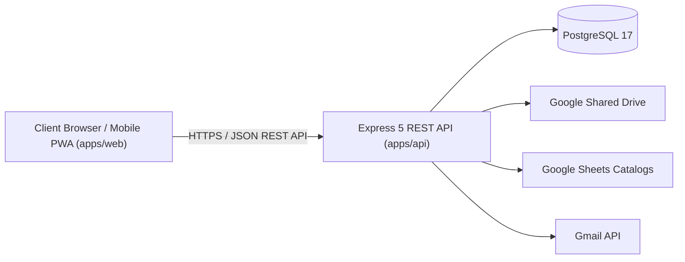

# Applications Blueprint (`apps/`)

Intermediate architectural blueprint grouping the frontend client application and backend REST API service in the Bull Dog Solution monorepo.

## Subsystem Decomposition

| Application               | Type                             | Technology Stack                       | Description                                                                                             |
| ------------------------- | -------------------------------- | -------------------------------------- | ------------------------------------------------------------------------------------------------------- |
| [`api/`](./api/README.md) | Backend Service (Blueprint)      | Node.js, Express 5, Prisma, PostgreSQL | REST API backend handling authentication, domain logic, persistence, and Google Workspace integrations. |
| [`web/`](./web/README.md) | Frontend Application (Blueprint) | Vue 3, Vite, Pinia, Naive UI           | Single Page Application and PWA providing administrative dashboards and field technician portals.       |

## Monorepo Architecture & Cross-Application Contracts



## Invariants

- **Application Isolation**: Direct imports between `apps/api` and `apps/web` are strictly prohibited by ESLint architecture rules.
- **Shared Contracts Boundary**: All shared data structures, DTOs, and validation logic flow through `@puk/contracts` in `packages/contracts/`.
- **Stateless API**: API instances maintain no sticky sessions; authentication is validated on every request via Ed25519 JWT and database revocation checks.

## Verification

```bash
# Verify backend API tests
pnpm --filter @puk/api test

# Verify frontend Web tests
pnpm --filter @puk/web test

# Run full monorepo test suite
pnpm test
```
