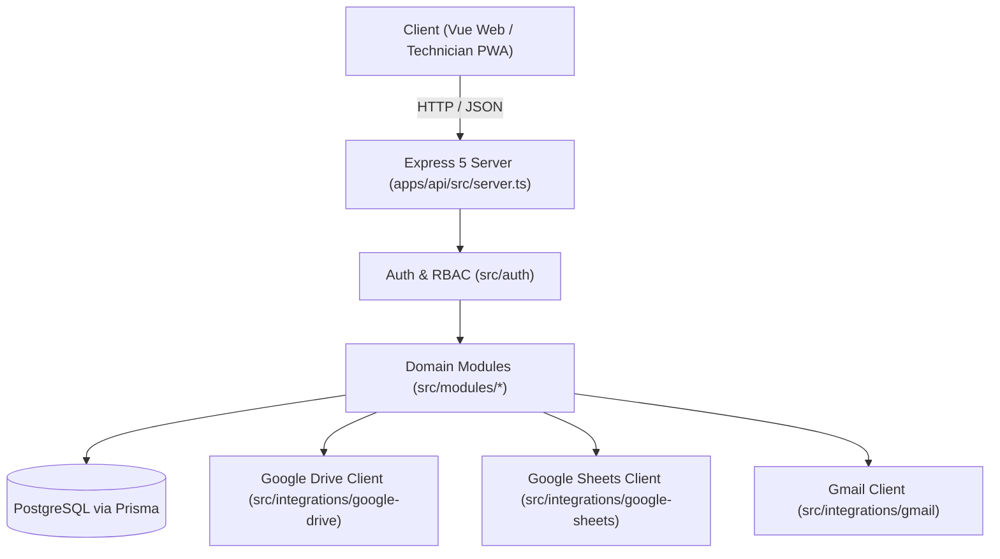

# API Service Blueprint (`apps/api/`)

Backend modular monolith Express 5 REST API service package container (`@puk/api`) serving the Bull Dog Solution service orders platform.

## Subdirectories & Components

| Directory                         | Type                       | Description                                                                                 |
| --------------------------------- | -------------------------- | ------------------------------------------------------------------------------------------- |
| [`src/`](./src/README.md)         | Blueprint                  | Server application pipeline, domain modules, database client, and third-party integrations. |
| [`scripts/`](./scripts/README.md) | Component Package (Peanut) | Operational, bootstrapping, and seed CLI maintenance scripts.                               |

## Interface & Endpoints

| Route Prefix / Path                                           | Module                                                                                      | Responsibilities                                                                                           |
| ------------------------------------------------------------- | ------------------------------------------------------------------------------------------- | ---------------------------------------------------------------------------------------------------------- |
| `/api/v1/auth`                                                | [`src/modules/auth/`](./src/modules/auth/README.md)                                         | Login, token rotation, session validation, logout.                                                         |
| `/api/v1/orders`                                              | [`src/modules/orders/`](./src/modules/orders/README.md)                                     | Order creation, unit assignment, status machine transitions, and pricing.                                  |
| `/api/v1/orders/:id/*`                                        | [`src/modules/execution/`](./src/modules/execution/README.md)                               | Technician field checklists, photo uploads, digital signature, and order completion.                       |
| `/api/v1/orders/:id/report*`                                  | [`src/modules/reports/`](./src/modules/reports/README.md)                                   | PDF generation, Google Drive upload, recipient lists, and manual Gmail distribution.                       |
| `/api/v1/inventory`                                           | [`src/modules/inventory/`](./src/modules/inventory/README.md)                               | Local hardware inventory catalog and reservation binding.                                                  |
| `/api/v1/external`                                            | [`src/modules/catalogs/`](./src/modules/catalogs/README.md)                                 | Cached projections of Google Sheets external clients and equipment (`/clients`, `/equipment`, `/refresh`). |
| `/api/v1/clients`                                             | [`src/modules/clients/`](./src/modules/clients/README.md)                                   | Local client metadata and report recipient emails.                                                         |
| `/api/v1/users`, `/api/v1/technicians`                        | [`src/modules/administration/`](./src/modules/administration/README.md)                     | Administrative user and technician directory management.                                                   |
| `/api/v1/sync/operations`, `/api/v1/sync/schedule`            | [`src/modules/administration/`](./src/modules/administration/README.md)                     | Google Sheets sync outbox monitor and weekly cutoff schedule configuration.                                |
| `/api/v1/shared-technician-access`, `/api/v1/me/order-access` | [`src/modules/shared-technician-access/`](./src/modules/shared-technician-access/README.md) | Workshop technician access configuration and order permission verification.                                |
| `/health/live`, `/health/ready`                               | [`src/modules/health/`](./src/modules/health/README.md)                                     | Liveness and dependency readiness probes.                                                                  |
| `/docs`, `/api/v1/openapi.json`                               | [`src/docs/`](./src/docs/README.md)                                                         | OpenAPI 3.1 schema and Swagger UI documentation.                                                           |

## Architecture & Data Flow



## Invariants

- **Authentication & Sessions**: Bearer token authenticated with Ed25519 signatures; sessions actively validated against PostgreSQL.
- **Data Integrity**: All mutations execute within Prisma transactions with optimistic concurrency locking (`revision` / `version`).
- **External Integration Isolation**: Google Workspace APIs run behind domain ports with circuit breakers to prevent cascading failure.

## Verification

```bash
pnpm --filter @puk/api test
```
