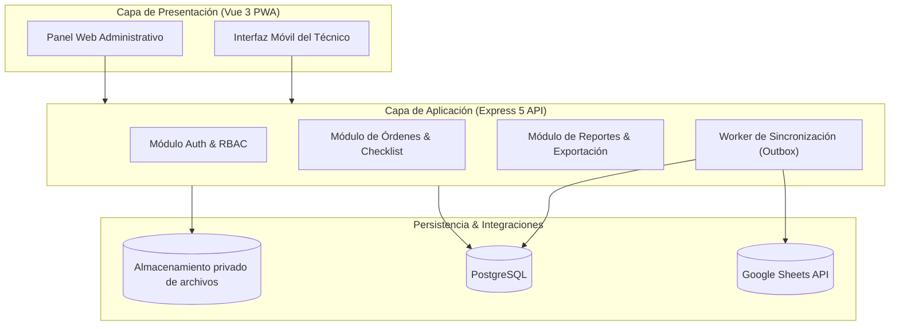
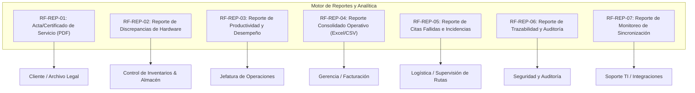

# Especificación de Requisitos de Software (ERS)

## Sistema de Gestión de Órdenes de Servicio — Bull Dog Solution

---

### Control del Documento

- **Proyecto:** Bull Dog Solution — Órdenes de servicio
- **Versión:** 1.0.0
- **Fecha:** 2026-09-02
- **Autor / Organización:** Bull Dog Solution
- **Estado:** Propuesta de Especificación Formal (ERS / IEEE 830 / ISO/IEC/IEEE 29148)

---

## 1. Introducción

### 1.1 Propósito

El propósito de este documento es especificar formalmente los requisitos funcionales y no funcionales para el desarrollo del **Sistema de Gestión de Órdenes de Servicio de Bull Dog Solution**. Este documento sirve como contrato técnico y funcional entre los interesados de negocio, administradores de operaciones, técnicos en campo y el equipo de ingeniería de software.

### 1.2 Alcance del Producto

El sistema es una plataforma web responsiva (PWA básica) orientada a sustituir la operativa manual basada en AppSheet. Centraliza la preparación, asignación, ejecución técnica en campo, verificación de equipamiento telemático, checklist vehicular, captura de evidencia multimedia, firmas de conformidad, auditoría de eventos y sincronización bidireccional controlada con Google Sheets.

**Objetivos clave:**

1. Eliminar inconsistencias en la captura de datos en campo.
2. Garantizar la trazabilidad del estado físico de las unidades antes y después del servicio.
3. Mantener a Google Sheets como catálogo maestro de clientes y almacén de inventario (`SALIDAS`), sin comprometer la integridad transaccional del sistema.
4. Proveer reportes operativos, técnicos y gerenciales en tiempo real y formatos descargables (PDF, Excel, CSV).

### 1.3 Definiciones, Acrónimos y Abreviaturas

- **ERS:** Especificación de Requisitos de Software.
- **PWA:** Progressive Web Application.
- **IMEI:** International Mobile Station Equipment Identity.
- **Proveedor de archivos:** Servicio privado configurado para evidencias, firmas y reportes.
- **JWT:** JSON Web Token.
- **Outbox Pattern:** Patrón arquitectónico para publicación garantizada y asíncrona de eventos transaccionales.
- **Checklist Post-Servicio:** Inspección del estado de la unidad vehicular realizada al concluir los trabajos técnicos.
- **Discrepancia:** Diferencia detectada en campo entre el equipo físico asignado (IMEI, serie, ID, unidad) y lo registrado en la orden.

### 1.4 Referencias

- Documento de Especificaciones Técnicas del Proyecto: `SPECS.md`
- Hoja de Ruta de Implementación: `ROADMAP.md`
- Estándar IEEE 830-1998 / ISO/IEC/IEEE 29148:2018 para Requisitos de Software.

### 1.5 Resumen del Documento

El resto del documento detalla la perspectiva del producto, actores, casos de uso, requisitos funcionales (incluyendo un módulo integral de reportes y analítica), requisitos no funcionales, interfaces de usuario y externas, y restricciones tecnológicas.

---

## 2. Descripción General

### 2.1 Perspectiva del Producto

El sistema opera bajo una arquitectura de monorepo con backend modular en Node.js (Express 5, TypeScript, Prisma ORM, PostgreSQL) y frontend reactivo en Vue 3 (Vite, Pinia, Naive UI, Tailwind CSS). Se integra de forma externa con:

- **Google Sheets API:** Autoridad de catálogos de Clientes y Equipos (`SALIDAS`).
- **Almacenamiento privado:** Repositorio de evidencias, firmas y reportes. Google Drive está integrado; el proveedor se configura por entorno y la aplicación controla el acceso.



### 2.2 Perfiles de Usuario (Roles)

| Rol                         | Descripción                                                                                                                                                                           | Nivel de Acceso                                                             |
| :-------------------------- | :------------------------------------------------------------------------------------------------------------------------------------------------------------------------------------ | :-------------------------------------------------------------------------- |
| **Administrador (`ADMIN`)** | Personal de operaciones y logística en oficina. Prepara órdenes, vincula clientes/unidades/equipos, asigna técnicos, gestiona catálogos locales, audita y consulta reportes globales. | Acceso total al sistema y módulos administrativos/reportes.                 |
| **Técnico (`TECHNICIAN`)**  | Personal operativo en campo. Visualiza órdenes asignadas en interfaz móvil, valida hardware, llena checklist con fotos, levanta discrepancias, recoge firmas y finaliza servicios.    | Acceso restringido únicamente a sus órdenes asignadas y flujo de ejecución. |

### 2.3 Restricciones Generales

1. **Autoridad de Catálogos:** La creación y edición de clientes y equipos no se realiza en la aplicación; residen y se administran en Google Sheets.
2. **Columnas Protegidas en Sheets:** El sistema tiene prohibido modificar `Fecha de salida` y `Estado` del equipo. Puede actualizar `Cliente`, `Estado del servicio` y los datos del vehículo conforme al servicio ejecutado.
3. **Almacenamiento Seguro:** No se almacenan imágenes en la base de datos; únicamente referencias y metadatos. El acceso a los archivos privados se autoriza mediante la aplicación.
4. **Modo Conectado:** El MVP asume conectividad a Internet para sincronización; no contempla soporte offline completo ni colas persistentes en IndexedDB.

---

## 3. Requisitos Específicos

### 3.1 Requisitos Funcionales (RF)

#### Módulo 1: Autenticación y Gestión de Usuarios

- **RF-01 (Autenticación Segura):** El sistema debe autenticar usuarios mediante correo electrónico y contraseña con hash Argon2id, retornando Access Token JWT (15 min) y Refresh Token (7 días) rotativo.
- **RF-02 (Control de Acceso Basado en Roles):** El sistema debe restringir endpoints y vistas según el rol (`ADMIN` o `TECHNICIAN`). Un técnico solo podrá consultar e interactuar con órdenes asignadas a su identificador.
- **RF-03 (Administración de Técnicos):** El administrador debe poder crear, editar y activar/desactivar perfiles de técnicos y asociarlos a cuentas de usuario del sistema.

#### Módulo 2: Integración con Google Sheets

- **RF-04 (Consulta de Catálogos en Sheets):** El sistema debe consultar el catálogo de clientes y de equipos disponibles (`SALIDAS`) mediante caché controlada con Redis/memoria y Google Sheets API.
- **RF-05 (Detección de Conflictos de Concurrencia):** Si la fila de un equipo o cliente cambia en Google Sheets durante la preparación de una orden, el sistema debe alertar al administrador sobre el conflicto de versión antes de confirmar.
- **RF-06 (Outbox y Reintentos de Sincronización):** Las actualizaciones dirigidas a Google Sheets deben registrarse en una tabla Outbox transaccional y procesarse asíncronamente con reintentos exponenciales y registro de errores.

#### Módulo 3: Gestión de Órdenes de Servicio

- **RF-07 (Creación de Órdenes Multilote):** El administrador debe poder crear una orden en estado `DRAFT`, asociarla a un cliente, registrar una o múltiples unidades vehiculares, y asignar uno o varios equipos por unidad.
- **RF-08 (Tipos de Servicio):** El sistema debe soportar `INSTALLATION`, `REVIEW`, `UNINSTALLATION`, `FAILED_APPOINTMENT`, `FUEL_SENSOR` y `EQUIPMENT_REPLACEMENT`, permitiendo varios servicios por orden mediante el tipo de cada unidad.
- **RF-09 (Asignación y Reasignación):** El administrador debe poder asignar y reasignar una orden a un técnico activo, transicionando su estado a `ASSIGNED`.
- **RF-10 (Ciclo de Vida de la Orden):** El sistema debe hacer cumplir la máquina de estados: `DRAFT` $\to$ `ASSIGNED` $\to$ `IN_PROGRESS` $\to$ `COMPLETED` / `REQUIRES_CORRECTION` / `FAILED_APPOINTMENT` / `CANCELLED`.

#### Módulo 4: Ejecución en Campo (Operación Técnica)

- **RF-11 (Vista Móvil del Técnico):** El técnico debe visualizar su listado de órdenes asignadas con detalles de cliente, ubicación, unidades y estatus.
- **RF-12 (Verificación de Equipamiento):** El técnico debe verificar individualmente cada equipo asignado a una unidad, marcándolo como `MATCHED` o `DISCREPANCY_REPORTED`.
- **RF-13 (Reporte de Discrepancias en Campo):** Si un equipo difiere físicamente (IMEI, serie, ID de equipo o unidad no coincidente), el técnico debe poder reportar los valores observados y continuar el servicio sin bloqueos.
- **RF-14 (Checklist Post-Servicio Obligatorio):** Para cada unidad, el técnico debe registrar el estado de 5 categorías obligatorias:
  1. Tablero (`DASHBOARD`)
  2. Cristales (`WINDOWS`)
  3. Accesorios (`ACCESSORIES`)
  4. Molduras (`TRIMS`)
  5. Carrocería (`BODYWORK`)
  - Estados permitidos: `GOOD` (Bien), `BAD` (Mal) o `NOT_APPLICABLE` (No aplica).
  - Si el estado es `BAD`, el campo de observación explicativa es **obligatorio**.
- **RF-15 (Evidencias Fotográficas Obligatorias):** Cada unidad requiere al menos diez fotografías completadas en su galería propia (no vinculadas a categorías del checklist) y cargadas al proveedor privado configurado.
- **Notas de ejecución:** El técnico puede capturar una nota general de la orden durante la ejecución. La nota puede guardarse antes del cierre o automáticamente al solicitar la finalización; no se divide por unidad.
- **RF-16 (Captura de Firma del Cliente):** La orden finalizada exige la captura digital de una única firma del cliente en pantalla, junto con el nombre completo y documento de la persona firmante.
- **RF-17 (Cierre de Cita Fallida):** Si la unidad no está disponible o el cliente no se presenta, el técnico puede registrar un cierre como `FAILED_APPOINTMENT` indicando obligatoriamente el motivo, omitiendo fotos, checklist y firma.
- **RF-18 (Resolución Administrativa de Cita Fallida):** El administrador puede cancelar el
  servicio o reprogramarlo. La cancelación conserva el cierre, tarifa y reporte de la visita. La
  reprogramación crea una nueva orden enlazada, con nuevo folio y fecha, en estado `DRAFT`; copia la
  configuración operativa y reinicia evidencias, firma, checklist, verificaciones y datos de cobro.
- **RF-19 (Tarifas Dinámicas y Ajuste de Liquidación):** El sistema debe permitir a los administradores (`orders:manage`) configurar tarifas acordadas (`rates`) y viáticos (`travelExpenses`) para una orden específica previo a su cierre, así como ajustar importes de liquidación técnica en órdenes ya finalizadas (`COMPLETED`, `FAILED_APPOINTMENT`). El reajuste post-cierre debe recalcular los importes y desgloses con aritmética de precisión arbitraria, registrar auditoría formal (`ORDER_PRICING_ADJUSTED`), incrementar la versión contable de la orden e invalidar y encolar la re-sincronización hacia el reporte técnico de Google Sheets.

---

### 3.2 Requisitos Funcionales del Módulo de Reportes y Analítica (RF-REP)

Este módulo atiende la supervisión operativa, la auditoría técnica, la rendición de cuentas al cliente y el control administrativo.



#### RF-REP-01: Acta de Entrega y Certificado Técnico de Servicio (Formato PDF)

- **Descripción:** El sistema debe generar automáticamente un documento PDF formal y descargable al completarse la orden de servicio.
- **Entrada / Filtro:** Folio o ID único de la orden completada.
- **Contenido Requerido:**
  - Encabezado con logotipo corporativo de Bull Dog Solution, folio único, fecha y hora de inicio/cierre.
  - Datos del cliente, técnico responsable y taller/ubicación.
  - Detalle por unidad vehicular: identificación, placas/VIN, estado final.
  - Tabla de equipamiento verificado: IDs, números de serie, IMEIs y notas de discrepancia (si existieran).
  - Resultados del checklist vehicular clasificado en las 5 categorías con sus observaciones.
  - Mosaico de evidencias fotográficas incrustadas con sello de fecha/hora y categoría correspondiente.
  - Imagen de la firma digitalizada del cliente, nombre completo legible y leyenda de conformidad del servicio.
- **Formato de Salida:** PDF estándar A4/Carta descargable y consultable mediante la aplicación con autorización sobre la orden.

#### RF-REP-02: Reporte de Discrepancias de Equipamiento en Campo

- **Descripción:** Reporte especializado para auditoría de almacén e inventarios que consolida todos los desfases detectados entre lo programado en Google Sheets y lo encontrado físicamente en las unidades.
- **Criterios de Filtrado:** Rango de fechas, cliente, técnico, estado de la orden, tipo de discrepancia (IMEI, Serie, ID, Unidad).
- **Columnas Requeridas:**
  - Folio de la orden.
  - Fecha del reporte y nombre del técnico reportante.
  - Nombre del cliente y unidad vehicular afectada.
  - Datos esperados (según catálogo `SALIDAS`) vs. Datos reales capturados en campo.
  - Observaciones y estatus de atención administrativa.
- **Formato de Salida:** Vista tabular interactiva en pantalla con opción de exportación a CSV y Excel (XLSX).

#### RF-REP-03: Reporte de Productividad y Desempeño Operativo de Técnicos

- **Descripción:** Panel y reporte consolidado para evaluar el rendimiento del personal operativo.
- **Criterios de Filtrado:** Periodo de tiempo (diario, semanal, mensual), técnico individual o todos los técnicos.
- **Métricas e Indicadores:**
  - Total de órdenes asignadas vs. completadas.
  - Tasa de efectividad de visitas (Completadas vs. Citas Fallidas / Canceladas).
  - Tiempo promedio transcurrido entre asignación, inicio del servicio y cierre (`IN_PROGRESS` a `COMPLETED`).
  - Total de unidades y equipos instalados/revisados/desinstalados por técnico.
  - Conteo de discrepancias levantadas por técnico.
- **Formato de Salida:** Tablero con gráficos de barras/progreso y descarga de resumen en formato CSV/XLSX.

#### RF-REP-04: Reporte Consolidado de Órdenes y Servicios (Exportación General)

- **Descripción:** Reporte maestro para administración y finanzas que consolida todas las transacciones operativas del sistema.
- **Criterios de Filtrado:** Rango de fechas de creación/finalización, estado de la orden (`DRAFT`, `ASSIGNED`, `IN_PROGRESS`, `COMPLETED`, `FAILED_APPOINTMENT`, `CANCELLED`), cliente, tipo de servicio.
- **Columnas Requeridas:** Folio, Cliente, Tipo de Servicio, Técnico Asignado, Cantidad de Unidades, Cantidad de Equipos, Estado Actual, Fecha de Creación, Fecha de Cierre, Duración Total.
- **Formato de Salida:** Exportación asíncrona o sincrónica en formato Excel (XLSX) y CSV con soporte para UTF-8.

#### RF-REP-05: Reporte de Citas Fallidas y Cancelaciones

- **Descripción:** Informe operativo orientado a identificar causas recurrentes de no ejecución de servicios para cobro de visita o reasignación logística.
- **Criterios de Filtrado:** Rango de fechas, cliente, técnico responsable, motivo registrado.
- **Columnas Requeridas:**
  - Folio de la orden.
  - Cliente y ubicación de la cita.
  - Técnico asignado.
  - Motivo de la cita fallida (justificación obligatoria registrada por el técnico).
  - Fecha y hora exacta de registro.
- **Formato de Salida:** Vista en pantalla y exportación en CSV/Excel.

#### RF-REP-06: Reporte de Auditoría y Trazabilidad de Acciones

- **Descripción:** Registro inmutable de eventos del sistema para cumplimiento y control de cambios.
- **Criterios de Filtrado:** Rango de fechas, usuario responsable, entidad afectada (`Order`, `Unit`, `Equipment`, `User`), tipo de acción (`CREATE`, `UPDATE`, `STATUS_CHANGE`, `REASSIGN`).
- **Columnas Requeridas:** Timestamp ISO-8601, Usuario (ID y nombre), Dirección IP (si aplica), Acción realizada, Estado previo vs. Estado nuevo (Diff JSON).
- **Formato de Salida:** Visor de auditoría paginado con exportación de registros a CSV.

#### RF-REP-07: Reporte y Monitoreo de Sincronización con Google Sheets

- **Descripción:** Tablero y reporte técnico para soporte y administración que expone la salud del canal de sincronización bidireccional.
- **Métricas y Datos:**
  - Total de transacciones encoladas en Outbox (`PENDING`, `PROCESSING`, `SYNCED`, `FAILED`).
  - Detalle de fallas: mensaje de error de la API de Google, código HTTP, número de reintentos ejecutados.
  - Conflictos de versión detectados en catálogos de clientes o equipos.
  - Botón de acción para reintento manual asistido de tareas fallidas.
- **Formato de Salida:** Panel de diagnóstico técnico en tiempo real en la interfaz de administración.

---

### 3.3 Requisitos No Funcionales (RNF)

#### 3.3.1 Rendimiento y Eficiencia

- **RNF-01 (Tiempos de Respuesta de la API):** El 95% de las peticiones REST estándar deben responder en menos de 300 ms bajo condiciones normales de red.
- **RNF-02 (Generación de Reportes PDF):** El tiempo de generación del PDF del acta de servicio no debe exceder los 3.5 segundos para órdenes con hasta 5 unidades y 25 imágenes.
- **RNF-03 (Optimización Móvil):** La aplicación móvil para técnicos debe tener un tamaño de bundle inicial menor a 1.5 MB y tiempos de renderizado menores a 1 segundo en dispositivos de gama media.

#### 3.3.2 Seguridad y Protección de Datos

- **RNF-04 (Cifrado en Tránsito y Reposo):** Toda comunicación debe efectuarse sobre HTTPS/TLS 1.3. Las contraseñas deben cifrarse con Argon2id.
- **RNF-05 (Privacidad de Evidencias):** Los buckets de almacenamiento de imágenes y firmas deben ser estrictamente privados. La consulta de fotos se realizará exclusivamente mediante URLs firmadas con expiración máxima de 15 minutos.
- **RNF-06 (Prevención de Inyecciones y Validación):** Todas las cargas útiles entrantes (payloads) deben validarse de forma estricta en el servidor mediante esquemas Valibot.

#### 3.3.3 Disponibilidad y Resiliencia

- **RNF-07 (Tolerancia a Fallos de Google Sheets):** La caída temporal o limitación de cuota de la API de Google Sheets no debe impedir la ejecución en campo de órdenes ya asignadas. Los eventos pendientes deben persistir en PostgreSQL mediante el patrón Outbox.
- **RNF-08 (Concurrencia Optimista):** El sistema debe prevenir sobreescrituras concurrentes en órdenes y sincronización mediante tokens de versión o timestamps de actualización.

#### 3.3.4 Usabilidad y Accesibilidad

- **RNF-09 (Diseño Mobile-First):** La interfaz para técnicos debe ser 100% operable en pantallas táctiles de smartphones con diagonales desde 4.7 pulgadas, con botones y áreas táctiles de al menos 48x48 px.
- **RNF-10 (Claridad en Reporte de Checklist):** La captura de checklist y fotos debe presentar retroalimentación visual clara e inequívoca del progreso (p. ej., barra de avance de fotos capturadas).

---

## 4. Requisitos de Interfaz Externa

### 4.1 Interfaces de Usuario

- **Interfaz Web de Administración:** Desarrollada con Naive UI y Tailwind CSS, con diseño optimizado para escritorio (1280px+), tablas paginadas, filtros de búsqueda avanzada, modales de visualización de evidencias y tableros de reportes.
- **Interfaz Móvil del Técnico:** Aplicación web responsiva con comportamiento PWA, navegación guiada paso a paso, componente de lienzo táctil (`HTML5 Canvas`) para captura de firma y selector nativo de cámara para evidencias fotográficas.

### 4.2 Interfaces de Software y Terceros

- **Google Sheets API v4:**
  - Lectura de hoja de `Clientes` (Nombres, identificadores, contratos).
  - Lectura y actualización selectiva de hoja `SALIDAS` (catálogo de equipos, series e IMEIs).
  - Lectura de `DIRECTORIO TECNICO` y publicación idempotente del cobro en la pestaña anual configurada del libro de técnicos.
- **Google Drive y almacenamiento de objetos:**
  - Persistencia privada de evidencias, firmas y reportes mediante el proveedor configurado.
  - Acceso y transferencia de archivos mediados por la aplicación o por URLs temporales cuando el adaptador las requiera.
- **Motor de Renderizado PDF:**
  - Librería de servidor (p. ej., PDFKit o Puppeteer ligero) para la compilación de actas de servicio firmadas.

---

## 5. Matriz de Trazabilidad de Requisitos

| ID Requisito  | Descripción Sintética               | Módulo Responsable | Componente de Sistema               | Prioridad |
| :------------ | :---------------------------------- | :----------------- | :---------------------------------- | :-------- |
| **RF-01**     | Autenticación JWT y sesiones        | Seguridad          | API Express / Auth Module           | Alta      |
| **RF-02**     | RBAC (`ADMIN` vs `TECHNICIAN`)      | Seguridad          | API Express / Middleware            | Alta      |
| **RF-04**     | Consulta a catálogos Sheets         | Integración        | API Express / Google Sheets Service | Alta      |
| **RF-07**     | Creación de órdenes multilote       | Operaciones        | API Express & Admin UI              | Alta      |
| **RF-10**     | Máquina de estados de la orden      | Núcleo             | API Express / Orders Module         | Crítica   |
| **RF-12**     | Verificación de equipos             | Operación Campo    | Technician Mobile UI                | Alta      |
| **RF-13**     | Reporte de discrepancias            | Operación Campo    | Mobile UI & Orders Service          | Media     |
| **RF-14**     | Checklist vehicular (5 categorías)  | Operación Campo    | Mobile UI & Checklist Service       | Crítica   |
| **RF-15**     | Evidencias fotográficas privadas    | Operación Campo    | Storage Adapter & Mobile UI         | Crítica   |
| **RF-16**     | Firma digital del cliente           | Operación Campo    | Canvas Signature & Storage Adapter  | Crítica   |
| **RF-17**     | Cierre como cita fallida            | Operación Campo    | Orders Module / Mobile UI           | Alta      |
| **RF-REP-01** | Acta técnica de servicio (PDF)      | Reportes           | Reports Engine & PDF Service        | Crítica   |
| **RF-REP-02** | Reporte de discrepancias            | Reportes           | Reports Engine & Admin UI           | Media     |
| **RF-REP-03** | Productividad de técnicos           | Reportes           | Reports Engine & Admin UI           | Media     |
| **RF-REP-04** | Consolidado general (XLSX/CSV)      | Reportes           | Reports Engine & Export Service     | Alta      |
| **RF-REP-05** | Reporte de citas fallidas           | Reportes           | Reports Engine & Admin UI           | Media     |
| **RF-REP-06** | Reporte de auditoría y trazabilidad | Reportes           | Audit Service & Admin UI            | Alta      |
| **RF-REP-07** | Monitoreo de sincronización         | Reportes           | Outbox Worker & Admin UI            | Alta      |
| **RNF-05**    | Acceso privado a archivos           | Seguridad          | Storage Service                     | Crítica   |
| **RNF-07**    | Resiliencia con Outbox              | Arquitectura       | Outbox Worker & PostgreSQL          | Crítica   |

---

## 6. Apéndice: Estructura de Datos Base para Reportes

```typescript
// Estructura de payload para generación del Reporte RF-REP-01 (Acta de Servicio PDF)
interface ServiceOrderReportData {
  folio: string;
  serviceType:
    | 'INSTALLATION'
    | 'REVIEW'
    | 'UNINSTALLATION'
    | 'FAILED_APPOINTMENT'
    | 'FUEL_SENSOR'
    | 'EQUIPMENT_REPLACEMENT';
  completedAt: string;
  client: {
    id: string;
    name: string;
  };
  technician: {
    id: string;
    name: string;
    workshop?: string;
  };
  units: Array<{
    id: string;
    serviceType: ServiceOrderReportData['serviceType'];
    identifier: string;
    plate?: string;
    vin?: string;
    checklist: Array<{
      category: 'DASHBOARD' | 'WINDOWS' | 'ACCESSORIES' | 'TRIMS' | 'BODYWORK';
      condition: 'GOOD' | 'BAD' | 'NOT_APPLICABLE';
      observation?: string;
      photos: Array<{
        url: string;
        uploadedAt: string;
      }>;
    }>;
    equipments: Array<{
      id: string;
      expectedImei: string;
      expectedSerial: string;
      verificationStatus: 'MATCHED' | 'DISCREPANCY_REPORTED';
      discrepancyNote?: string;
    }>;
  }>;
  signature: {
    signerName: string;
    signatureImageUrl: string;
    signedAt: string;
  };
}
```
