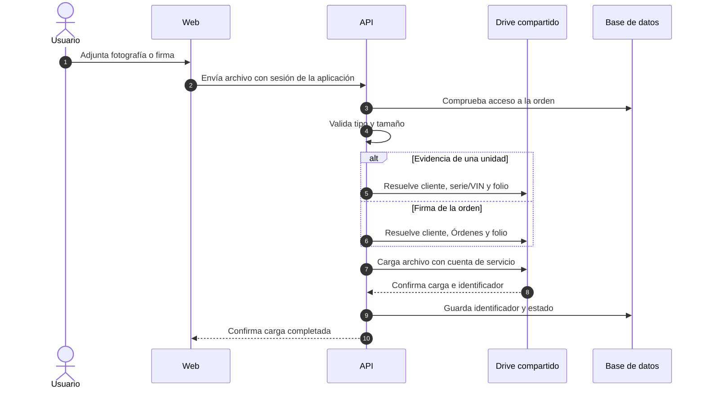
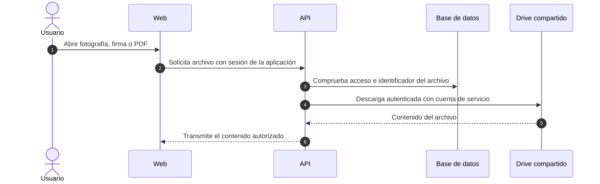

# Plan de integración con Google Drive

**Estado:** implementación integrada y validada en desarrollo, incluida carga de evidencia y lectura privada de archivos; la infraestructura de staging ya configura Drive, pero AWS staging está eliminado y no hay despliegue actual. Producción no está desplegada. La validación local no equivale a una validación operativa en producción. La implementación se contrasta con [`spec.md`](../spec.md).

**Alcance:** almacenar en un Drive compartido las nuevas fotografías de evidencia, firmas y reportes PDF de las órdenes de servicio, con acceso privado desde la aplicación. Los archivos actuales de S3 son exclusivamente de prueba: se pueden descartar y **no se migrarán** a Drive.

**Decisión vigente:** Google Drive compartido es el proveedor configurado para un futuro staging y el destino previsto para evidencias, firmas y reportes. El adaptador S3 permanece en el código como alternativa técnica/legado; no se provisiona en el stack de staging. AWS staging fue eliminado y no hay recursos actuales; antes de redeploy se deben recrear infraestructura y secretos. Ver [staging y despliegue](./staging-and-deployment.md).

> Las secciones siguientes conservan el diseño y los criterios originales del plan. La implementación
> de aplicación (carga/lectura privada de evidencias y firmas, generación y almacenamiento de PDF en
> Drive) está completada e integrada. Lo pendiente es operativo: recrear staging, volver a validar
> con Drive en ese entorno y definir respaldo/retención para producción. No ejecutar operaciones de
> AWS ni limpieza de datos como parte de este documento.

## Resumen de la propuesta

1. Confirmar con TI el Drive compartido de producción, su capacidad, las políticas de acceso y la identidad de servicio aprobada.
2. Completar la validación de extremo a extremo de fotografías, firmas, PDF, descargas privadas, reintentos y permisos en un entorno controlado.
3. Desplegar la configuración de Drive con secretos gestionados fuera del repositorio y verificar referencias de prueba antes del corte.
4. Activar escrituras en producción solo después de cumplir los criterios de aceptación y acordar observabilidad y reversión. El borrado físico de objetos S3 es una operación posterior y separada.

**No se decide aquí eliminar firmas originales.** Hoy se consultan por separado y se necesitan para generar o regenerar PDF. Además, [el plan de migración desde AppSheet](./appsheet-migration-plan.md#3-políticas-de-retención-de-evidencias-y-firmas) indica conservación indefinida de firmas; cualquier cambio requiere una decisión funcional y de retención explícita.

## Estado actual y alcance técnico

| Archivo     | Estado implementado                                                                                                                                                               | Consideración operativa                                                                              |
| ----------- | --------------------------------------------------------------------------------------------------------------------------------------------------------------------------------- | ---------------------------------------------------------------------------------------------------- |
| Fotografías | La web prepara JPEG y envía la carga autenticada a la API; la API valida, persiste y confirma la referencia privada en Drive. El adaptador S3 permanece en el código como legado. | Validar tipos de archivo, permisos y rendimiento de extremo a extremo en Drive antes del despliegue. |
| Firmas      | La API recibe PNG autenticado, registra la referencia y mantiene una vista previa privada en Drive.                                                                               | Preservar la firma original conforme a la política de retención.                                     |
| PDF         | El worker genera la versión del reporte y `report-storage.ts` la persiste en Drive.                                                                                               | Comprobar lectura de evidencias/firma, regeneración y descarga privada en Drive.                     |

El adaptador S3 implementa [`ObjectStoragePort`](../apps/api/src/integrations/ports.ts) y utiliza URLs temporales; Drive usa IDs de archivo, referencias persistidas y autorización propia. El stack de staging selecciona Drive con `STORAGE_PROVIDER=drive`; el entorno desplegado no existe actualmente. Las referencias de evidencia, firma y reporte se guardan en PostgreSQL y no deben mezclarse entre proveedores. Los registros antiguos de prueba no requieren migración histórica a Drive.

## Requisitos previos de Google Workspace

| Responsable                        | Validación requerida                                                                                                                                                                                                                                                                                                                                     |
| ---------------------------------- | -------------------------------------------------------------------------------------------------------------------------------------------------------------------------------------------------------------------------------------------------------------------------------------------------------------------------------------------------------- |
| TI / administrador de Workspace    | Confirmar edición, almacenamiento compartido libre, política de miembros externos y posibilidad de usar una identidad `@...iam.gserviceaccount.com` en el Drive compartido.                                                                                                                                                                              |
| TI / administrador de Google Cloud | Drive API ya fue habilitada para la configuración local usada en la prueba confirmada. Para producción, crear o aprobar una cuenta de servicio **dedicada** y conceder solo el acceso necesario al Drive de la aplicación. Validar el alcance OAuth mínimo para crear, leer y descargar archivos. No conceder delegación de todo el dominio por defecto. |
| Seguridad / operación              | Definir el mecanismo de autenticación de la carga en AWS. Preferir credenciales de corta duración si la integración lo permite; si se requiere una clave, custodiarla fuera del repositorio y gestionar su rotación. Definir auditoría, respaldo/exportación y recuperación.                                                                             |
| Negocio / cumplimiento             | Confirmar plazos de conservación de fotografías, firmas y cada versión de PDF, así como los requisitos de borrado definitivo y acceso de personal autorizado.                                                                                                                                                                                            |

Una cuenta de servicio no debe guardar archivos en **Mi unidad**: Google indica que no puede ser propietaria de archivos y que debe usar un Drive compartido o actuar en nombre de un usuario mediante OAuth. El Drive compartido pertenece a la organización y consume su capacidad agrupada. La aplicación ya usa una cuenta de servicio para Sheets, pero con alcance de Sheets; se propone una identidad separada para reducir el impacto de una credencial comprometida.

## Diseño propuesto para validar en el piloto

### Organización de carpetas

Los archivos nuevos se ubicarán en el Drive compartido con esta jerarquía visible:

```text
Nombre del cliente/
  Serie o VIN de la unidad/
    Folio de la orden de servicio/
      Evidencias de esa unidad
  Órdenes/
    Folio de la orden de servicio/
      firma.png
      reporte-v1.pdf
      reporte-v2.pdf
```

La carpeta del cliente se reutiliza para sus unidades; la de cada unidad se reutiliza para sus distintas órdenes. Dentro de la última carpeta de cada unidad van únicamente sus evidencias. Los nombres visibles pueden salir de `clientNameSnapshot`, `OrderUnit.serialNumber` y `folio`, respectivamente. Para encontrar o crear la carpeta de una unidad se usará la combinación de `clientSheetId` y serie/VIN normalizada; se conservarán los identificadores de carpeta y archivo de Drive, sin depender solo del nombre visible. `OrderUnit.id` identifica una unidad **dentro de una orden**, no el mismo auto en órdenes posteriores. El piloto debe validar el formato y la consistencia de la serie/VIN antes de reutilizar una carpeta.

La firma y el PDF son recursos de la **orden completa**, no de una unidad. Se guardarán una sola vez en `Nombre del cliente/Órdenes/Folio de la orden de servicio/`, incluso si la orden tiene una sola unidad. Cada versión del PDF tendrá su propio archivo y referencia persistida. Esta rama separada evita elegir arbitrariamente una unidad o duplicar archivos compartidos; a cambio, los archivos de una orden quedan repartidos entre su carpeta común y las carpetas de evidencias de sus unidades. La aplicación debe resolverlos desde las referencias de la base de datos, no inferir su ubicación a partir de una ruta visible.

### Carga y lectura privadas

La integración con Drive ya está implementada. En ese modo la aplicación conserva la autorización:
el navegador no recibe credenciales ni enlaces públicos del proveedor. El adaptador de
almacenamiento de objetos mantiene su propio protocolo alternativo; no es el modelo conceptual
único de almacenamiento.

#### Flujo implementado: carga privada en Drive



Si Drive falla, la API no debe marcar la carga como completada. Los PDF generados por la API se guardarán en la carpeta común de la orden mediante el mismo tramo API → Drive, sin pasar por el navegador.

#### Flujo implementado: lectura privada desde Drive



El navegador no recibe credenciales de Google ni un enlace público de Drive. Este diseño añade transferencia de datos y trabajo a la API, por lo que el piloto debe medir latencia y consumo de recursos.

- **Carga:** mantener la autenticación y las reglas de acceso de la API. Como punto de partida, recibir el archivo en un endpoint autenticado de la API y transmitirlo a Drive, con límite de bytes, validación de tipo real, confirmación de carga y limpieza de cargas incompletas. Probar el consumo de memoria, el tiempo de respuesta y la conectividad de ECS a Google antes de fijar esta vía. Las sesiones de carga resumible son una opción a evaluar si las mediciones lo requieren.
- **Lectura:** resolver la referencia de la base de datos y transmitir fotografías, firmas y PDF a través de la API tras verificar acceso a la orden. No usar enlaces públicos ni exigir que cada técnico inicie sesión en Google. Evitar exponer tokens o identificadores como mecanismo de autorización.
- **Metadatos:** conservar una clave lógica estable para la aplicación y registrar los identificadores de archivo y carpeta de Drive. No interpretar una ruta S3 como identificador de Drive. Conservar MIME, tamaño y checksum cuando corresponda.
- **Fallas:** reintentos acotados con espera progresiva para errores transitorios de Drive; no marcar evidencia como `COMPLETED` ni PDF como `READY` antes de comprobar la carga. Registrar fallas sin incluir credenciales ni contenido sensible.
- **Idempotencia:** exigir una clave UUID por carga de evidencia y firma, reservar el ID de Drive en la base antes de transferir, y reservar `objectKey` del reporte antes de generar/subir. Los reintentos verifican nombre, padre, MIME y checksum del archivo reservado. Las firmas sustituidas conservan su referencia anterior; no se ejecuta borrado físico.

Google documenta cargas resumibles, descarga de archivos binarios mediante `files.get` con `alt=media` y el parámetro `supportsAllDrives=true` para operaciones sobre Drives compartidos. El piloto debe confirmar el alcance OAuth exacto y las políticas del tenant antes de fijar el diseño definitivo.

### Alcance de los cambios en el repositorio

- API y contratos: [`ObjectStoragePort`](../apps/api/src/integrations/ports.ts), servicios de [`ejecución`](../apps/api/src/modules/execution/execution.service.ts) y [`reportes`](../apps/api/src/modules/reports/reports.service.ts), rutas y contratos de carga/descarga, composición en [`server.ts`](../apps/api/src/server.ts).
- Persistencia: modelos y migración Prisma para localizar los nuevos archivos y carpetas por sus identificadores de Drive y retirar las referencias de prueba a S3 sin dejar registros que aparenten archivos disponibles.
- Web: captura de [evidencias](../apps/web/src/modules/service-execution/components/EvidenceCapture.vue), firma y vistas previas/descarga; mantener mensajes de progreso y errores.
- Configuración y operación: entornos local, pruebas y staging; infraestructura CDK solo después de aprobar el mecanismo de autenticación y salida de red. MinIO/S3 puede seguir sirviendo a pruebas locales, pero no es una dependencia de lectura histórica en producción.
- Mantenimiento: no ejecutar [`cleanup-orphaned-objects.ts`](../infra/scripts/cleanup-orphaned-objects.ts) como atajo para descartar S3. Hoy considera referencias de evidencia y firma, **pero no las de reportes PDF**; revisar su alcance antes de cualquier limpieza autorizada. No reutilizarlo para Drive sin rediseñar inventario, límites y borrado.

## Secuencia de trabajo y criterios de salida

La prueba local confirmada cubre una carga de fotos y la ubicación de sus carpetas. No demuestra por sí sola la preparación de producción. Las fases siguientes conservan controles de despliegue y corte; la issue #28 da trazabilidad a la implementación.

| Fase                   | Trabajo                                                                                                                                                                                | Criterio para avanzar                                                                                                                           |
| ---------------------- | -------------------------------------------------------------------------------------------------------------------------------------------------------------------------------------- | ----------------------------------------------------------------------------------------------------------------------------------------------- |
| 1. Piloto              | Medir tamaños esperados y capacidad libre del tenant; validar identidad, permisos, consistencia de serie/VIN, jerarquía de carpetas, carga, lectura y descarga con archivos de prueba. | TI confirma acceso al Drive compartido y se documentan resultados sin datos reales expuestos.                                                   |
| 2. Adaptación          | Implementar referencias de Drive, creación/reutilización de ambas ramas de carpetas y pruebas de autorización para nuevas cargas y lecturas.                                           | Una orden de prueba con varias unidades funciona de extremo a extremo, con firma y PDF únicos en la carpeta común; no se depende de lectura S3. |
| 3. Corte y observación | Identificar y descartar de forma controlada los registros y objetos de prueba de S3; activar Drive para nuevas órdenes y vigilar errores, latencia y cuota.                            | No quedan referencias de prueba que aparenten archivos disponibles y el flujo nuevo supera los criterios de aceptación.                         |

**Reversión:** antes de crear datos reales, se puede detener el corte y descartar los archivos de prueba. Después del corte, no se promete volver a S3 con un cambio de configuración: los archivos reales nuevos estarán en Drive y cualquier retorno requeriría un plan explícito para conservar su acceso.

## Verificación mínima

- Cargar y consultar fotografías JPEG/HEIC convertidas, firmas PNG y PDF sin acceso anónimo a Drive.
- Rechazar archivos fuera de límite o tipo permitido; recuperar cargas interrumpidas sin duplicar registros activos.
- Generar y volver a generar reportes con fotografías y firma de Drive; probar correcciones y versiones nuevas de PDF.
- Verificar que la jerarquía cliente/serie o VIN/orden reutiliza las carpetas correctas entre órdenes, sin mezclar clientes ni unidades; probar diferencias de formato en la serie/VIN.
- Verificar que una orden con varias unidades guarda cada evidencia en su carpeta de unidad y una sola firma y cada versión del PDF en `Cliente/Órdenes/Folio`.
- Comprobar autorización por orden, tratamiento de errores `403`/`404`/`429`, reintentos, métricas y registros sin datos sensibles.
- Comprobar que los mecanismos de limpieza de Drive respetan la política de retención; no ejecutar la limpieza de S3 sin autorización y alcance verificado.
- Verificar que el descarte de datos de prueba no afecta órdenes reales ni deja referencias rotas antes del corte.

## Decisiones pendientes

1. ¿Qué edición y capacidad libre tiene el Workspace, y permite TI agregar la cuenta de servicio al Drive compartido?
2. ¿Qué mecanismo de credenciales se aprueba para la API que corre en AWS y qué alcance OAuth mínimo funciona en el piloto?
3. ¿Durante cuánto tiempo deben conservarse originales y versiones de PDF? La eliminación de firmas después de `READY` contradice la retención documentada y hoy impediría su vista previa y regeneración.
4. ¿Quién confirma que todos los registros y objetos actuales de S3 son descartables y autoriza su eliminación, incluidas las versiones anteriores si existen?

El volumen comunicado es de aproximadamente 15 reportes semanales y, normalmente, una unidad con al menos 10 fotografías por reporte. Esto orienta el piloto, pero no reemplaza medir tamaños reales, crecimiento, lecturas y capacidad libre. El costo incremental de Drive depende del contrato y la capacidad agrupada del tenant; el esfuerzo de integración y operación también forma parte de la comparación con S3.

## Referencias externas

- [Google Drive: Drives compartidos y propiedad de archivos](https://developers.google.com/workspace/drive/api/guides/about-shareddrives).
- [Google Workspace: cuentas de servicio y acceso acotado](https://developers.google.com/workspace/guides/create-credentials).
- [Google Drive: cargas de archivos](https://developers.google.com/workspace/drive/api/guides/manage-uploads) y [descargas](https://developers.google.com/workspace/drive/api/guides/manage-downloads).
- [Google Drive: soporte de Drives compartidos](https://developers.google.com/workspace/drive/api/guides/enable-shareddrives), [alcances OAuth](https://developers.google.com/workspace/drive/api/guides/api-specific-auth) y [límites de uso](https://developers.google.com/workspace/drive/api/guides/limits).
- [Amazon S3: borrado de objetos con versionado](https://docs.aws.amazon.com/AmazonS3/latest/userguide/DeletingObjectVersions.html).
