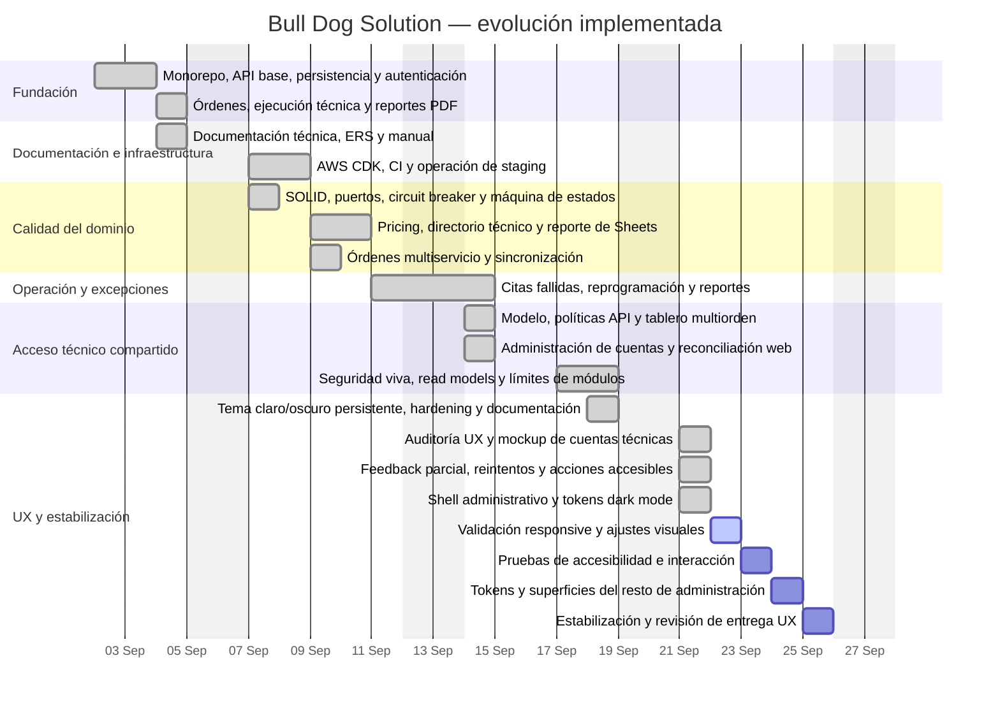

# Línea de tiempo del proyecto

Esta línea de tiempo resume la evolución implementada en el repositorio y el plan UX inmediato. Las
fechas históricas se obtienen del historial Git; el trabajo UX del 21 de septiembre todavía está en
la rama activa y aún no tiene commit. El plan restante cubre únicamente días laborales: lunes 21 a
viernes 25 de septiembre, sin sábado ni domingo.

## Diagrama de Gantt

El Gantt muestra fases por día laboral. Los fines de semana quedan fuera del calendario de trabajo y
no se agregan tareas para esos días.

## Fases y commits representativos

| Fecha      | Fase                            | Commits principales                                                         | Resultado                                                                                                 |
| ---------- | ------------------------------- | --------------------------------------------------------------------------- | --------------------------------------------------------------------------------------------------------- |
| 2026-09-02 | Fundación del producto          | `cad9005`, `ffc8048`, `19d5b14`, `de75bec`, `d37c5bc`, `d2edb3a`, `4409750` | Monorepo, API, persistencia, autenticación, órdenes, ejecución técnica y reportes PDF.                    |
| 2026-09-04 | Documentación base              | `35886f4`                                                                   | Paquete inicial de documentación técnica.                                                                 |
| 2026-09-07 | Infraestructura y arquitectura  | `3a90b0b`, `7154fad`, `8c93a69`, `62d37e4`, `09624b4`, `c67a47f`            | Staging AWS, CI, operación, SOLID, inversión de dependencias y máquina de estados.                        |
| 2026-09-09 | Dominio multiservicio           | `0e43ed1`–`0239c88`, `d447a9a`, `d6b967a`                                   | Tarifas, snapshots de pricing, directorio técnico, transiciones de equipos y sincronización de reportes.  |
| 2026-09-11 | Excepciones operativas          | `64d77e3`, `ae79473`, `9742216`, `b31bedb`, `871ac21`, `e73f53a`             | Programación de reportes, citas fallidas, reprogramación y reintentos consistentes.                       |
| 2026-09-14 | Acceso compartido               | `5cefdbe`, `1acd4ed`, `39e7b19`, `b65621c`, `34d9cb2`, `7b9a9c3`, `6df839a` | Cuenta técnica compartida, tablero multiorden, permisos y administración de cuentas.                      |
| 2026-09-17 | Endurecimiento y mantenibilidad | `6fb7580`                                                                   | Principal vigente, read models seguros, reconciliación de sesión, límites de módulos y refactor frontend. |
| 2026-09-18 | Staging y tema                 | `2abece9`, `46ffb5e`, `bf285db`                                             | Tema persistente claro/oscuro, hardening de despliegue y documentación operativa.                         |
| 2026-09-21 | UX de cuentas técnicas         | Rama activa, sin commit todavía                                            | Auditoría, mockup, estados parciales, reintentos, acciones accesibles, navegación agrupada y tokens del shell. |

## Plan laboral restante

| Fecha      | Trabajo previsto                                | Resultado esperado                                      |
| ---------- | ----------------------------------------------- | ------------------------------------------------------- |
| 2026-09-22 | Validación responsive y ajustes visuales        | Cuentas técnicas verificadas en desktop y mobile.      |
| 2026-09-23 | Pruebas de accesibilidad e interacción          | Teclado, foco, errores, reintentos y estados validados. |
| 2026-09-24 | Tokens y superficies del resto de administración | Tema oscuro consistente en pantallas administrativas.  |
| 2026-09-25 | Estabilización y revisión de entrega UX         | Diff acotado, tests verdes y entrega lista para review. |

## Hitos actuales

- **Producto funcional:** órdenes administrativas, ejecución móvil, evidencias, firma, reportes y
  sincronización con Sheets.
- **Operación avanzada:** pricing por servicio, citas fallidas y tablero de taller multiorden.
- **Seguridad:** autorización por capacidad y propiedad, principal resuelto en vivo y respuestas
  operativas sin datos administrativos.
- **Calidad:** contratos compartidos, pruebas unitarias/integración/E2E, OpenAPI validado, build y
  auditoría de dependencias de producción sin vulnerabilidades conocidas.
- **UX en curso:** primera tajada de cuentas técnicas implementada; quedan validación visual,
  accesibilidad y extensión de tokens administrativos.

## Criterio de lectura

El Gantt representa días de trabajo observables en Git y tareas UX planificadas. Para una auditoría
histórica, usar `git log --date=iso` y revisar cada hash listado en la
tabla. El trabajo del 21 de septiembre se identifica explícitamente como rama activa sin commit.
