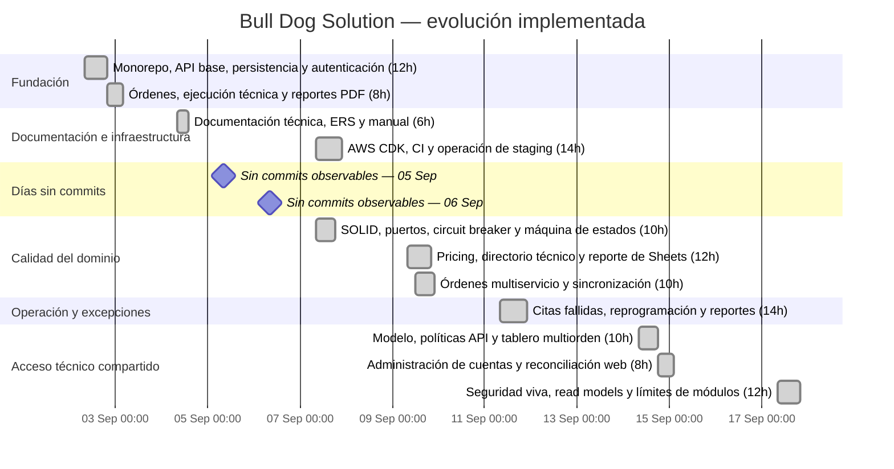

# Línea de tiempo del proyecto

Esta línea de tiempo resume la evolución implementada en el repositorio. Las fechas se obtienen del
historial Git; cuando varios commits comparten día se agrupan en una misma fase para que el diagrama
sea legible. Las horas son una **estimación de esfuerzo activo**, no horas registradas: se ponderaron
el alcance del módulo, la cantidad de commits y la ventana temporal observada. La distribución no
deja huecos dentro de cada bloque de esfuerzo.

## Diagrama de Gantt

**Esfuerzo estimado total: 116 horas.** Los bloques se leen como esfuerzo acumulado por módulo;
los días sin commits representan pausas entre sesiones, no horas de trabajo omitidas. En particular,
el 5 y 6 de septiembre quedan marcados explícitamente como días sin commits observables.

## Fases y commits representativos

| Fecha      | Fase                            | Esfuerzo | Acumulado | Commits principales                                                         | Resultado                                                                                                 |
| ---------- | ------------------------------- | -------- | --------- | --------------------------------------------------------------------------- | --------------------------------------------------------------------------------------------------------- |
| 2026-09-02 | Fundación del producto          | 20h      | 0–20h     | `cad9005`, `ffc8048`, `19d5b14`, `de75bec`, `d37c5bc`, `d2edb3a`, `4409750` | Monorepo, API, persistencia, autenticación, órdenes, ejecución técnica y reportes PDF.                    |
| 2026-09-04 | Documentación base              | 6h       | 20–26h    | `35886f4`                                                                   | Paquete inicial de documentación técnica.                                                                 |
| 2026-09-07 | Infraestructura y arquitectura  | 24h      | 26–50h    | `3a90b0b`, `7154fad`, `8c93a69`, `62d37e4`, `09624b4`, `c67a47f`            | Staging AWS, CI, operación, SOLID, inversión de dependencias y máquina de estados.                        |
| 2026-09-09 | Dominio multiservicio           | 22h      | 50–72h    | `0e43ed1`–`0239c88`, `d447a9a`, `d6b967a`                                   | Tarifas, snapshots de pricing, directorio técnico, transiciones de equipos y sincronización de reportes.  |
| 2026-09-11 | Excepciones operativas          | 14h      | 72–86h    | `64d77e3`, `ae79473`, `9742216`, `b31bedb`, `871ac21`, `e73f53a`            | Programación de reportes, citas fallidas, reprogramación y reintentos consistentes.                       |
| 2026-09-14 | Acceso compartido               | 18h      | 86–104h   | `5cefdbe`, `1acd4ed`, `39e7b19`, `b65621c`, `34d9cb2`, `7b9a9c3`, `6df839a` | Cuenta técnica compartida, tablero multiorden, permisos y administración de cuentas.                      |
| 2026-09-17 | Endurecimiento y mantenibilidad | 12h      | 104–116h  | `6fb7580`                                                                   | Principal vigente, read models seguros, reconciliación de sesión, límites de módulos y refactor frontend. |

## Hitos actuales

- **Producto funcional:** órdenes administrativas, ejecución móvil, evidencias, firma, reportes y
  sincronización con Sheets.
- **Operación avanzada:** pricing por servicio, citas fallidas y tablero de taller multiorden.
- **Seguridad:** autorización por capacidad y propiedad, principal resuelto en vivo y respuestas
  operativas sin datos administrativos.
- **Calidad:** contratos compartidos, pruebas unitarias/integración/E2E, OpenAPI validado, build y
  auditoría de dependencias de producción sin vulnerabilidades conocidas.

## Criterio de lectura

El Gantt representa días de trabajo observables en Git, no horas exactas de dedicación. Para una
auditoría fina, usar `git log --date=iso` y revisar cada hash listado en la tabla. Si se necesita un
plan operativo, estas horas pueden convertirse directamente en jornadas de 8 horas: 116 horas son
aproximadamente 14.5 jornadas efectivas.
