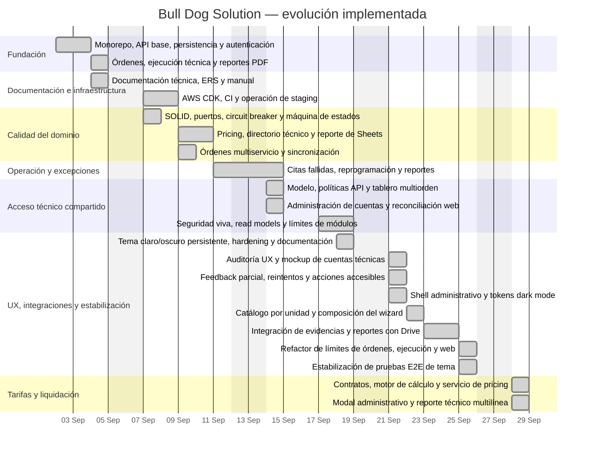

# Línea de tiempo del proyecto

Esta línea de tiempo resume la evolución implementada en el repositorio hasta el 30 de septiembre
de 2026. Las fechas históricas y los commits representativos se obtienen del historial Git. El
trabajo UX de cuentas técnicas y la limpieza de mantenibilidad ya están integrados en la rama
actual; no queda un plan laboral pendiente reflejado aquí.

**Estado de lectura (2026-10-02):** la cronología es un registro histórico cerrado al 2026-09-30;
no representa disponibilidad de staging. La documentación operativa vigente confirma que staging
fue eliminado y producción no está desplegada. Esta actualización documental no añade hitos de código.

## Diagrama de Gantt

El Gantt muestra fases por día laboral. Los fines de semana quedan fuera del calendario de trabajo y
no se agregan tareas para esos días.

## Fases y commits representativos

| Fecha      | Fase                            | Commits principales                                                         | Resultado                                                                                                                   |
| ---------- | ------------------------------- | --------------------------------------------------------------------------- | --------------------------------------------------------------------------------------------------------------------------- |
| 2026-09-02 | Fundación del producto          | `cad9005`, `ffc8048`, `19d5b14`, `de75bec`, `d37c5bc`, `d2edb3a`, `4409750` | Monorepo, API, persistencia, autenticación, órdenes, ejecución técnica y reportes PDF.                                      |
| 2026-09-04 | Documentación base              | `35886f4`                                                                   | Paquete inicial de documentación técnica.                                                                                   |
| 2026-09-07 | Infraestructura y arquitectura  | `3a90b0b`, `7154fad`, `8c93a69`, `62d37e4`, `09624b4`, `c67a47f`            | Staging AWS, CI, operación, SOLID, inversión de dependencias y máquina de estados.                                          |
| 2026-09-09 | Dominio multiservicio           | `0e43ed1`–`0239c88`, `d447a9a`, `d6b967a`                                   | Tarifas, snapshots de pricing, directorio técnico, transiciones de equipos y sincronización de reportes.                    |
| 2026-09-11 | Excepciones operativas          | `64d77e3`, `ae79473`, `9742216`, `b31bedb`, `871ac21`, `e73f53a`            | Programación de reportes, citas fallidas, reprogramación y reintentos consistentes.                                         |
| 2026-09-14 | Acceso compartido               | `5cefdbe`, `1acd4ed`, `39e7b19`, `b65621c`, `34d9cb2`, `7b9a9c3`, `6df839a` | Cuenta técnica compartida, tablero multiorden, permisos y administración de cuentas.                                        |
| 2026-09-17 | Endurecimiento y mantenibilidad | `6fb7580`                                                                   | Principal vigente, read models seguros, reconciliación de sesión, límites de módulos y refactor frontend.                   |
| 2026-09-18 | Staging y tema                  | `2abece9`, `46ffb5e`, `bf285db`                                             | Tema persistente claro/oscuro, hardening de despliegue y documentación operativa.                                           |
| 2026-09-21 | UX de cuentas técnicas          | `48d127d`, `1754850`, `6508887`                                             | Auditoría y mockup, feedback/reintentos, acciones accesibles y superficies administrativas del tema.                        |
| 2026-09-22 | UX del asistente de órdenes     | `82cfe23`, `8f1a98b`                                                        | Estado del wizard en composables y explicación de ejecución por unidad.                                                     |
| 2026-09-23 | Google Drive                    | `0f7c455`, `820b47f`, `a6e386d`                                             | Evidencias, firmas y reportes privados en Drive, organización y documentación/benchmark.                                    |
| 2026-09-25 | Mantenibilidad y estabilización | `68b769b`, `365c7b4`, `24b91fd`–`cfd7856`                                   | Separación de consultas, flujos y presentación; auditoría actualizada y aserciones E2E de tema estabilizadas.               |
| 2026-09-28 | Tarifas y liquidación dinámica  | `bfb0608`–`48c05cc`                                                         | Contratos de pricingOverrides, motor decimal puro, OrderPricingService, modal administrativo y costo multilínea en reporte. |

## Hitos actuales

- **Producto funcional:** órdenes administrativas, ejecución móvil, evidencias, firma, reportes y
  sincronización con Sheets.
- **Operación avanzada:** pricing por servicio, citas fallidas y tablero de taller multiorden.
- **Seguridad:** autorización por capacidad y propiedad, principal resuelto en vivo y respuestas
  operativas sin datos administrativos.
- **Calidad:** contratos compartidos, pruebas unitarias/integración/E2E, OpenAPI validado, build y
  auditoría de dependencias de producción sin vulnerabilidades conocidas.
- **UX y estabilización:** los cambios de cuentas técnicas y del asistente están integrados; las
  pruebas E2E del tema fueron ajustadas para tolerar diferencias de Chromium.
- **Mantenibilidad:** limpieza prioritaria reportada y verificada; las limitaciones y deuda residual
  permanecen explícitas en `docs/maintainability-audit.md`.

## Criterio de lectura

El Gantt representa días de trabajo observables en Git y tareas UX planificadas. Para una auditoría
histórica, usar `git log --date=iso` y revisar cada hash listado en la
tabla. El trabajo del 21 de septiembre se identifica explícitamente como rama activa sin commit.
