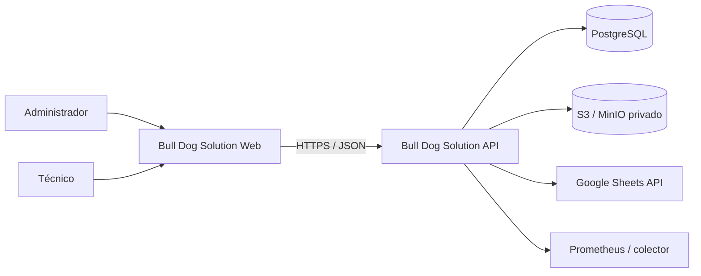
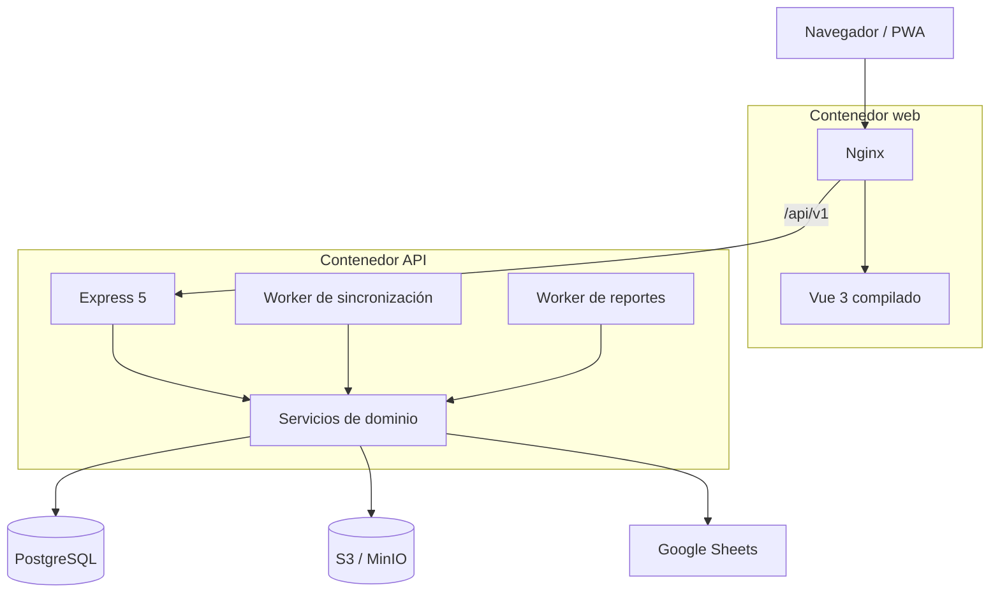
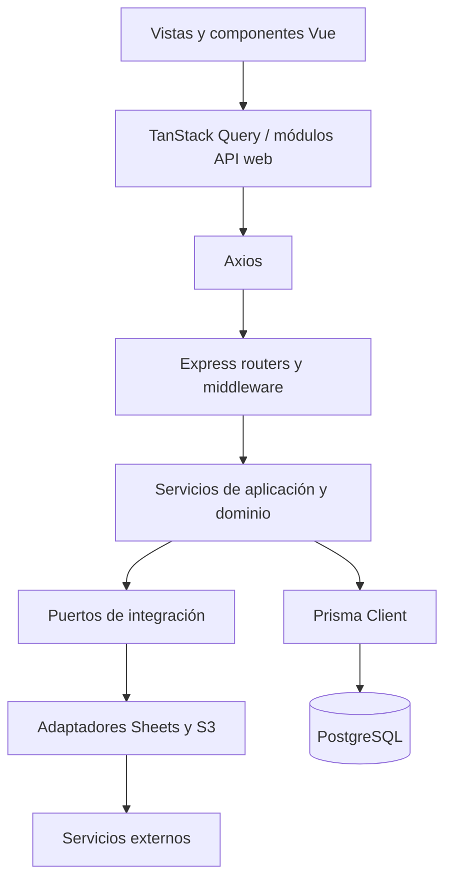

# Arquitectura

## Resumen

Bull Dog Solution es un monorepo TypeScript con un frontend Vue y una API Express desplegables por separado. La API implementa un monolito modular: autenticación, órdenes, ejecución técnica, catálogos, sincronización, archivos y reportes comparten proceso y base de datos, pero están separados por módulos de dominio.

PostgreSQL conserva el estado transaccional. Google Sheets sigue siendo la fuente externa de clientes y equipos. Las fotografías, firmas y PDFs viven en almacenamiento compatible con S3; PostgreSQL guarda únicamente metadatos y claves de objeto.

## Diagrama de contexto



## Contenedores desplegables



En AWS, Nginx y Express viven en la misma tarea Fargate y Nginx puede alcanzar la API en `127.0.0.1:3000`. En Docker Compose viven en contenedores distintos; PostgreSQL y MinIO usan volúmenes persistentes y `minio-init` crea el bucket y bloquea el acceso anónimo. La topología detallada y la divergencia conocida del proxy local están documentadas en [Infraestructura y operación](./infrastructure-and-operations.md).

## Capas lógicas



### Responsabilidades

- El frontend coordina navegación, formularios, cámara, firma, estados de carga y consumo HTTP.
- Los routers autentican, autorizan, validan y traducen HTTP; no deben contener reglas de negocio.
- Los servicios validan estados, propiedad, concurrencia y efectos del dominio.
- Prisma implementa persistencia y transacciones.
- Los puertos aíslan SDKs y siguen segregación de interfaces (ISP): `SheetsPort`, `ObjectStoragePort`, `EquipmentCatalogPort`, `ClientCatalogPort`, `CatalogServicePort` y `ReportGeneratorPort`.
- La resiliencia de integración aplica el patrón Decorator con `CircuitBreaker` configurable y telemetría hacia Prometheus.
- `packages/contracts` comparte esquemas Valibot y tipos de entrada entre API y web.

## Estructura del monorepo

```text
apps/
├── api/                 API, workers, integraciones y OpenAPI
└── web/                 SPA/PWA Vue
packages/
├── contracts/           DTOs y validaciones compartidas
├── eslint-config/       reglas de lint
└── typescript-config/   configuraciones TS compartidas
prisma/                  esquema, migraciones y seed
infra/docker/            imágenes de API/web y Nginx
infra/cdk/               stacks de staging en AWS
infra/scripts/           migración, respaldo, restore, smoke y E2E
.github/workflows/       CI y despliegue continuo de staging
docs/                    requisitos, decisiones y documentación técnica
```

## Decisiones arquitectónicas vigentes

- Monolito modular antes que microservicios.
- Catálogos externos con snapshots locales dentro de la orden.
- Escrituras a Sheets mediante outbox persistente y reintentos.
- Carga directa de evidencias a S3 usando URLs prefirmadas.
- Reportes PDF generados en segundo plano y versionados mediante abstracción `ReportGeneratorPort`.
- Ciclo de vida y transiciones de orden gobernados por una máquina de estados de dominio explícita (`order-state-machine`).
- Validación de cierre y completitud técnica desacoplada mediante patrón de especificación pura (`order-completeness`).
- Tolerancia a fallos en adaptadores externos (Sheets y S3) protegida por Circuit Breaker con estados CLOSED, OPEN y HALF-OPEN.
- JWT de acceso en memoria del navegador; refresh token en cookie HTTP-only.
- TanStack Query para estado remoto; Pinia se limita a sesión y estado global de UI.
- Mocks de Sheets, almacenamiento y claves JWT únicamente en desarrollo con valores `development-only`.
- Staging definido como infraestructura inmutable en dos stacks CDK: foundation para estado/red y application para cómputo/entrega.
