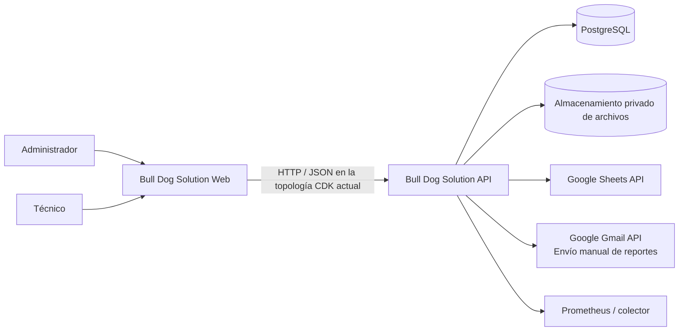
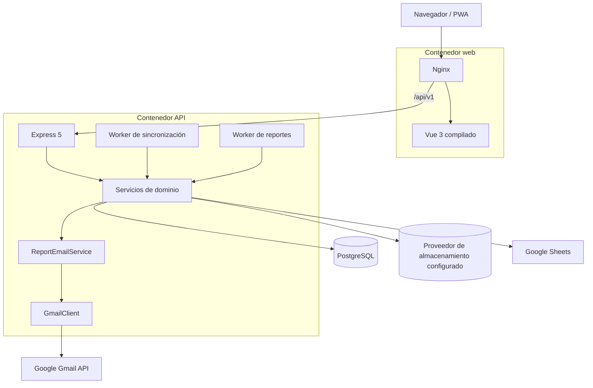
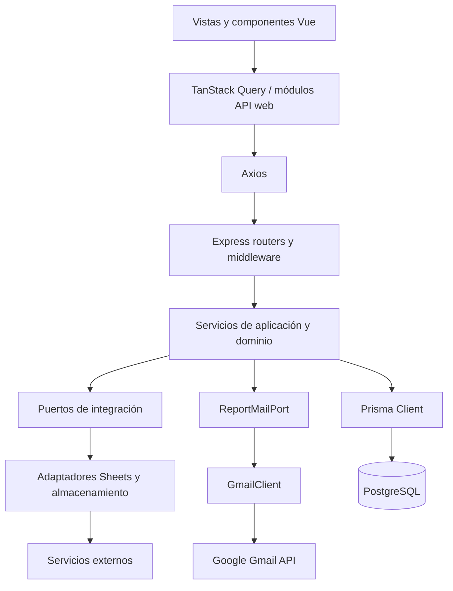

# Arquitectura

## Resumen

Bull Dog Solution es un monorepo TypeScript con un frontend Vue y una API Express desplegables por separado. La API implementa un monolito modular: autenticación, órdenes, ejecución técnica, catálogos, sincronización, archivos y reportes comparten proceso y base de datos, pero están separados por módulos de dominio.

PostgreSQL conserva el estado transaccional, incluyendo contactos de correo por cliente. Google Sheets sigue siendo la fuente externa de clientes y equipos. La IaC local configura Google Drive compartido para fotografías, firmas y PDFs, pero staging está eliminado/no desplegado y Drive aún requiere configuración y validación antes de volver a desplegar; el último inventario histórico observó S3. El adaptador de almacenamiento de objetos permanece en el código para compatibilidad y otros entornos. Gmail permite el envío manual del PDF cuando la API está configurada; no hay envío automático. Producción no tiene infraestructura propia y CDK todavía no inyecta credenciales Gmail.

## Diagrama de contexto



## Contenedores desplegables



La topología CDK declarada usa ECS sobre EC2 con tareas en modo `bridge`: Nginx y Express comparten la tarea, y Nginx llega a la API mediante el enlace de contenedor `api` en el puerto 3000. El host publica HTTP por el puerto 80, sin TLS; esta infraestructura no está desplegada actualmente y no debe usarse con datos reales. Docker Compose ofrece MinIO como proveedor local de desarrollo, no como modelo del almacenamiento en staging. La topología detallada, su estado y las diferencias del proxy local están documentados en [Infraestructura y operación](./infrastructure-and-operations.md).

### Despliegue y migraciones

El workflow de staging espera un CI exitoso sobre `main`, y sólo despliega si la variable `AWS_STAGING_READY` vale exactamente `true`. En la revisión validada ejecuta `pnpm infra:deploy`; staging está eliminado/no desplegado, por lo que esta automatización no implica que haya un entorno disponible.

Durante el build Docker, las imágenes de API y migración generan Prisma Client usando una URL ficticia de compilación; la generación no se conecta a la base de datos real ni ejecuta migraciones. Cuando inicia una nueva tarea ECS, el contenedor de migración ejecuta `prisma migrate deploy` y luego el seed. La API espera que la migración termine con éxito y la web espera a que la API esté saludable. Sólo se aplican migraciones pendientes versionadas en `prisma/migrations/`: cambiar únicamente `prisma/schema.prisma` no modifica la base de datos. Un despliegue sólo de código no cambia el esquema si no hay migraciones pendientes. Las migraciones deben ser compatibles con la versión previa de la aplicación durante el reemplazo de tareas; un rollback de ECS no revierte los cambios ya aplicados a la base.

## Capas lógicas



### Responsabilidades

- El frontend coordina navegación, formularios, cámara, firma, estados de carga y consumo HTTP.
- Los routers autentican, autorizan, validan y traducen HTTP; no deben contener reglas de negocio.
- Los servicios validan estados, propiedad, concurrencia y efectos del dominio.
- Prisma implementa persistencia y transacciones.
- Los puertos aíslan SDKs y siguen segregación de interfaces (ISP): `SheetsPort`, `ObjectStoragePort`, `EquipmentCatalogPort`, `ClientCatalogPort`, `CatalogServicePort` y `ReportGeneratorPort`.
- La resiliencia de integración aplica el patrón Decorator con `CircuitBreaker` configurable y telemetría hacia Prometheus.
- `packages/contracts` comparte esquemas Valibot y tipos de entrada entre API y web.

## Estructura del monorepo

```text
apps/
├── api/                 API, workers, integraciones y OpenAPI
└── web/                 SPA/PWA Vue
packages/
├── contracts/           DTOs y validaciones compartidas
├── eslint-config/       reglas de lint
└── typescript-config/   configuraciones TS compartidas
prisma/                  esquema, migraciones y seed
infra/docker/            imágenes de API/web y Nginx
infra/cdk/               stacks de staging en AWS
infra/scripts/           migración, respaldo, restore, smoke y E2E
.github/workflows/       CI y despliegue continuo de staging
docs/                    requisitos, decisiones y documentación técnica
```

## Decisiones arquitectónicas vigentes

- Monolito modular antes que microservicios.
- Catálogos externos con snapshots locales dentro de la orden.
- Escrituras a Sheets mediante outbox persistente y reintentos.
- Almacenamiento privado de evidencias, firmas y reportes detrás de adaptadores de proveedor.
- Reportes PDF generados en segundo plano y versionados mediante abstracción `ReportGeneratorPort`.
- Envío manual por Gmail separado de la generación del PDF; destinatarios provienen de `ClientEmail`, y la identidad del remitente se configura en la API.
- Ciclo de vida y transiciones de orden gobernados por una máquina de estados de dominio explícita (`order-state-machine`).
- Validación de cierre y completitud técnica desacoplada mediante patrón de especificación pura (`order-completeness`).
- Tolerancia a fallos en adaptadores externos (Sheets y almacenamiento) protegida por Circuit Breaker con estados CLOSED, OPEN y HALF-OPEN.
- JWT de acceso en memoria del navegador; refresh token en cookie HTTP-only.
- TanStack Query para estado remoto; Pinia se limita a sesión y estado global de UI.
- Mocks de Sheets, almacenamiento y claves JWT únicamente en desarrollo con valores `development-only`.
- Staging descrito en dos stacks CDK: foundation para estado/red y application para cómputo/entrega. Los stacks no están desplegados actualmente; verificar estado y diff antes de operar.

## Estado implementado al 2026-10-12

- El acceso técnico compartido se modela como configuración versionada y auditable; las políticas
  distinguen ejecución individual de tablero multiorden.
- Cada request protegido resuelve el principal vigente desde PostgreSQL. El JWT identifica la
  sesión, pero no es la fuente final de actividad ni de rol.
- Las respuestas de detalle de órdenes usan read models explícitos: el detalle administrativo y el
  detalle operativo tienen selects, mapeadores y contratos separados.
- La web reconcilia la identidad con `/auth/me` al navegar, recuperar foco y actualizar el tablero;
  las APIs de cuentas técnicas viven fuera del módulo `orders`.
- Las consultas de órdenes, la reprogramación de citas fallidas, la finalización y los medios de
  ejecución, el almacenamiento de reportes y varios flujos de la web tienen límites dedicados; sus
  servicios/vistas públicas conservan fachadas y contratos compatibles. El alcance y la deuda
  residual se detallan en la [auditoría de mantenibilidad](../maintainability-audit.md).
- Evidencias, firmas y reportes usan el proveedor configurado; Google Drive está integrado y el
  adaptador de objetos se conserva para entornos que lo seleccionen. Drive está configurado en la
  IaC local, pero falta validar sus credenciales y recursos antes de un redeploy. Cada proveedor
  mantiene sus protocolos de permisos, reintento y confirmación.
- El envío manual de reportes utiliza Gmail con delegación de dominio y las variables `GOOGLE_GMAIL_*`;
  `GOOGLE_GMAIL_SENDER_EMAIL` es el usuario suplantado y el encabezado `From`. CDK aún no pasa estas
  variables a la tarea, por lo que esta integración no está disponible en AWS hasta conectar el secret mapping.
- Las tarifas de órdenes admiten personalización acordada previa y ajuste contable post-cierre
  mediante `OrderPricingService` y cálculo puro en `pricing.ts`, con precisión arbitraria, auditoría,
  versiones contables y publicación multilínea en la columna de costo del reporte técnico de Sheets.

La secuencia histórica de implementación y sus commits está en la [línea de tiempo del proyecto](../project-timeline.md).
