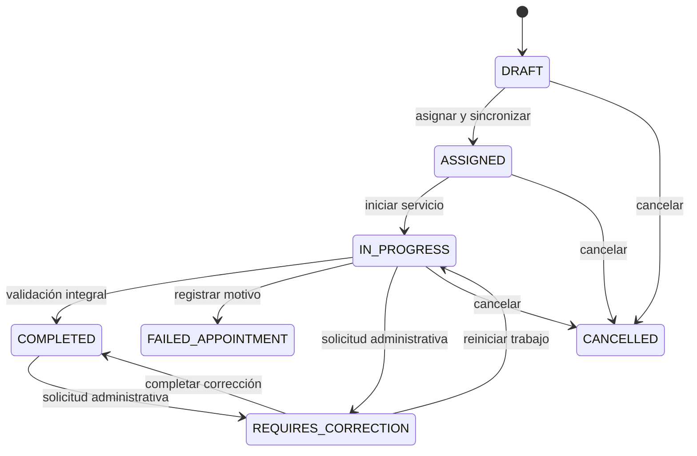
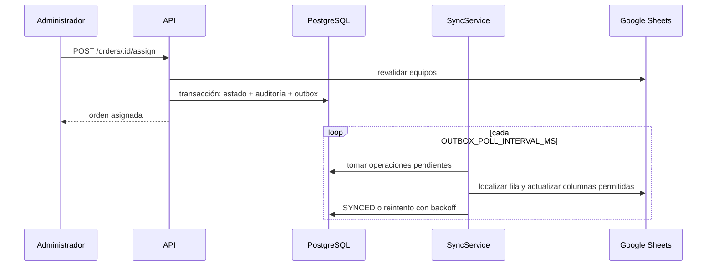
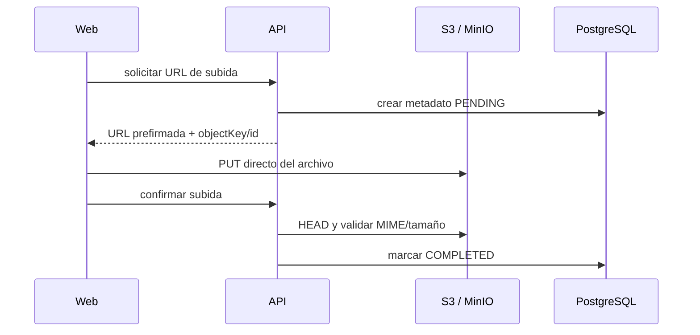
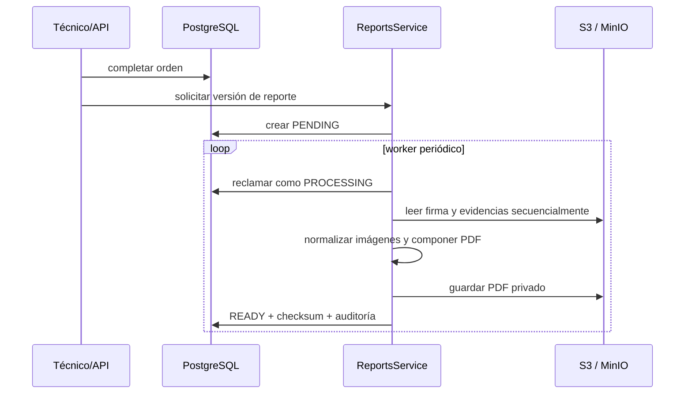

# Backend y flujos

## Módulos de la API

| Módulo                  | Responsabilidad                                                            |
| ----------------------- | -------------------------------------------------------------------------- |
| `auth`                  | login, refresh, revocación y consulta de sesión                            |
| `users` / `technicians` | administración local y auditoría                                           |
| `catalogs`              | consulta y caché de clientes/equipos de Sheets                             |
| `orders`                | borradores, unidades, equipos, asignación, cancelación y outbox            |
| `execution`             | inicio, verificación, discrepancias, checklist, evidencias, firma y cierre |
| `reports`               | generación, versionado y descarga privada del PDF                          |
| `health`                | liveness y readiness                                                       |
| `observability`         | logs estructurados y métricas                                              |

## Ciclo de una orden

Para completar normalmente se validan equipos, cinco categorías de checklist, un mínimo de tres fotografías por unidad y firma con nombre. Una discrepancia documentada no bloquea el cierre. La cita fallida omite checklist, fotos y firma.

## Asignación y sincronización con Sheets

Las operaciones fallidas almacenan intentos, código/mensaje y siguiente fecha. El administrador puede devolverlas a `PENDING`. Google Sheets no se consulta para reconstruir órdenes cerradas: los equipos conservan snapshots.

### Creación atómica y validación de conflictos

- `POST /orders` permite la creación atómica de la cabecera de la orden junto con sus unidades iniciales y equipos vinculados dentro de una misma transacción de dominio (`domainTransaction`).
- Antes de confirmar la asignación (`POST /orders/:id/assign`), el backend ejecuta una revalidación fresca contra Google Sheets.
- Para evitar falsos positivos de conflicto (`409 SHEET_ROW_CONFLICT`), la coincidencia de cliente entre la hoja y la orden aplica `isMatchingClient` y `normalizeString`. Esto asegura que diferencias de mayúsculas/minúsculas, acentos, espacios múltiples o sufijos corporativos (como `S.A. de C.V.`) no bloqueen la asignación de hardware que legítimamente pertenece al cliente. Solo se emite conflicto si el equipo en Sheets está asignado a una empresa completamente ajena.

## Carga de fotografías y firma

Las claves siguen los prefijos `orders/{orderId}/units/...`, `orders/{orderId}/signature/...` y `orders/{orderId}/reports/...`. La base nunca almacena bytes ni Base64.

## Generación de reporte PDF

PDFKit compone páginas Carta; Sharp corrige orientación y normaliza imágenes. Una evidencia por página ocupa el área útil sin mostrar la categoría del checklist. Un proceso `PROCESSING` abandonado por más de diez minutos vuelve a `PENDING`. Los errores públicos se sanitizan y un reintento no duplica la versión vigente.

## Transacciones y auditoría

`domainTransaction` reúne mutaciones del dominio, auditorías y registros de outbox en una transacción Prisma. Acciones como creación, asignación, cierre, captura de evidencia, generación y descarga de reporte dejan eventos identificables. Los controladores no escriben directamente salvo consultas administrativas puntuales.
