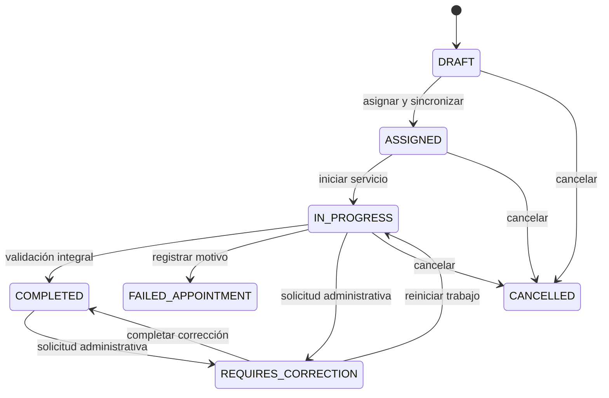
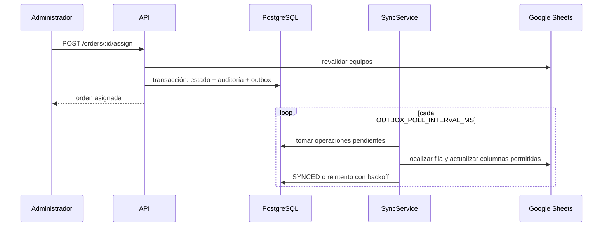
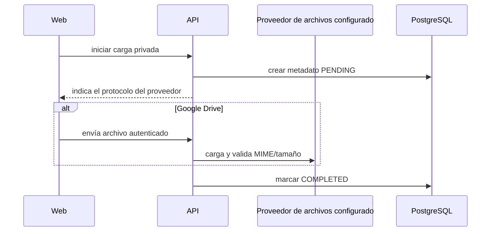
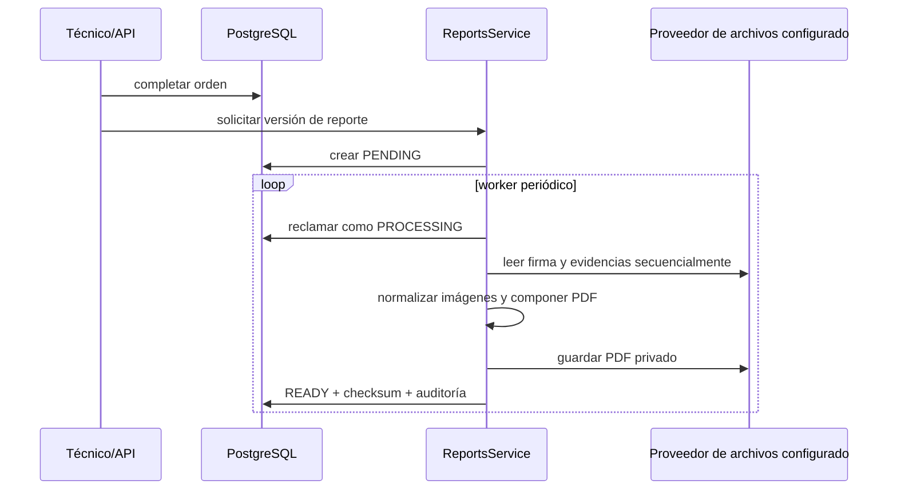

# Backend y flujos

## Módulos de la API

| Módulo                     | Responsabilidad                                                                |
| -------------------------- | ------------------------------------------------------------------------------ |
| `auth`                     | login, refresh, revocación y consulta de sesión                                |
| `administration`           | gestión administrativa unificada de usuarios y técnicos (con DI)               |
| `shared-technician-access` | configuración auditable del acceso compartido y consulta del modo de acceso    |
| `catalogs`                 | consulta y caché de clientes/equipos de Sheets                                 |
| `clients`                  | registro local de clientes validados contra Sheets y sus correos destinatarios |
| `orders`                   | borradores, unidades, equipos, asignación, cancelación y outbox                |
| `execution`                | inicio, verificación, discrepancias, checklist, evidencias, firma y cierre     |
| `reports`                  | generación, versionado, descarga privada y envío manual por correo del PDF     |
| `health`                   | liveness y readiness                                                           |
| `observability`            | logs estructurados y métricas                                                  |

Dentro de `orders`, `reschedule-failed-appointment.ts` concentra la resolución de una cita fallida y la clonación de la orden dentro de una sola transacción de dominio; `OrdersService` conserva la API pública del módulo. En `execution`, `OrderFinalizationService` concentra validación de completitud, cierre, cita fallida y corrección, mientras `ExecutionService` conserva la fachada pública y los flujos de evidencias y firma. Ambos servicios comparten la carga de la orden con autorización mediante `execution-order-access.ts`.

### Acceso a órdenes técnicas

La API aplica `assertOrderAccess` en operaciones de lectura y ejecución. El modo individual limita
al técnico a sus propias órdenes. La cuenta TECHNICIAN compartida designada recibe acceso sólo a la
orden explícitamente habilitada en `SharedTechnicianAccess`; habilitarla no cambia `Order.technicianId`
y no abre el resto del catálogo. La configuración permite una sola orden, valida que sea ejecutable,
usa `revision` para control optimista y registra cambios/revocaciones en auditoría.

## Ciclo de una orden

El ciclo de vida está formalizado en una máquina de estados determinista (`order-state-machine.ts`), que define el grafo de transiciones permitidas y valida invariantes de dominio (`assertValidOrderTransition`, `assertCanEditOrder`, `assertCanModifyUnits`, `assertCanExecuteWork`).

### Validación de completitud (Specification Pattern)

Para completar normalmente una orden se evalúa la regla de dominio pura mediante `evaluateOrderCompleteness`:

1. Al menos una unidad registrada.
2. Todos los equipos verificados (`MATCHED` o `DISCREPANCY_REPORTED`). Una discrepancia documentada no bloquea el cierre.
3. Checklist completo con las 5 categorías obligatorias (`DASHBOARD`, `WINDOWS`, `ACCESSORIES`, `TRIMS`, `BODYWORK`).
4. Mínimo 10 fotografías de evidencia completadas por unidad. Se almacenan como galería de unidad y no están ligadas a categorías del checklist.
5. Firma digital y nombre de conformidad del cliente.

La cita fallida omite checklist, fotos y firma.

### Notas de ejecución

Las notas capturadas durante el trabajo se almacenan en `Order.generalNotes` como una nota general
de la orden. `PATCH /orders/:id/execution-notes` permite guardarlas mientras la orden está en
`IN_PROGRESS`, genera la auditoría `EXECUTION_NOTES_UPDATED` y acepta hasta 5000 caracteres. Si la
vista tiene cambios pendientes al solicitar el cierre, los guarda antes de ejecutar
`POST /orders/:id/complete`. No existe todavía una nota independiente por unidad.

## Asignación y sincronización con Sheets

Las operaciones fallidas almacenan intentos, código/mensaje y siguiente fecha. El administrador puede devolverlas a `PENDING`. Google Sheets no se consulta para reconstruir órdenes cerradas: los equipos conservan snapshots.

Al completar una orden, el backend vuelve a encolar el estado final de cada equipo de forma
inmediata. El reporte técnico queda programado en el outbox para la ventana semanal configurada.
Por defecto, el corte es el martes al final del día y la publicación ocurre el miércoles a las
17:00 en `America/Hermosillo`. Una orden cerrada después del corte pasa a la ventana de la semana
siguiente. El administrador puede modificar corte, día, hora y zona horaria desde el tablero de
sincronización; las operaciones todavía no intentadas se recalculan al guardar.

La sincronización final de equipos es idempotente y corrige una asignación inicial
omitida o desactualizada: instalación, revisión y sensor fuel conservan cliente y vehículo con
estado `INSTALADO`; desinstalación devuelve el equipo a `STOCK TECNICO` y limpia cliente y
vehículo; y cambio de equipo hace lo mismo con el anterior antes de instalar el nuevo. Una cita
fallida no modifica el inventario.

Los fallos posteriores al inicio de una ventana usan el backoff normal del outbox y no esperan otra
semana. Una ejecución manual establece la operación como disponible inmediatamente. Cuando una
corrección genera una versión nueva del reporte, las versiones pendientes anteriores se marcan
como `SUPERSEDED` para no escribir dos veces el mismo folio.

### Creación atómica y validación de conflictos

- `POST /orders` permite la creación atómica de la cabecera de la orden junto con sus unidades iniciales y equipos vinculados dentro de una misma transacción de dominio (`domainTransaction`).
- Antes de confirmar la asignación (`POST /orders/:id/assign`), el backend ejecuta una revalidación fresca contra Google Sheets.
- Para evitar falsos positivos de conflicto (`409 SHEET_ROW_CONFLICT`), la coincidencia de cliente entre la hoja y la orden aplica `isMatchingClient` y `normalizeString`. Esto asegura que diferencias de mayúsculas/minúsculas, acentos, espacios múltiples o sufijos corporativos (como `S.A. de C.V.`) no bloqueen la asignación de hardware que legítimamente pertenece al cliente. Solo se emite conflicto si el equipo en Sheets está asignado a una empresa completamente ajena.

## Tarifas dinámicas y liquidación de órdenes

El cálculo de liquidación y costos de las órdenes se gestiona mediante componentes desacoplados de alta precisión:

### Motor de cálculo financiero (`pricing.ts`)

- Utiliza aritmética de precisión arbitraria (`Prisma.Decimal` / `decimal.js`) con redondeo `ROUND_HALF_UP` a dos decimales.
- Determina el costo base por unidad multiplicando la tarifa del servicio por la cantidad de equipos (o tarifa única en reemplazo de equipos).
- Aplica viáticos / costo de salida según la configuración de la orden o tarifas del técnico.
- Genera el desglose estructurado `pricingBreakdown` congelado al completar la orden.

### Servicio de ajuste: `OrderPricingService`

- Permite la sobreescritura de tarifas acordadas (`pricingOverrides`) por administradores (`orders:manage`).
- **Órdenes no finalizadas y no canceladas:** guarda los overrides para ser tomados durante el cierre y emite auditoría `ORDER_PRICING_CONFIGURED`.
- **Órdenes finalizadas (`COMPLETED`, `FAILED_APPOINTMENT`):** ejecuta recálculo financiero completo, incrementa `pricingVersion`, actualiza snapshots de precios y encola la re-sincronización hacia Google Sheets invalidando versiones previas (`SUPERSEDED`), registrando auditoría `ORDER_PRICING_ADJUSTED`.

### Formato en Reporte Técnico de Google Sheets (`technical-report-formatter.ts`)

- Para órdenes multiservicio o con múltiples unidades (excluyendo citas fallidas), las columnas F (`economico`), G (`serie`), H (`imeiId`), K (`servicio`) y L (`costo`) se sincronizan renglón por renglón usando saltos de línea (`\n`).
- La columna L (`costo`) desglosa el costo correspondiente a cada unidad en estricto orden cronológico alineado con el servicio, preservando la coherencia visual y contable en la hoja de cálculo.

## Carga de fotografías y firma

Las referencias siguen una identidad estable por evidencia, firma o reporte; Google Drive resuelve su ubicación física. La base nunca almacena bytes ni Base64. La API recibe, valida y transmite las cargas autenticadas; no existen flujos de URLs prefirmadas.

Drive compartido es el único proveedor de archivos configurado. AWS staging está eliminado y no existe producción desplegada.

## Generación de reporte PDF

PDFKit compone páginas Carta; Sharp corrige orientación y normaliza imágenes. Una evidencia por página ocupa el área útil sin mostrar la categoría del checklist. Un proceso `PROCESSING` abandonado por más de diez minutos vuelve a `PENDING`. Los errores públicos se sanitizan y un reintento no duplica la versión vigente.
`ReportsService` carga la orden y conserva la transición `READY` y su auditoría; `report-storage.ts` gestiona la reserva/reutilización de IDs en Drive o el almacenamiento del proveedor de objetos. En Drive el checksum se calcula sobre los bytes remotos cuando se reutiliza un archivo.

### Envío manual de reportes por Gmail

El envío se inicia desde la vista web; completar una orden no envía correo. El backend obtiene las
direcciones seleccionadas de los correos asociados al cliente y entrega el PDF mediante Gmail. La
cuenta de servicio suplantada usa el scope `https://www.googleapis.com/auth/gmail.send`, autorizado
por el superadministrador de Workspace para la delegación de dominio. `GOOGLE_GMAIL_SENDER_EMAIL`
define tanto el usuario suplantado como el encabezado `From`; modificarlo requiere reiniciar la API.
El envío puede suplantar cualquier usuario activo del dominio autorizado.

La auditoría registra `SERVICE_ORDER_REPORT_EMAIL_ATTEMPTED`, `SERVICE_ORDER_REPORT_EMAIL_SENT` y
`SERVICE_ORDER_REPORT_EMAIL_FAILED`. `SENT` significa que Gmail aceptó el mensaje y devolvió un ID,
no que la entrega al buzón esté confirmada. Un fallo queda como no confirmado y puede requerir
revisión de la carpeta Enviados antes de un reintento. Ver [entrega de reportes por correo](../report-email-delivery.md).

En AWS la integración aún no está habilitada: CDK no mapea las variables `GOOGLE_GMAIL_*` al task
definition. Agregar credenciales al secreto no basta; hay que actualizar ese mapeo antes de desplegar.

## Transacciones y auditoría

`domainTransaction` reúne mutaciones del dominio, auditorías y registros de outbox en una transacción Prisma. Acciones como creación, asignación, cierre, captura de evidencia, generación y descarga de reporte dejan eventos identificables. Los controladores no escriben directamente salvo consultas administrativas puntuales.
`ExecutionService` conserva la API pública de ejecución; delega cierre y corrección a `OrderFinalizationService`, y evidencias/firmas a `ExecutionMediaService`. Los protocolos Drive y el adaptador de objetos permanecen explícitos para preservar permisos, reservas y confirmaciones diferentes.
`OrdersQueryService` concentra las lecturas de listado, detalle administrativo y técnico, y auditoría. `OrdersService` conserva métodos públicos delegados para mantener los routers y consumidores existentes; el helper de creación de equipos permanece junto a los comandos que lo usan.

## Resiliencia y Circuit Breaker

Para proteger la aplicación ante degradaciones o caídas en servicios de terceros (Google Sheets y almacenamiento), los adaptadores se envuelven mediante el patrón Decorator (`CircuitBreakerSheetsPort` y `CircuitBreakerStoragePort`):

- **Estados de circuito**: `CLOSED` (operación normal), `OPEN` (fallo rápido inmediato sin saturar la red externa) y `HALF_OPEN` (prueba controlada de recuperación).
- **Parámetros configurables**: Umbral de fallos consecutivos (`CIRCUIT_BREAKER_ERROR_THRESHOLD`, por defecto 5) y tiempo de espera antes de reintento (`CIRCUIT_BREAKER_RESET_TIMEOUT_MS`, por defecto 30,000 ms).
- **Telemetría**: Cada transición de estado actualiza la métrica Prometheus `puk_circuit_breaker_state{circuit="..."}` para observabilidad y alertas operativas.
