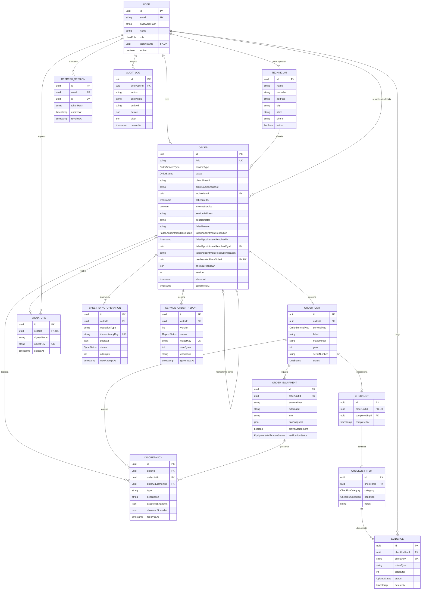

# Modelo de datos

## Diagrama entidad-relación

## Agregado principal

`Order` es la raíz del agregado operativo. Conserva el cliente como snapshot y contiene unidades.
La API exige un técnico activo desde la creación; la relación en base de datos permanece nullable
para conservar órdenes históricas sin técnico. Cada unidad tiene su propio tipo de servicio y agrupa
equipos, checklist, fotografías y discrepancias, lo que permite órdenes multiservicio. La orden
conserva el precio congelado y un desglose por servicio en `pricingBreakdown`. La firma se captura
una vez por orden. Sincronizaciones y reportes son efectos versionados relacionados con la orden.

Una cita fallida permanece como resultado histórico y facturable. Su resolución administrativa se
registra mediante `FailedAppointmentResolution`: `CANCELLED` cierra el servicio y `RESCHEDULED`
crea una nueva orden enlazada mediante `rescheduledFromOrderId`. La nueva orden comienza en
`DRAFT`, copia cliente, servicio, técnico, unidades y snapshots de equipos, y reinicia todos los
datos de ejecución.

## Enumeraciones de estado

| Entidad                    | Estados                                                                                                   |
| -------------------------- | --------------------------------------------------------------------------------------------------------- |
| Orden                      | `DRAFT`, `ASSIGNED`, `IN_PROGRESS`, `REQUIRES_CORRECTION`, `COMPLETED`, `FAILED_APPOINTMENT`, `CANCELLED` |
| Unidad                     | `PENDING`, `IN_PROGRESS`, `COMPLETED`                                                                     |
| Verificación               | `PENDING`, `MATCHED`, `DISCREPANCY_REPORTED`                                                              |
| Evidencia                  | `PENDING`, `COMPLETED`, `REJECTED`, `DELETED`                                                             |
| Sincronización             | `PENDING`, `PROCESSING`, `SYNCED`, `FAILED`                                                               |
| Reporte                    | `PENDING`, `PROCESSING`, `READY`, `FAILED`                                                                |
| Resolución de cita fallida | `CANCELLED`, `RESCHEDULED`                                                                                |

## Restricciones relevantes

- `Order.folio` es único.
- Un usuario solo puede vincularse con un técnico.
- El número de serie de una unidad es único dentro de su orden.
- Solo existe un checklist y una firma por unidad/orden respectivamente.
- Cada categoría aparece una sola vez en cada checklist.
- Las claves de evidencia, firma y reporte son únicas en almacenamiento.
- El par `(orderId, version)` identifica una versión de reporte.
- `idempotencyKey` impide duplicar operaciones de sincronización.
- Una restricción parcial de migración impide asignar simultáneamente el mismo `externalKey` a más de una orden activa.
- `Order.version` implementa concurrencia optimista para edición administrativa.
- `Order.rescheduledFromOrderId` es único, por lo que una cita fallida solo puede originar una
  reprogramación.
- La base restringe las resoluciones administrativas a órdenes cuyo estado es
  `FAILED_APPOINTMENT`.

## Eliminación y retención

Unidades, checklist, items, evidencias, firmas y reportes usan cascada al eliminar su padre. Usuarios y técnicos usan restricciones o `SET NULL` para conservar trazabilidad. La aplicación normalmente cancela o elimina lógicamente evidencias; no expone eliminación física de órdenes como operación habitual.
