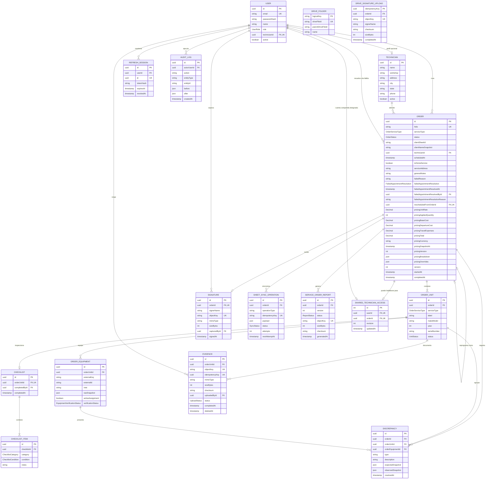

# Modelo de datos

**Estado:** esquema relacional documentado según `prisma/schema.prisma` (revisado 2026-10-02).
Las referencias de almacenamiento son opacas y dependen del proveedor; Drive usa IDs de archivo y
una tabla de mapeo de carpetas. La base conserva metadatos, no bytes.

## Diagrama entidad-relación

## Agregado principal

`Order` es la raíz del agregado operativo. Conserva el cliente y el técnico como snapshots, y contiene
unidades. La API exige un técnico activo para crear/asignar, pero la relación puede ser nullable por
compatibilidad con registros históricos. Cada unidad tiene su tipo de servicio, equipos, checklist,
fotografías (`Evidence`) y discrepancias. Las evidencias pertenecen directamente a la unidad, no a los
items del checklist; las cinco categorías del checklist se almacenan independientemente. La orden
conserva los importes y el desglose congelados (`pricing*`, `pricingBreakdown`), así como los overrides
acordados (`pricingOverrides`). El servicio administrativo puede reajustar una orden cerrada,
incrementar `pricingVersion`, auditar y encolar una nueva publicación. La firma se captura una vez por
orden. Sincronizaciones y reportes son efectos versionados relacionados con la orden.

`SharedTechnicianAccess` es una configuración de control de acceso singleton (ID 1), con una cuenta
TECHNICIAN designada y, opcionalmente, una orden ejecutable habilitada. `revision` evita actualizaciones
obsoletas; cambiar la cuenta también limpia la orden habilitada. La cuenta y la orden son relaciones
opcionales para poder revocar el acceso.

Una cita fallida permanece como resultado histórico y facturable. Su resolución administrativa se
registra mediante `FailedAppointmentResolution`: `CANCELLED` cierra el servicio y `RESCHEDULED`
crea una nueva orden enlazada mediante `rescheduledFromOrderId`. La nueva orden comienza en
`DRAFT`, copia cliente, servicio, técnico, unidades y snapshots de equipos, y reinicia todos los
datos de ejecución.

## Enumeraciones de estado

| Entidad                    | Estados                                                                                                   |
| -------------------------- | --------------------------------------------------------------------------------------------------------- |
| Orden                      | `DRAFT`, `ASSIGNED`, `IN_PROGRESS`, `REQUIRES_CORRECTION`, `COMPLETED`, `FAILED_APPOINTMENT`, `CANCELLED` |
| Unidad                     | `PENDING`, `IN_PROGRESS`, `COMPLETED`                                                                     |
| Verificación               | `PENDING`, `MATCHED`, `DISCREPANCY_REPORTED`                                                              |
| Evidencia                  | `PENDING`, `COMPLETED`, `REJECTED`, `DELETED`                                                             |
| Sincronización             | `PENDING`, `PROCESSING`, `SYNCED`, `FAILED`                                                               |
| Reporte                    | `PENDING`, `PROCESSING`, `READY`, `FAILED`                                                                |
| Resolución de cita fallida | `CANCELLED`, `RESCHEDULED`                                                                                |

## Restricciones relevantes

- `Order.folio` es único.
- Un usuario solo puede vincularse con un técnico.
- El número de serie de una unidad es único dentro de su orden.
- Solo existe un checklist por unidad y una firma por orden.
- La configuración singleton de acceso compartido mantiene a lo sumo una cuenta y una orden activas;
  su elegibilidad y sincronización con el estado de la orden también se valida en el dominio.
- Cada categoría aparece una sola vez en cada checklist.
- Las claves de evidencia, firma y reporte son únicas en almacenamiento.
- El par `(orderId, version)` identifica una versión de reporte.
- `idempotencyKey` impide duplicar operaciones de sincronización.
- Una restricción parcial de migración impide asignar simultáneamente el mismo `externalKey` a más de una orden activa.
- `Order.version` implementa concurrencia optimista para edición administrativa.
- `Order.rescheduledFromOrderId` es único, por lo que una cita fallida solo puede originar una
  reprogramación.
- La base restringe las resoluciones administrativas a órdenes cuyo estado es
  `FAILED_APPOINTMENT`.

## Eliminación y retención

Unidades, checklist, items, evidencias, firmas y reportes usan cascada al eliminar su padre. Usuarios y técnicos usan restricciones o `SET NULL` para conservar trazabilidad. La aplicación normalmente cancela órdenes o elimina lógicamente evidencias; no expone eliminación física de órdenes como operación habitual. `DriveFolder` persiste IDs de carpetas para resolver claves lógicas de forma idempotente; no representa una ruta física local ni almacena el contenido de archivos.
