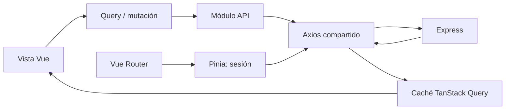

# Frontend

## Tecnologías y organización

La aplicación web usa Vue 3, Composition API, Vite, Vue Router, TanStack Query, Pinia, Axios, Naive UI y Tailwind CSS. Las rutas se cargan de forma diferida por módulo.

```text
apps/web/src/
├── app/                  tema global
├── modules/
│   ├── auth/             inicio de sesión
│   ├── home/             tablero inicial
│   ├── external-catalogs/selectores de Sheets
│   ├── orders/           lista, alta y detalle administrativo
│   ├── service-execution/flujo móvil, cámara y firma
│   └── technicians/      directorio administrativo
├── router/               composición y guardas
├── shared/               HTTP y layout
└── stores/               sesión
```

## Flujo de datos



- TanStack Query mantiene datos remotos, caché, polling e invalidación.
- Pinia conserva usuario, access token en memoria e inicialización de sesión.
- Axios adjunta el access token y coordina un único refresh ante respuestas `401`.
- Formularios y modales usan estado local del componente.
- Tras mutaciones se invalidan órdenes, auditoría, sincronización o reporte según corresponda.

## Rutas

| Ruta                  | Vista                                    | Perfil                              |
| --------------------- | ---------------------------------------- | ----------------------------------- |
| `/login`              | inicio de sesión                         | público                             |
| `/`                   | dashboard / órdenes recientes            | autenticado                         |
| `/orders`             | listado y filtros                        | autenticado; datos filtrados en API |
| `/orders/new`         | asistente de creación                    | administrador                       |
| `/orders/:id`         | detalle, evidencias, reporte y auditoría | autorizado sobre la orden           |
| `/orders/:id/execute` | ejecución mobile-first                   | técnico asignado o administrador    |
| `/technicians`        | administración de técnicos               | administrador                       |

La guarda de navegación inicializa la sesión, redirige al login y aplica `requiresRole`. La autorización real siempre se repite en backend.

## Evidencias y reportes

El navegador comprime fotografías a JPEG antes de solicitar/subir una URL prefirmada. La firma se captura con canvas y se sube como PNG. El detalle de la orden consulta el estado del reporte cada tres segundos mientras está pendiente o procesándose y obtiene una URL temporal cuando queda listo.

## PWA

El proyecto incluye manifest e iconos instalables. Solo se cachean assets estáticos; no se promete operación offline ni se cachean respuestas autenticadas.
