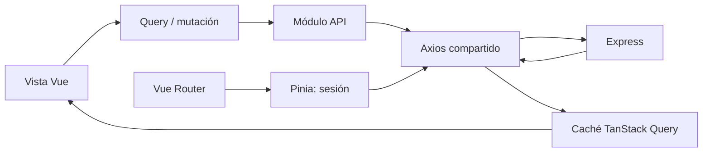

# Frontend

## Tecnologías y organización

La aplicación web usa Vue 3, Composition API, Vite, Vue Router, TanStack Query, Pinia, Axios, Naive UI y Tailwind CSS. Las rutas se cargan de forma diferida por módulo.

```text
apps/web/src/
├── app/                  tema global
├── modules/
│   ├── auth/             inicio de sesión
│   ├── home/             tablero inicial
│   ├── external-catalogs/selectores de Sheets
│   ├── orders/           lista, alta y detalle administrativo
│   ├── service-execution/flujo móvil, cámara y firma
│   ├── technicians/      directorio y cuentas técnicas
│   └── technical-accounts/ APIs de cuentas compartidas y usuarios técnicos
├── router/               composición y guardas
├── shared/               HTTP y layout
└── stores/               sesión
```

## Flujo de datos



- TanStack Query mantiene datos remotos, caché, polling e invalidación.
- Pinia conserva usuario, access token en memoria e inicialización de sesión. La identidad se
  reconcilia con `/auth/me` mediante una promesa deduplicada y TTL de 30 segundos.
- Axios adjunta el access token y coordina un único refresh ante respuestas `401`.
- Los módulos de frontend (`orders`, `service-execution`, `technicians`) encapsulan sus peticiones en archivos `api.ts` dedicados que comparten la interfaz `ApiResponse<T>`.
- El manejo de errores de interfaz utiliza la utilidad `extractApiErrorMessage` (`@/shared/http/client.ts`) para presentar transparentemente al usuario los mensajes de error originados en el backend en lugar de códigos genéricos de Axios.
- Formularios y modales usan estado local del componente.
- Tras mutaciones se invalidan órdenes, auditoría, sincronización o reporte según corresponda.
- **Auditoría:** al agregar una acción nueva en el backend, agrega su título en español a `AUDIT_ACTION_LABELS` en `apps/web/src/modules/orders/formatters.ts`; el registro conserva la clave técnica en inglés.
- En el detalle administrativo, `useOrderMedia` administra el ciclo de vida de las URLs privadas y `useAddOrderUnit` encapsula el formulario de alta; `AddOrderUnitModal`, `OrderEvidenceTab`, `OrderSyncTab`, `OrderReportCard` y `OrderAuditTab` separan la presentación de la orquestación de la vista. Asimismo, `OrderPricingModal` y `useOrderPricingModal` aíslan el formulario y validación para configurar tarifas acordadas y reajustar liquidaciones técnicas en formato tabular. La vista conserva las consultas y mutaciones de TanStack Query.
- `OrderUnitsTab` presenta unidades y equipos con propiedades/eventos tipados; `AttachOrderEquipmentModal` y `useAttachOrderEquipment` aíslan el formulario de vinculación. `useEvidenceGallery` administra URLs privadas y descarta respuestas obsoletas al cambiar de contexto. Estos límites no trasladan las mutaciones ni la autoridad de permisos fuera de la vista/backend.

## Rutas

| Ruta                  | Vista                                    | Perfil                              |
| --------------------- | ---------------------------------------- | ----------------------------------- |
| `/login`              | inicio de sesión                         | público                             |
| `/`                   | dashboard / órdenes recientes            | autenticado                         |
| `/orders`             | listado y filtros                        | autenticado; datos filtrados en API |
| `/orders/new`         | asistente de creación                    | administrador                       |
| `/orders/:id`         | detalle, evidencias, reporte y auditoría | administrador                       |
| `/orders/:id/execute` | ejecución mobile-first                   | técnico autorizado o administrador  |
| `/technicians`        | administración de técnicos               | administrador                       |
| `/admin/users`        | administración de cuentas ADMIN          | administrador                       |

La guarda de navegación inicializa la sesión, revalida la identidad cuando vence el TTL, redirige
según `orderAccessMode` y aplica `requiresRole`. Recuperar el foco y actualizar manualmente el
tablero compartido fuerzan la misma reconciliación y reutilizan una única política de redirección.
La autorización real siempre se repite en backend.

La administración de cuentas técnicas se compone desde `technicians/views/TechnicalAccountsView.vue`:
`useTechnicalAccounts` concentra estado y mutaciones, mientras `SharedAccountPanel`,
`TechnicalAccountTable` y `TechnicalAccountModals` mantienen la presentación separada. Las llamadas
de usuarios y acceso compartido pertenecen a `modules/technical-accounts`.
La vista de cuentas técnicas permite designar la cuenta de taller y configurar una referencia de orden ejecutable;
la administración de cuentas ADMIN está separada y no debe confundirse con ese control.
La vista de ejecución carga `/orders/:id/execution`, cuyo contrato omite información administrativa,
fiscal y de sincronización. Los técnicos navegan a esa vista también para consultar su historial.
Al final de la vista, la tarjeta **Notas de ejecución** permite guardar una nota general de la orden
de hasta 5000 caracteres. Si hay cambios pendientes al pulsar **Finalizar y Cerrar Servicio**, la
interfaz los guarda automáticamente antes de completar la orden; las notas no se separan por unidad.
`useExecutionNotes` centraliza el estado y la persistencia; el guardado manual refresca la orden,
mientras que un error al guardar antes del cierre impide finalizarla.

## Asistente de creación de órdenes y catálogo de equipos

El asistente (`/orders/new`) guía al administrador en un flujo estructurado de 5 pasos:

1. **Cliente**: Selección del cliente desde Sheets. Los servicios se agregan por bloque en el paso siguiente.
2. **Unidades y Equipos**:
   - **Revisiones y Desinstalaciones**: El componente `EquipmentSelect` filtra automáticamente los equipos con estatus `INSTALADO` del cliente. Al seleccionar un hardware, la función `extractUnitFromEquipment` autocompleta la unidad (`unit`, `unitMakeModel`, `unitYear`, `unitSerialNumber`) reduciendo la captura manual.
   - **Instalaciones y Sensor fuel**: `EquipmentSelect` filtra exclusivamente hardware en stock/almacén (`STOCK TECNICO`, `DISPONIBLE`, etc.) y solicita los datos de la nueva unidad física.
   - **Cambio de equipo**: exige seleccionar el equipo instalado que se retira y uno disponible de almacén; ambos quedan asociados a la misma unidad.
   - **Órdenes mixtas**: cada unidad conserva su propio `serviceType` y el resumen agrupa unidades por servicio.
   - **Normalización**: Las comparaciones de clientes aplican `normalizeString` (case-insensitive, diacríticos removidos vía NFD y eliminación de sufijos legales tipo `S.A. de C.V.`).
3. **Programación**: Fecha, hora, tipo de servicio (en sitio o taller) y notas operativas.
4. **Técnico**: Selección obligatoria desde `DIRECTORIO TECNICO`, con filtros de ciudad y taller, búsqueda, ficha de contacto, marca de última sincronización y recarga explícita. La carga, el catálogo vacío y los errores bloquean el avance.
5. **Resumen y Creación**: Validación integral y envío atómico de la orden con sus unidades y equipos a la API.

En el detalle, las acciones Agregar Unidad, Registrar Primera Unidad y Asignar
Equipo aparecen para administradores mientras la orden está en borrador y respetan el servicio
seleccionado. La API valida la misma regla. La carga inicial anidada del wizard y las acciones de
quitar/eliminar conservan sus reglas existentes. Los botones interactivos personalizados responden
tanto a clic como a teclado.
`AddOrderUnitModal` y `AttachOrderEquipmentModal` contienen los formularios; sus composables
administran estado, validación y mutación sin trasladar al componente de detalle el payload de Sheets.
`OrderUnitsTab` presenta unidades y equipos con propiedades y eventos tipados. El detalle conserva
las mutaciones y los modales, de modo que la pestaña no crea otra fuente de estado de órdenes.

## Evidencias y reportes

`image-preprocessing.ts` convierte fotografías HEIC/HEIF a JPEG y limita sus dimensiones a 1920 px antes de enviarlas. Las promesas rechazan explícitamente archivos no legibles o imágenes no decodificables para evitar bloqueos en la interfaz. El módulo transforma imágenes; `EvidenceCapture` conserva los protocolos del proveedor configurado. En modo Drive la API recibe la carga autenticada; el adaptador de objetos puede usar URLs prefirmadas. La firma se captura con canvas y se envía como PNG. El detalle de la orden consulta el estado del reporte cada tres segundos mientras está pendiente o procesándose y solicita el archivo privado cuando queda listo.
`evidence-upload-retry.ts` conserva la identidad de reintento de Drive usando la orden, la unidad y el archivo original. `useEvidenceGallery` libera las URLs privadas cuando una evidencia sale de la lista, cambia el contexto o se desmonta la vista, e ignora respuestas de cargas obsoletas.

## PWA

El proyecto incluye manifest e iconos instalables. Solo se cachean assets estáticos; no se promete operación offline ni se cachean respuestas autenticadas.
