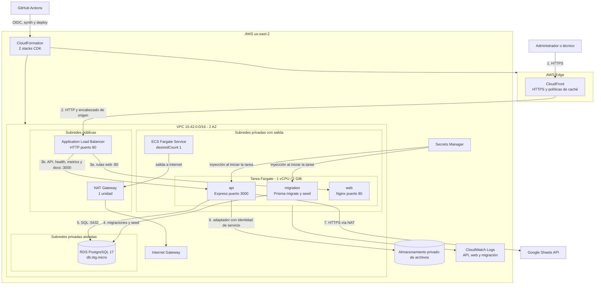
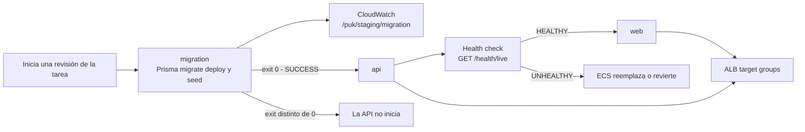
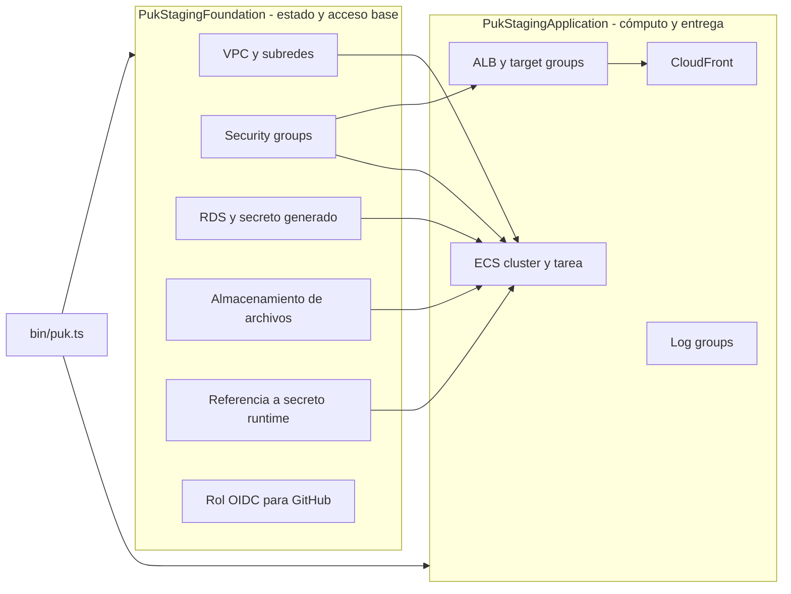
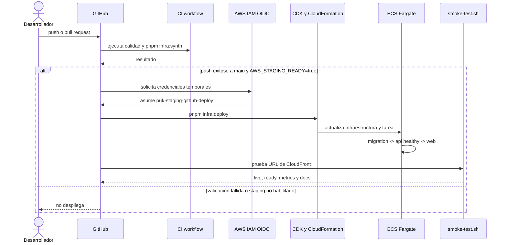
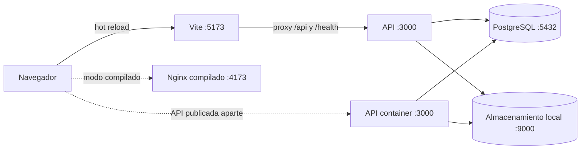

# Infraestructura y operación

**Estado documentado:** 2026-09-07

**Fuente de verdad:** `infra/cdk`, `docker-compose.yml`, `infra/docker` y `.github/workflows`

Este documento describe la infraestructura que existe en el repositorio. El ambiente AWS implementado es **staging**; producción todavía no tiene stacks CDK propios. Las recomendaciones para producción se identifican explícitamente para no confundirlas con capacidades desplegadas.

## Ambientes

| Ambiente                  | Implementación actual                                                                            | Persistencia                  | Entrada                                           |
| ------------------------- | ------------------------------------------------------------------------------------------------ | ----------------------------- | ------------------------------------------------- |
| Desarrollo con hot reload | Vite y API en el host; PostgreSQL y MinIO en Docker Compose                                      | Volúmenes locales             | `http://localhost:5173` y `http://localhost:3000` |
| Desarrollo compilado      | Contenedores `web`, `api`, `postgres`, `minio` y `minio-init`                                    | Volúmenes locales             | `http://localhost:4173` y `http://localhost:3000` |
| Staging                   | AWS CDK en `us-east-2`: CloudFront, ALB, ECS Fargate, RDS, S3, Secrets Manager y CloudWatch Logs | Recursos administrados en AWS | URL HTTPS de CloudFront                           |
| Producción                | No implementado como IaC en la rama actual                                                       | Por definir                   | Por definir                                       |

## Staging en AWS

### Vista de despliegue



El diagrama muestra relaciones lógicas. CDK crea una pareja de subredes de cada tipo, una por zona de disponibilidad. El NAT Gateway está en una de las subredes públicas porque staging usa `natGateways: 1`.

### Recorrido de una solicitud

1. El navegador usa exclusivamente la URL HTTPS de CloudFront.
2. CloudFront redirige HTTP a HTTPS, comprime respuestas y agrega encabezados de seguridad.
3. CloudFront reenvía la solicitud al ALB por HTTP. También agrega el encabezado `X-Origin-Verify` que esperan las reglas del listener.
4. El listener del ALB devuelve `403` por defecto. Sólo reenvía solicitudes cuyo encabezado coincide:
   - `/api*`, `/health*`, `/metrics` y `/docs*` van al target group de la API en el puerto 3000.
   - Las demás rutas van al target group web en el puerto 80.
5. Nginx sirve los archivos Vue y aplica fallback a `index.html` para rutas de la SPA. Express procesa API, salud, métricas y OpenAPI.

El encabezado de origen evita el acceso casual directo al ALB a nivel de aplicación, pero el security group del ALB permite actualmente HTTP desde cualquier IPv4. No debe considerarse un secreto ni una barrera de red. Para producción se recomienda un origen privado de CloudFront o restringir el security group al managed prefix list de CloudFront, además de usar HTTPS entre CloudFront y el origen.

### Enrutamiento y caché

| Patrón de CloudFront | Destino         | Métodos            | Caché         | Uso                            |
| -------------------- | --------------- | ------------------ | ------------- | ------------------------------ |
| `/assets/*`          | Nginx `:80`     | GET, HEAD          | Optimizada    | JS, CSS y recursos versionados |
| `/api/*`             | Express `:3000` | Todos              | Deshabilitada | API REST                       |
| `/health/*`          | Express `:3000` | GET, HEAD          | Deshabilitada | Liveness y readiness           |
| `/metrics`           | Express `:3000` | GET, HEAD          | Deshabilitada | Métricas Prometheus            |
| `/docs*`             | Express `:3000` | GET, HEAD          | Deshabilitada | OpenAPI y Swagger UI           |
| Predeterminado       | Nginx `:80`     | GET, HEAD, OPTIONS | Deshabilitada | HTML y rutas de la SPA         |

Todos los behaviors redirigen al cliente de HTTP a HTTPS y agregan la política administrada de encabezados de seguridad. El origen ALB recibe tráfico HTTP porque `OriginProtocolPolicy` está configurado como `HTTP_ONLY`.

### Red y límites de confianza

| Zona               | Recursos                                     | Entrada permitida                                      | Salida relevante                 |
| ------------------ | -------------------------------------------- | ------------------------------------------------------ | -------------------------------- |
| Pública            | ALB y NAT Gateway                            | ALB: TCP/80 desde cualquier IPv4                       | Internet Gateway                 |
| Privada con salida | Tareas Fargate                               | TCP/80 y TCP/3000 sólo desde el security group del ALB | NAT Gateway, RDS y servicios AWS |
| Privada aislada    | RDS PostgreSQL                               | TCP/5432 sólo desde el security group de la aplicación | Sin ruta directa a Internet      |
| Fuera de la VPC    | CloudFront, S3, Secrets Manager y CloudWatch | Mediante APIs administradas                            | Según el servicio                |

Las tareas no reciben IP pública. El único NAT reduce el costo de staging, pero también crea un punto único de falla para la salida a Internet y tráfico entre zonas si la tarea corre en la otra AZ. La API lo necesita actualmente para Google Sheets y la tarea puede usarlo para servicios AWS porque no se han definido VPC endpoints.

### Tarea Fargate y orden de arranque



Los tres contenedores comparten la misma tarea y su interfaz de red:

- `migration` no es esencial. Ejecuta migraciones y seed una vez por cada arranque de tarea; la API depende de que termine con éxito.
- `api` es esencial y expone el puerto 3000. Su health check interno consulta `/health/live`.
- `web` es esencial y expone el puerto 80. Sólo inicia cuando la API está saludable.
- El servicio usa `desiredCount: 1`, despliegue de 100 % mínimo y 200 % máximo, grace period de 120 segundos y circuit breaker con rollback.

La migración dentro de cada tarea mantiene el orden de arranque, pero con más de una tarea podría ejecutar migraciones o seed de forma concurrente. Antes de escalar horizontalmente se debe convertir la migración en un job único por despliegue o comprobar explícitamente su idempotencia y bloqueo.

### Persistencia

| Recurso                   | Configuración implementada                                                                                            | Comportamiento al eliminar el stack   |
| ------------------------- | --------------------------------------------------------------------------------------------------------------------- | ------------------------------------- |
| RDS PostgreSQL 17         | `db.t4g.micro`, 20 GiB, autoscaling hasta 100 GiB, cifrado, Single-AZ, 1 día de backup automático, sin acceso público | `RETAIN` y deletion protection activa |
| Almacenamiento de objetos | Cifrado, versionado, acceso privado, TLS y CORS para el proveedor de objetos de staging                               | `RETAIN`                              |
| Logs                      | Grupos separados para migración, API y web; retención de un mes                                                       | `RETAIN`                              |

El stack de staging todavía provisiona el bucket configurado para el adaptador de objetos; esa decisión de despliegue no define el modelo lógico de almacenamiento de la aplicación. Google Drive también está integrado y se selecciona por configuración. PostgreSQL conserva referencias y metadatos. El lifecycle del bucket de staging sólo aborta cargas multipart incompletas después de un día: no elimina versiones ni define la retención de evidencias. La política de negocio y el respaldo independiente siguen pendientes antes de producción.

### Stacks CDK



`PukStagingApplication` recibe referencias del stack foundation, por lo que CDK crea dependencias y exports de CloudFormation. Foundation concentra recursos con estado o compartidos; Application concentra cómputo y entrega. Esta separación reduce el riesgo al reemplazar la capa de aplicación, aunque el stack foundation todavía no activa `terminationProtection` a nivel de CloudFormation.

No se deben renombrar construct IDs ni mover recursos persistentes sin revisar primero `pnpm infra:diff`: un cambio de logical ID puede provocar reemplazo. Tampoco se debe eliminar un export del stack foundation mientras Application lo consuma.

### Identidades y configuración de ejecución

- RDS genera sus credenciales en Secrets Manager. ECS inyecta usuario y contraseña en `migration` y `api` al iniciar la tarea.
- El secreto existente `puk/staging/runtime` aporta la configuración sensible de JWT, Google Sheets y seed. El valor no está contenido en CloudFormation ni en el repositorio.
- La API accede a S3 mediante el task role generado por ECS y `grantReadWrite`; staging no inyecta access keys estáticas de S3.
- GitHub Actions usa OIDC para asumir `puk-staging-github-deploy`. La trust policy limita la rama `main` del repositorio configurado.
- Las variables no sensibles del runtime se definen en el task definition.

La administración o lectura de valores sensibles debe realizarse mediante el procedimiento seguro aprobado por el equipo. Este documento sólo describe sus referencias y consumidores.

### Observabilidad implementada

- ECS Container Insights V2 está habilitado en el cluster `puk-staging`.
- `GET /health/live` comprueba que el proceso de API responda.
- `GET /health/ready` comprueba conectividad con PostgreSQL y es el health check del target group de API.
- `GET /metrics` expone métricas Prometheus, pero el CDK no crea un scraper, alarmas ni dashboards.
- `GET /health/metrics` ofrece un snapshot JSON desde la aplicación.
- Los logs de migración, API y web se envían a grupos separados de CloudWatch Logs con retención de un mes.
- Cada petición recibe un `requestId`; puede propagarse uno válido desde el cliente.

## Integración y despliegue continuo



El workflow `.github/workflows/ci.yml` instala dependencias, valida Prisma, ejecuta lint, typecheck, pruebas, validación OpenAPI, build, `infra:synth`, auditoría y E2E. Después de un CI exitoso sobre `main`, `.github/workflows/deploy-staging.yml` despliega si la variable de repositorio `AWS_STAGING_READY` vale `true`. La concurrencia está serializada y no cancela un despliegue en curso.

Los assets Docker de CDK se construyen y publican mediante el bootstrap de CDK. El repositorio no define ECR repositories ni tags de aplicación explícitos.

El workflow de despliegue hace checkout de `github.event.workflow_run.head_sha`, por lo que CI
despliega la revisión que pasó las validaciones. Un despliegue manual de assets o de CDK debe
registrar explícitamente el SHA de Git, la revisión de ECS y el operador para conservar la
trazabilidad de release.

### Rotación de secretos y recuperación

El secreto `puk/staging/runtime` se configura con el script local. Para una rotación explícita:

```bash
AWS_REGION=us-east-2 node --env-file=.env infra/scripts/configure-staging-secrets.mjs --overwrite
```

No se deben mostrar valores del secreto. La contraseña de seed se recupera únicamente mediante el
flujo seguro aprobado para Secrets Manager, sin imprimirla ni copiarla a logs, tickets o chat. Una
nueva versión de Secrets Manager no cambia tareas ECS ya iniciadas: se debe forzar un nuevo
despliegue o reiniciar el servicio para que `migration` y `api` reciban los valores actualizados.
Rotar las claves JWT invalida los tokens firmados con las claves anteriores y puede cerrar sesiones
activas.

Para un incidente, use primero diagnósticos de sólo lectura:

```bash
aws cloudformation describe-stacks --region us-east-2 --stack-name PukStagingApplication
aws ecs describe-services --region us-east-2 --cluster puk-staging --services <service-name>
aws ecs list-tasks --region us-east-2 --cluster puk-staging --service-name <service-name>
aws logs tail /puk/staging/migration --region us-east-2 --since 30m
aws logs tail /puk/staging/api --region us-east-2 --since 30m
```

Valide la URL resultante sin exponer configuración:

```bash
TARGET_URL="https://<cloudfront-host>" ./infra/scripts/smoke-test.sh
```

El script comprueba `/health/live`, `/health/ready`, `/metrics` y `/docs/`. Si falla la migración,
la API no inicia; conserve logs y revise la migración antes de reintentar. El circuit breaker de
ECS está configurado para rollback de la aplicación. Para datos, use sólo un respaldo verificado y
`infra/scripts/restore.sh` con aprobación operativa. RDS y S3 usan `RETAIN`, por lo que un rollback
no debe destruirlos.

RDS tiene deletion protection y NAT Gateway y RDS mantienen costos aunque no haya tráfico. Los
recursos `RETAIN` también sobreviven al stack. No destruya el ambiente ni desactive la protección
de borrado sin confirmar titularidad, respaldos y plan de retención.

## Desarrollo local

### Servicios Docker Compose

| Servicio     | Imagen o proceso      | Puerto predeterminado     | Persistencia            |
| ------------ | --------------------- | ------------------------- | ----------------------- |
| `web`        | Nginx + Vue compilado | 4173 externo / 80 interno | No                      |
| `api`        | Node.js 24 + Express  | 3000                      | No                      |
| `postgres`   | PostgreSQL 18         | 5432                      | Volumen `postgres-data` |
| `minio`      | MinIO                 | 9000 API, 9001 consola    | Volumen `minio-data`    |
| `minio-init` | Cliente `mc`          | No aplica                 | Crea el bucket privado  |



En hot reload, el proxy de Vite envía `/api` y `/health` a `VITE_API_PROXY_TARGET`. En ECS, Nginx y API comparten tarea y `127.0.0.1:3000` es correcto. En Docker Compose están en contenedores distintos, pero la configuración Nginx también apunta a `127.0.0.1:3000`; por ello el proxy `/api` del contenedor web compilado no alcanza actualmente a `api`. Hasta corregir esa divergencia, use hot reload o el puerto publicado de la API para validar el modo local.

### Inicio rápido

```bash
pnpm install
cp .env.example .env
docker compose up -d postgres minio minio-init
pnpm prisma:migrate
pnpm prisma:seed
pnpm dev
```

Para construir todos los contenedores:

```bash
docker compose up --build -d
```

Los Dockerfiles son multi-stage. La imagen de API se ejecuta como usuario `node`; el frontend se construye con Vite y se sirve desde Nginx. Las versiones admitidas son Node.js 24 a 26 y pnpm 11.

## Variables de entorno

| Grupo         | Variables principales                                            |
| ------------- | ---------------------------------------------------------------- |
| HTTP          | `PORT`, `APP_ORIGIN`, `API_ORIGIN`, `TRUST_PROXY`                |
| Base de datos | `DATABASE_URL`, `DIRECT_URL` o variables `PUK_DATABASE_*` en ECS |
| JWT           | Claves pública y privada, `JWT_ISSUER`, `JWT_AUDIENCE`, TTLs     |
| Cookies       | `COOKIE_DOMAIN`, `COOKIE_SECURE`, `COOKIE_SAME_SITE`             |
| S3            | Endpoint, región, bucket, credenciales locales y path style      |
| Sheets        | Spreadsheet, cuenta de servicio, clave privada y pestañas        |
| Límites       | Tamaños de evidencia y firma, TTL de URLs, caché                 |
| Resiliencia   | Timeouts, reintentos, circuit breaker y polling                  |
| Seed          | Correos y contraseña inicial                                     |

La API valida su configuración al arrancar. Los valores `development-only` activan adaptadores simulados fuera de producción y nunca deben usarse en producción.

## Procesos periódicos

- `SyncService` consulta el outbox cada `OUTBOX_POLL_INTERVAL_MS`, procesa hasta 20 operaciones y aplica backoff exponencial con jitter.
- `ReportsService` procesa hasta dos PDFs por ciclo y recupera trabajos interrumpidos después de diez minutos.
- Ambos intervalos usan `unref()` y se cancelan durante el apagado ordenado.
- Con `desiredCount: 1` hay una sola instancia de cada worker. El modelo debe revisarse antes de escalar la cantidad de tareas para evitar trabajo duplicado.

## Operación y validación

```bash
pnpm typecheck
pnpm lint
pnpm test
pnpm build
pnpm prisma:validate
pnpm docs:validate
pnpm infra:synth
pnpm infra:diff
```

Antes de desplegar cambios CDK se debe ejecutar `synth` y revisar `diff`, especialmente para RDS, S3, VPC y referencias entre stacks. Hotswap y express mode no forman parte del flujo y no deben usarse en producción.

La guía operativa y el primer despliegue están en [staging-and-deployment.md](../staging-and-deployment.md). Los scripts `infra/scripts/backup.sh` y `restore.sh` realizan respaldo lógico y restauración de PostgreSQL, pero no están conectados al workflow de AWS; su programación, almacenamiento externo y prueba periódica son responsabilidad operativa.

## Evaluación para producción

La infraestructura de staging prioriza costo y simplicidad. Antes de declararla apta para producción se requiere, como mínimo:

| Pilar          | Estado actual                                                           | Trabajo pendiente                                                                                                                                 |
| -------------- | ----------------------------------------------------------------------- | ------------------------------------------------------------------------------------------------------------------------------------------------- |
| Seguridad      | RDS y S3 cifrados; S3 privado; tareas privadas; IAM para S3; OIDC en CI | Restringir el origen ALB a CloudFront o usar VPC origin; HTTPS al origen; revisar CORS S3; agregar WAF según riesgo; auditar permisos con cdk-nag |
| Confiabilidad  | Dos AZ para subredes; rollback de ECS; RDS y S3 retenidos               | RDS Multi-AZ; un NAT por AZ o endpoints; alarmas; estrategia de migración única; restauraciones probadas                                          |
| Rendimiento    | CloudFront comprime y cachea `/assets/*`                                | Autoscaling ECS, pruebas de carga y dimensionamiento de RDS                                                                                       |
| Costos         | Un NAT, una tarea y RDS micro                                           | Presupuestos y alarmas de costo; evaluar VPC endpoints frente al costo del NAT y transferencia                                                    |
| Operación      | Logs por contenedor, Container Insights y smoke test                    | Dashboards, alarmas, trazas, runbooks y objetivos SLO                                                                                             |
| Sostenibilidad | Contenedores dimensionados explícitamente                               | Medir utilización y ajustar CPU, memoria y retenciones                                                                                            |

## Referencias oficiales AWS

- [Restringir acceso a un Application Load Balancer desde CloudFront](https://docs.aws.amazon.com/AmazonCloudFront/latest/DeveloperGuide/restrict-access-to-load-balancer.html)
- [Conectar aplicaciones ECS a Internet desde subredes privadas](https://docs.aws.amazon.com/AmazonECS/latest/developerguide/networking-outbound.html)
- [Periodo de retención de backups automatizados de RDS](https://docs.aws.amazon.com/AmazonRDS/latest/UserGuide/USER_WorkingWithAutomatedBackups.BackupRetention.html)
- [Buenas prácticas de desarrollo y despliegue con AWS CDK](https://docs.aws.amazon.com/cdk/v2/guide/best-practices.html)
