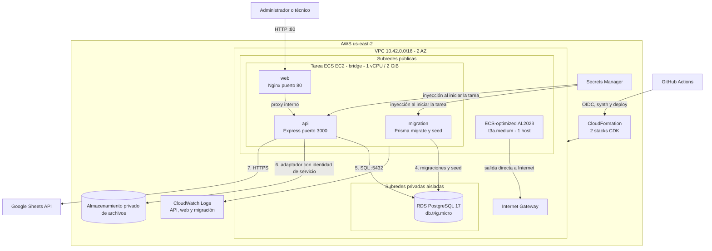
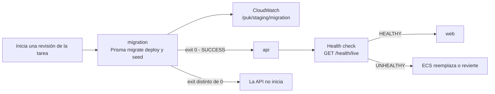
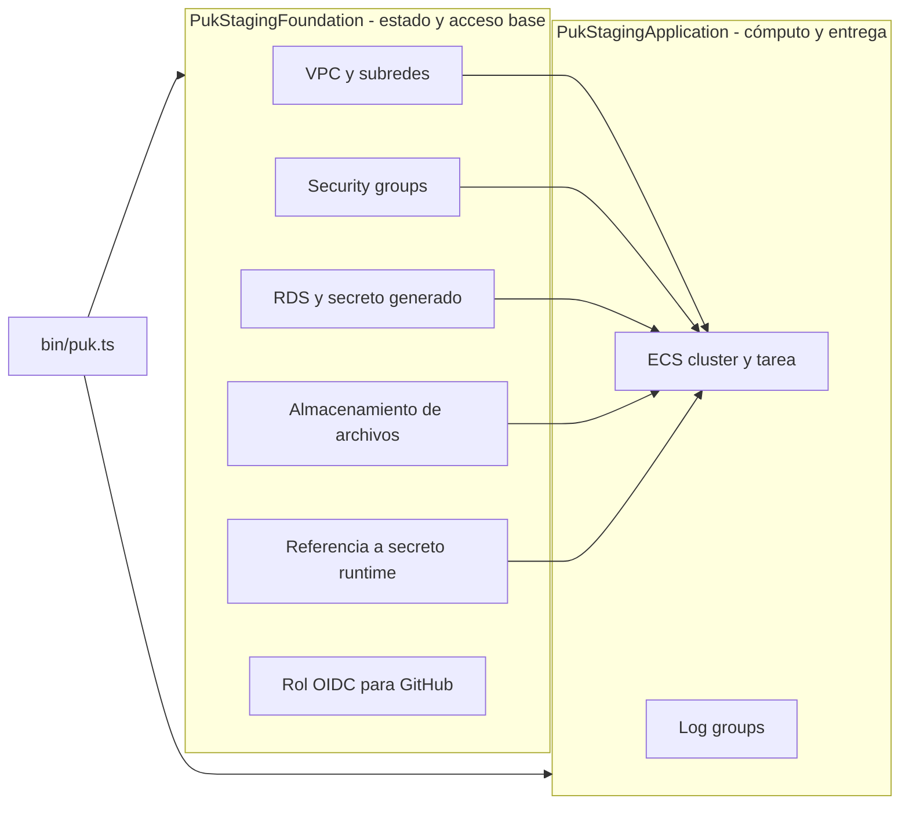
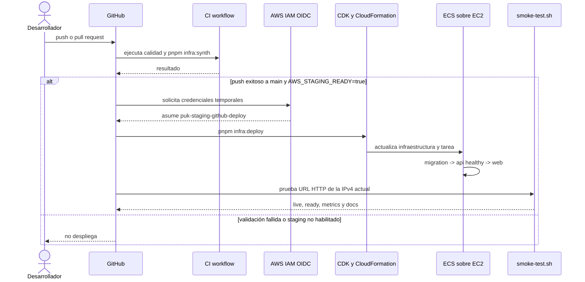
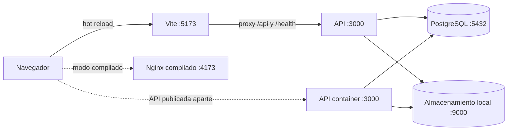

# Infraestructura y operación

**Estado documentado:** 2026-09-28

**Fuente de verdad:** `infra/cdk`, `docker-compose.yml`, `infra/docker` y `.github/workflows`

Este documento distingue la arquitectura declarada por CDK de los recursos actualmente desplegados. **Al 2026-09-28 no existe infraestructura de staging en AWS**: se eliminaron los stacks de aplicación, foundation y `CDKToolkit`, además de los recursos asociados. No hay URL ni IP de staging, base de datos, archivos ni secretos disponibles.

La base de datos anterior y sus respaldos automáticos se eliminaron sin snapshot final; el bucket y sus versiones se vaciaron y eliminaron, y también se eliminó el secreto runtime. **Los datos anteriores no son recuperables.** Los diagramas y detalles siguientes describen la arquitectura objetivo que `infra/cdk` volvería a crear, no recursos vivos. Producción no tiene stacks CDK propios.

## Ambientes

| Ambiente                  | Implementación actual                                                                                                       | Persistencia                    | Entrada                                           |
| ------------------------- | --------------------------------------------------------------------------------------------------------------------------- | ------------------------------- | ------------------------------------------------- |
| Desarrollo con hot reload | Vite y API en el host; PostgreSQL y MinIO en Docker Compose                                                                 | Volúmenes locales               | `http://localhost:5173` y `http://localhost:3000` |
| Desarrollo compilado      | Contenedores `web`, `api`, `postgres`, `minio` y `minio-init`                                                               | Volúmenes locales               | `http://localhost:4173` y `http://localhost:3000` |
| Staging                   | No desplegado; `infra/cdk` define ECS sobre EC2, RDS privado, almacenamiento de archivos, Secrets Manager y CloudWatch Logs | No hay recursos ni datos en AWS | Sin URL ni IP                                     |
| Producción                | No implementado como IaC en la rama actual                                                                                  | Por definir                     | Por definir                                       |

## Arquitectura objetivo de staging en AWS (no desplegada)

### Vista de despliegue

> **Diagrama objetivo de IaC:** representa lo que CDK provisionaría en un redeploy; actualmente no hay stacks ni recursos de staging.



El diagrama muestra la topología que CDK define para redeploy: subredes públicas, privadas para aplicación y privadas aisladas, una por zona de disponibilidad; un Auto Scaling Group fijo con una instancia EC2 `t3a.medium` en subred pública y una IPv4 efímera; HTTP directo por el puerto 80; sin NAT Gateway, Elastic IP, ALB ni CloudFront. Nginx enruta internamente al API y RDS queda en subredes privadas aisladas.

### Recorrido de una solicitud

1. El navegador accede a `http://<ipv4-publica>` directamente.
2. El security group acepta sólo HTTP TCP/80 desde Internet; no expone SSH ni el puerto 3000.
3. Nginx sirve el frontend Vue, aplica fallback a `index.html` y enruta `/api/`, `/health/`, `/docs/` y `/metrics` al API por la red interna de contenedores.
4. Express procesa API, salud, métricas y OpenAPI.

Esta entrada no usa TLS: las credenciales y cookies de sesión viajan sin cifrado. La IPv4 es efímera y puede cambiar al detener/reemplazar el host; no existe un dominio estable ni CDN, protección de borde, terminación TLS o caché CDN. No debe usarse para datos reales ni producción.

### Red y límites de confianza

| Zona            | Recursos                              | Entrada permitida                                      | Salida relevante                 |
| --------------- | ------------------------------------- | ------------------------------------------------------ | -------------------------------- |
| Pública         | Host ECS EC2 con IPv4 pública efímera | TCP/80 desde cualquier IPv4                            | Internet Gateway, RDS y APIs AWS |
| Privada aislada | RDS PostgreSQL                        | TCP/5432 sólo desde el security group de la aplicación | Sin ruta directa a Internet      |
| Fuera de la VPC | S3, Secrets Manager y CloudWatch      | Mediante APIs administradas                            | Según el servicio                |

El host EC2 recibe IPv4 pública efímera para conexiones entrantes y salientes sin NAT Gateway ni Elastic IP. Su security group sólo permite TCP/80 desde Internet; el API en el puerto 3000 no se publica. La API requiere salida HTTPS para Google Sheets y AWS. La tarea usa modo `bridge` y conserva sus roles ECS propios; IMDSv2 es obligatorio y el hop limit es 1 para impedir que contenedores alcancen las credenciales del instance profile. La instancia no recibe permisos de Secrets Manager ni de S3. Esta configuración evita el costo horario y de procesamiento del NAT, aunque la IPv4 pública sigue teniendo costo y la salida no pasa por un NAT controlado.

### Tarea ECS sobre EC2 y orden de arranque

> **Diagrama objetivo de IaC:** el orden descrito corresponde a una futura tarea; no hay tarea ECS corriendo mientras staging esté eliminado.



Los tres contenedores comparten la tarea; ECS la ejecuta en modo `bridge` dentro del host EC2. Nginx se vincula al contenedor `api` por el alias `api`. Nginx publica el puerto de host 80; el API también mapea el puerto de host 3000, pero el security group bloquea el ingreso externo a ese puerto:

- `migration` no es esencial. Ejecuta migraciones y seed una vez por cada arranque de tarea; la API depende de que termine con éxito.
- `api` es esencial y expone el puerto 3000. Su health check interno consulta `/health/live`.
- `web` es esencial y expone el puerto 80. Sólo inicia cuando la API está saludable.
- El servicio usa `desiredCount: 1` en un ASG de capacidad fija (mínimo/máximo/deseado 1). El despliegue usa 0 % mínimo y 100 % máximo para detener la tarea anterior antes de iniciar la nueva: hay una interrupción breve durante cada despliegue y no se garantiza alta disponibilidad ante falla del host.
- El host es `t3a.medium` con CPU credits en modo `standard`: se limita el costo inesperado de créditos surplus, a cambio de que el rendimiento de CPU pueda bajar al agotarse el balance bajo carga sostenida.

La migración dentro de cada tarea mantiene el orden de arranque, pero con más de una tarea podría ejecutar migraciones o seed de forma concurrente. Antes de escalar horizontalmente se debe convertir la migración en un job único por despliegue o comprobar explícitamente su idempotencia y bloqueo.

### Persistencia

| Recurso                   | Configuración definida en CDK (no desplegada)                                                                         | Política IaC al eliminar en el futuro |
| ------------------------- | --------------------------------------------------------------------------------------------------------------------- | ------------------------------------- |
| RDS PostgreSQL 17         | `db.t4g.micro`, 20 GiB, autoscaling hasta 100 GiB, cifrado, Single-AZ, 1 día de backup automático, sin acceso público | `RETAIN` y deletion protection        |
| Almacenamiento de objetos | Cifrado, versionado, acceso privado, TLS y CORS; el proveedor de staging es S3                                        | `RETAIN`                              |
| Logs                      | Grupos separados para migración, API y web; retención de un mes                                                       | `RETAIN`                              |

La IaC de staging define un bucket S3 para el adaptador de objetos; esa decisión de despliegue no define el modelo lógico de almacenamiento de la aplicación. Google Drive también está integrado y se selecciona por configuración. PostgreSQL conserva referencias y metadatos. El lifecycle del bucket definido en CDK sólo abortaría cargas multipart incompletas después de un día; no elimina versiones ni define la retención de evidencias. Aunque la IaC configure `RETAIN`, **los recursos y datos previos fueron eliminados expresamente y no existen respaldos recuperables**. La política de negocio y el respaldo independiente siguen pendientes antes de producción.

### Stacks CDK

> **Diagrama objetivo de IaC:** describe dependencias de futuros stacks. Los stacks Foundation y Application ya fueron eliminados.



En un redeploy, `PukStagingApplication` recibe referencias del stack foundation, por lo que CDK crea dependencias y exports de CloudFormation. Foundation concentrará recursos con estado o compartidos; Application concentrará cómputo. Esta separación reduce el riesgo al reemplazar la capa de aplicación, aunque el stack foundation no activa `terminationProtection` a nivel de CloudFormation.

La definición CDK conserva una referencia a un security group legado del ALB para compatibilidad de actualización entre stacks; el redeploy objetivo no crea ALB ni CloudFront, y dicho grupo no procesa tráfico. Esa referencia no significa que el grupo siga desplegado: el stack Foundation también fue eliminado. Su limpieza en IaC debe hacerse en dos pasos coordinados para no dejar una exportación consumida.

No se deben renombrar construct IDs ni mover recursos persistentes sin revisar primero `pnpm infra:diff`: un cambio de logical ID puede provocar reemplazo. Tampoco se debe eliminar un export del stack foundation mientras Application lo consuma.

### Identidades y configuración de ejecución previstas para redeploy

- En un redeploy, RDS generará credenciales en Secrets Manager y ECS las inyectará en `migration` y `api` al iniciar la tarea.
- El secreto runtime `puk/staging/runtime` debe volver a crearse con el script seguro existente; el secreto anterior fue eliminado.
- La API accederá al bucket S3 mediante el task role de ECS; no se inyectan access keys estáticas.
- Foundation volverá a crear el rol GitHub OIDC `puk-staging-github-deploy`, limitado a la rama `main` del repositorio configurado.
- Las variables no sensibles del runtime se definen en el task definition.

La administración o lectura de valores sensibles debe realizarse mediante el procedimiento seguro aprobado por el equipo. Este documento sólo describe sus referencias y consumidores.

### Observabilidad definida para redeploy

Esta sección describe la configuración que CDK aplicará en un redeploy; no hay cluster, host ni grupos de logs actualmente desplegados.

- ECS Container Insights está deshabilitado en el cluster `puk-staging` para evitar métricas adicionales; permanecen disponibles los health checks y logs de CloudWatch.
- El host usa ECS-optimized Amazon Linux 2023 x86_64, no expone SSH y acepta HTTP público sólo por TCP/80. No tiene Elastic IP; si la instancia se reemplaza, cambia su IPv4 pública de acceso y egreso.
- `GET /health/live` comprueba que el proceso de API responda.
- `GET /health/ready` comprueba conectividad con PostgreSQL y se usa en el smoke test.
- `GET /metrics` expone métricas Prometheus, pero el CDK no crea un scraper, alarmas ni dashboards.
- `GET /health/metrics` ofrece un snapshot JSON desde la aplicación.
- Los logs de migración, API y web se envían a grupos separados de CloudWatch Logs con retención de un mes.
- Cada petición recibe un `requestId`; puede propagarse uno válido desde el cliente.

## Integración y despliegue continuo

> **Diagrama objetivo de IaC:** el workflow no podrá desplegar hasta recrear CDKToolkit, los stacks y el secreto runtime.



El workflow `.github/workflows/ci.yml` instala dependencias, valida Prisma, ejecuta lint, typecheck, pruebas, validación OpenAPI, build, `infra:synth`, auditoría y E2E. Después de un CI exitoso sobre `main`, `.github/workflows/deploy-staging.yml` despliega si la variable de repositorio `AWS_STAGING_READY` vale `true`. La concurrencia está serializada y no cancela un despliegue en curso.

Los assets Docker de CDK se construyen y publican mediante el bootstrap de CDK. El repositorio no define ECR repositories ni tags de aplicación explícitos.

El workflow de despliegue hace checkout de `github.event.workflow_run.head_sha`, por lo que CI
despliega la revisión que pasó las validaciones. Un despliegue manual de assets o de CDK debe
registrar explícitamente el SHA de Git, la revisión de ECS y el operador para conservar la
trazabilidad de release.

### Recreación de secretos y operación posterior a redeploy

El secreto `puk/staging/runtime` fue eliminado junto con el ambiente. Para crearlo de nuevo, primero
despliegue Foundation y después use el script local con sus entradas válidas, sin imprimir valores:

```bash
AWS_REGION=us-east-2 node --env-file=.env infra/scripts/configure-staging-secrets.mjs
```

El script configura valores nuevos; no restaura ni revela valores anteriores. Nunca muestres
secretos en terminal, logs, tickets o chat. Una nueva versión no cambia tareas ya iniciadas: fuerza
un nuevo despliegue o reinicio para que `migration` y `api` reciban los valores actualizados.
Rotar claves JWT invalida tokens firmados con claves anteriores y puede cerrar sesiones activas.

Sólo después de recrear el ambiente, use estos diagnósticos de sólo lectura para un incidente:

```bash
aws cloudformation describe-stacks --region us-east-2 --stack-name PukStagingApplication
aws ecs describe-services --region us-east-2 --cluster puk-staging --services <service-name>
aws ecs list-tasks --region us-east-2 --cluster puk-staging --service-name <service-name>
aws logs tail /puk/staging/migration --region us-east-2 --since 30m
aws logs tail /puk/staging/api --region us-east-2 --since 30m
```

Valide la URL resultante sin exponer configuración:

```bash
TARGET_URL="http://<ipv4-publica-actual>" ./infra/scripts/smoke-test.sh
```

Después de redeploy, el script comprueba `/health/live`, `/health/ready`, `/metrics` y `/docs/`. Si falla la migración,
la API no inicia; conserve logs y revise la migración antes de reintentar. El circuit breaker de
ECS está configurado para rollback de la aplicación. En un redeploy, `RETAIN` protegerá algunos
recursos frente a eliminación del stack; no es un respaldo ni recupera los datos anteriores. No hay
recursos de staging que generen costos actualmente. Después de redeploy, RDS, el host EC2 siempre
encendido, EBS y su IPv4 pública generarán costos incluso sin tráfico. No presuponga que existan
backups o contenido histórico.

## Desarrollo local

### Servicios Docker Compose

| Servicio     | Imagen o proceso      | Puerto predeterminado     | Persistencia            |
| ------------ | --------------------- | ------------------------- | ----------------------- |
| `web`        | Nginx + Vue compilado | 4173 externo / 80 interno | No                      |
| `api`        | Node.js 24 + Express  | 3000                      | No                      |
| `postgres`   | PostgreSQL 18         | 5432                      | Volumen `postgres-data` |
| `minio`      | MinIO                 | 9000 API, 9001 consola    | Volumen `minio-data`    |
| `minio-init` | Cliente `mc`          | No aplica                 | Crea el bucket privado  |



En hot reload, el proxy de Vite envía `/api` y `/health` a `VITE_API_PROXY_TARGET`. En ECS, Nginx y API comparten tarea y `127.0.0.1:3000` es correcto. En Docker Compose están en contenedores distintos, pero la configuración Nginx también apunta a `127.0.0.1:3000`; por ello el proxy `/api` del contenedor web compilado no alcanza actualmente a `api`. Hasta corregir esa divergencia, use hot reload o el puerto publicado de la API para validar el modo local.

### Inicio rápido

```bash
pnpm install
cp .env.example .env
docker compose up -d postgres minio minio-init
pnpm prisma:migrate
pnpm prisma:seed
pnpm dev
```

Para construir todos los contenedores:

```bash
docker compose up --build -d
```

Los Dockerfiles son multi-stage. La imagen de API se ejecuta como usuario `node`; el frontend se construye con Vite y se sirve desde Nginx. Las versiones admitidas son Node.js 24 a 26 y pnpm 11.

## Variables de entorno

| Grupo         | Variables principales                                            |
| ------------- | ---------------------------------------------------------------- |
| HTTP          | `PORT`, `APP_ORIGIN`, `API_ORIGIN`, `TRUST_PROXY`                |
| Base de datos | `DATABASE_URL`, `DIRECT_URL` o variables `PUK_DATABASE_*` en ECS |
| JWT           | Claves pública y privada, `JWT_ISSUER`, `JWT_AUDIENCE`, TTLs     |
| Cookies       | `COOKIE_DOMAIN`, `COOKIE_SECURE`, `COOKIE_SAME_SITE`             |
| S3            | Endpoint, región, bucket, credenciales locales y path style      |
| Sheets        | Spreadsheet, cuenta de servicio, clave privada y pestañas        |
| Límites       | Tamaños de evidencia y firma, TTL de URLs, caché                 |
| Resiliencia   | Timeouts, reintentos, circuit breaker y polling                  |
| Seed          | Correos y contraseña inicial                                     |

La API valida su configuración al arrancar. Los valores `development-only` activan adaptadores simulados fuera de producción y nunca deben usarse en producción.

## Procesos periódicos

- `SyncService` consulta el outbox cada `OUTBOX_POLL_INTERVAL_MS`, procesa hasta 20 operaciones y aplica backoff exponencial con jitter.
- `ReportsService` procesa hasta dos PDFs por ciclo y recupera trabajos interrumpidos después de diez minutos.
- Ambos intervalos usan `unref()` y se cancelan durante el apagado ordenado.
- Con `desiredCount: 1` hay una sola instancia de cada worker. El modelo debe revisarse antes de escalar la cantidad de tareas para evitar trabajo duplicado.

## Operación y validación

```bash
pnpm typecheck
pnpm lint
pnpm test
pnpm build
pnpm prisma:validate
pnpm docs:validate
pnpm infra:synth
pnpm infra:diff
```

Antes de desplegar cambios CDK se debe ejecutar `synth` y revisar `diff`, especialmente para RDS, S3, VPC y referencias entre stacks. Hotswap y express mode no forman parte del flujo y no deben usarse en producción.

La guía operativa y el primer despliegue están en [staging-and-deployment.md](../staging-and-deployment.md). Los scripts `infra/scripts/backup.sh` y `restore.sh` realizan respaldo lógico y restauración de PostgreSQL, pero no están conectados al workflow de AWS; su programación, almacenamiento externo y prueba periódica son responsabilidad operativa.

## Evaluación para producción

La arquitectura de staging definida en IaC prioriza costo y simplicidad, pero no está desplegada.
La tabla compara esa configuración objetivo con el trabajo pendiente antes de producción:

| Pilar          | Configuración objetivo de IaC (no desplegada)                                          | Trabajo pendiente                                                                                                  |
| -------------- | -------------------------------------------------------------------------------------- | ------------------------------------------------------------------------------------------------------------------ |
| Seguridad      | RDS y S3 cifrados; S3 privado; host con HTTP público; IAM de tarea para S3; OIDC en CI | Configurar dominio y TLS; limitar ingreso; revisar CORS S3; agregar WAF según riesgo; auditar permisos con cdk-nag |
| Confiabilidad  | Dos AZ para subredes; rollback de ECS; políticas de retención previstas para RDS y S3  | RDS Multi-AZ; alarmas; estrategia de migración única; restauraciones probadas                                      |
| Rendimiento    | Sin CDN ni caché de borde                                                              | Autoscaling ECS, pruebas de carga y dimensionamiento de RDS                                                        |
| Costos         | Sin NAT; host EC2 único con IPv4 pública y RDS micro                                   | Presupuestos y alarmas de costo; revisar transferencia e IPv4 públicas                                             |
| Operación      | Logs por contenedor y smoke test                                                       | Dashboards, alarmas, trazas, runbooks y objetivos SLO                                                              |
| Sostenibilidad | Contenedores dimensionados explícitamente                                              | Medir utilización y ajustar CPU, memoria y retenciones                                                             |

## Referencias oficiales AWS

- [Conectar aplicaciones ECS a Internet desde subredes privadas](https://docs.aws.amazon.com/AmazonECS/latest/developerguide/networking-outbound.html)
- [Periodo de retención de backups automatizados de RDS](https://docs.aws.amazon.com/AmazonRDS/latest/UserGuide/USER_WorkingWithAutomatedBackups.BackupRetention.html)
- [Buenas prácticas de desarrollo y despliegue con AWS CDK](https://docs.aws.amazon.com/cdk/v2/guide/best-practices.html)
