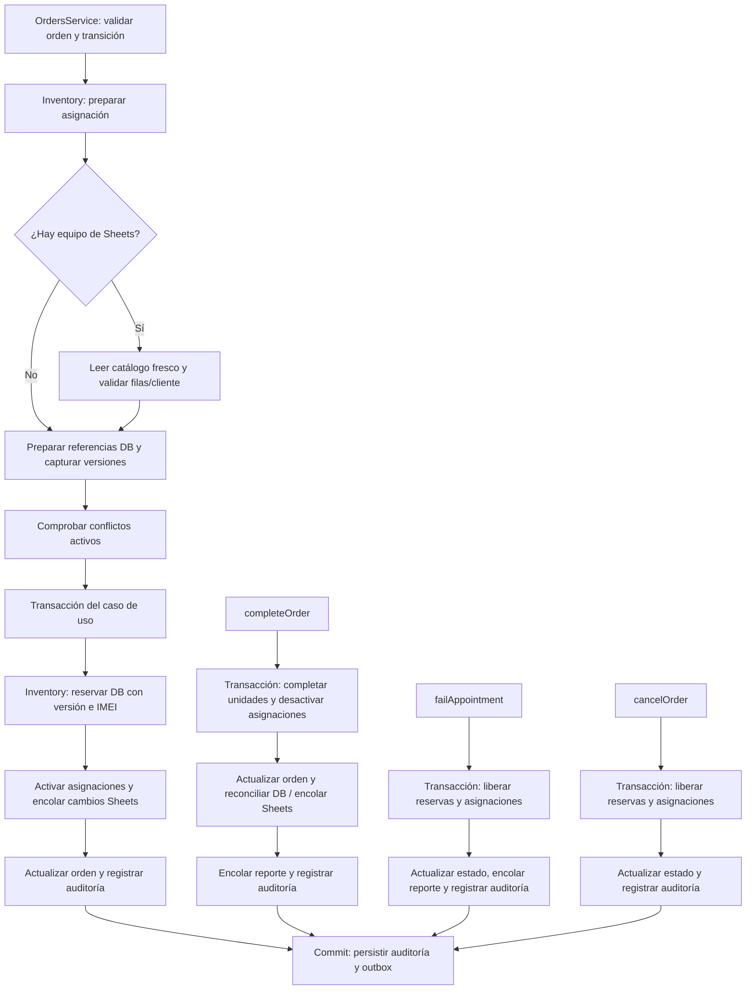

# Límites del ciclo de vida del inventario

La asignación de una orden separa la validación/preparación externa de la confirmación transaccional. `OrdersService` conserva la coordinación del caso de uso y el módulo `inventory` concentra las políticas y escrituras de inventario.

El diagrama muestra límites y orden general; las validaciones y excepciones de cada flujo se detallan abajo.

## Cambios por módulo

### Inventario (`apps/api/src/modules/inventory`)

- `order-inventory.ts` centraliza la preparación de asignaciones, la clasificación DB/Sheets, la validación de compatibilidad e identidad, la detección de conflictos activos por IMEI, la reserva con control de versión, la activación, la finalización y la liberación de inventario.
- `equipment-sheet-assignment.ts` concentra la conversión del estado del equipo y del tipo de servicio a los valores que se escriben en la hoja `SALIDAS`.
- `index.ts` expone estas operaciones para que Órdenes y Ejecución las consuman sin duplicar las reglas.
- `toOrderEquipmentCreateData` también centraliza el mapeo de origen y snapshots del equipo al registro persistido de la orden.

### Órdenes (`apps/api/src/modules/orders`)

- `OrdersService` sigue siendo dueño de las operaciones y transiciones de la orden, y de la transacción del caso de uso.
- Antes de abrir la transacción, delega a Inventario la preparación de equipos y las validaciones que dependen de su fuente o identidad.
- Dentro de la transacción delega a Inventario la confirmación de reservas/asignaciones y la liberación cuando se cancela la orden.

### Ejecución (`apps/api/src/modules/execution`)

- `OrderFinalizationService` conserva la finalización del caso de uso: completar la orden, registrar una cita fallida y coordinar sus reportes.
- Delega a Inventario la conciliación de equipos DB y la liberación de reservas al fallar una cita.
- Las operaciones de Inventario reciben la transacción existente; no crean una transacción independiente.

### Persistencia externa (Sheets)

- La lectura fresca del catálogo y las validaciones de Sheets ocurren antes de entrar a la transacción.
- Las escrituras a Sheets se guardan como operaciones outbox dentro de la transacción para ejecutarse después del commit.
- La asignación y la finalización usan el mapeo común de Inventario para mantener consistentes los valores enviados.

## Flujo de asignación

1. `OrdersService.assignAndSyncOrder` valida la transición, el técnico y la orden.
2. `InventoryAssignmentPreparer.prepareOrderAssignment` clasifica equipos por fuente y, si existen equipos de Sheets, solicita una lectura fresca de su catálogo con el `forceFresh` recibido (por defecto `true`). Valida disponibilidad de Sheets, existencia/identidad de cada fila y cliente antes de consultar el inventario DB.
3. La misma operación recorre los equipos en su orden persistido. Para cada equipo DB valida referencia, prepara el snapshot con identidad fresca, vuelve a leer el registro DB, valida compatibilidad y captura la versión. Después consulta conflictos activos para todos los equipos, también en orden.
4. Dentro de la transacción propiedad del caso de uso, `confirmOrderInventoryAssignment` reserva equipos DB con control optimista de versión y comprueba alias activos por IMEI. Luego recorre todos los equipos en orden: activa la asignación y encola la actualización de Sheets cuando corresponda.
5. La orden se marca `ASSIGNED` y se registra la auditoría, en ese orden y dentro de la misma transacción.

## Finalización y liberación

- **Finalización (`completeOrder`)**: antes de la transacción se calcula la tarifa y la programación del reporte. Dentro de la transacción se marcan unidades completas, se desactivan asignaciones, se actualiza la orden a `COMPLETED` y se reconcilia el inventario DB/encola la sincronización de Sheets respetando el orden original. Luego se reemplaza el reporte técnico pendiente y se encola el nuevo reporte; la auditoría se agrega al final del callback. `domainTransaction` persiste primero los registros de auditoría y después el outbox dentro de la misma transacción. Tras el commit se solicita la generación del PDF; un fallo de esa solicitud se registra y no revierte el cierre.
- **Cita fallida (`failAppointment`)**: en la transacción se liberan reservas DB, se desactivan asignaciones, se cambia el estado y se genera el snapshot del reporte. Después se superseden reportes pendientes y se encola el reporte nuevo; la auditoría queda al final del callback. La persistencia común escribe auditoría antes que outbox.
- **Cancelación (`cancelOrder`)**: se liberan reservas DB, se desactivan las asignaciones activas y se cambia el estado a `CANCELLED`; luego se registra auditoría. No se encola un reporte técnico en este flujo. Al cancelar una orden que ya estaba en `FAILED_APPOINTMENT`, el flujo resuelve esa cita fallida; la liberación ocurrió en la operación original de cita fallida.

## Invariantes

- La clasificación por fuente y validación de catálogo Sheets pertenecen a Inventario. No se consulta Sheets dentro de la transacción; la disponibilidad se valida antes de entrar y sus escrituras se representan como outbox.
- La detección de conflictos activos por IMEI también pertenece a Inventario, incluso al agregar un equipo individual a una orden en borrador.
- Inventario prepara los datos de persistencia de la asignación y conserva la política de origen y snapshots; Orders mantiene la propiedad de la orden y de la transacción.
- La operación de Inventario recibe la transacción del llamador: no abre ni confirma una transacción propia.
- Se mantienen el orden secuencial y la precedencia de errores del flujo anterior; una reserva fallida o un alias por IMEI aborta la transacción antes de activar asignaciones.
- La clave de idempotencia de Sheets sigue siendo `ASSIGN:<orderId>:<equipmentId>:<orderVersion>` y la fila desconocida usa `0`.
- La asignación no traslada validaciones ajenas al inventario, como las comprobaciones de duplicados de la misma orden.

## Por qué se hizo y qué mejora

Antes, parte de las reglas y escrituras del ciclo de vida del equipo estaban repartidas entre la coordinación de órdenes y sus servicios. Eso hacía más difícil identificar quién debía validar la fuente del equipo, mantener sus reservas y reconciliar cambios al completar, cancelar o fallar una orden.

La extracción deja a `inventory` como responsable de esas políticas y operaciones, mientras `OrdersService` sigue coordinando el caso de uso y conserva la transacción. Esto mejora la cohesión y hace más fácil probar y evolucionar las reglas de inventario sin duplicarlas en los flujos de órdenes. También mantiene consistentes reservas, asignaciones, auditoría y outbox: las escrituras relacionadas siguen dentro de la transacción existente, y las llamadas externas a Sheets no se ejecutan dentro de ella.

El cambio reorganiza responsabilidades; no pretende alterar el comportamiento funcional del usuario. Se preservan el orden de operaciones, la precedencia de errores, las reservas y la sincronización existentes.

## Alcance y verificación

Este documento describe la extracción del ciclo de asignación y las responsabilidades de preparación, confirmación, finalización y liberación que ya están implementadas. No sustituye la revisión final de todos los criterios del RFC.

La prueba de integración carga opcionalmente el `.env` de la raíz y solo se activa cuando `TEST_DATABASE_URL` apunta a `localhost` y a la base aislada `puk_test`. Esto evita que se ejecute accidentalmente contra una base compartida.

Verificación ejecutada para este cambio: suite completa de API (**442 pruebas pasaron; 11 omitidas**, en 52 archivos pasados y 3 omitidos), typecheck y `git diff --check`. Las 15 pruebas de integración de Inventario pasaron contra PostgreSQL local, incluida la prueba de rollback tras un error dentro de la transacción. Pruebas de referencia: `apps/api/src/modules/inventory/order-inventory.test.ts` y `apps/api/src/modules/inventory/inventory.database.integration.test.ts`.
