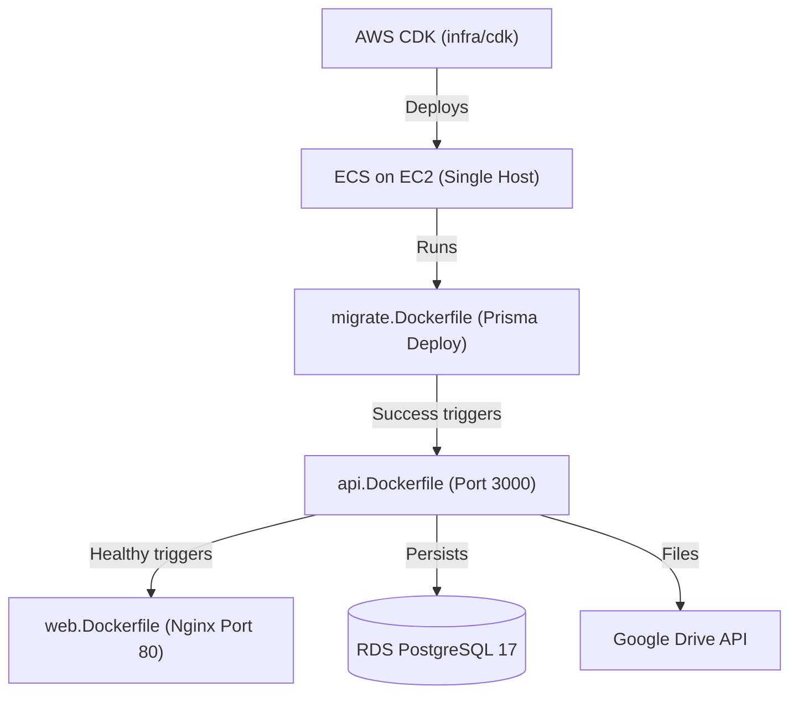

# Infrastructure Blueprint (`infra/`)

Top-level architectural blueprint for Bull Dog Solution infrastructure, unifying local Docker orchestration, AWS CDK Infrastructure as Code, and operational automation scripts.

## Subdirectories & Components

| Subdirectory                      | Type                       | Description                                                                                           |
| --------------------------------- | -------------------------- | ----------------------------------------------------------------------------------------------------- |
| [`cdk/`](./cdk/README.md)         | Intermediate Blueprint     | AWS CDK v2 TypeScript stacks (`PukStagingFoundation`, `PukStagingApplication`).                       |
| [`scripts/`](./scripts/README.md) | Component Package (Peanut) | Operational scripts for backups, restores, migrations, secret provisioning, and smoke testing.        |
| [`docker/`](./docker/README.md)   | Component Package (Peanut) | Dockerfiles (`api.Dockerfile`, `web.Dockerfile`, `migrate.Dockerfile`) and local Nginx configuration. |

## Architecture & Data Flow



## Invariants

- **Exclusive Object Storage Provider**: All persistent media (evidence photos, customer signatures, PDF reports) is stored in Google Drive; zero S3 or MinIO infrastructure.
- **Cost-Controlled Staging**: Staging runs on a single `t3.small` EC2 instance in a public subnet with direct port mapping, eliminating Application Load Balancers and NAT Gateways.
- **Container Parity**: ECS container images are built directly from Dockerfiles in `docker/`, matching local Docker Compose environments.

## Verification

```bash
pnpm infra:test
pnpm infra:synth
```
